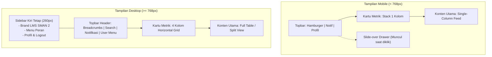

# DESIGN SYSTEM & UI/UX SPECIFICATION
## Learning Management System (LMS) SMAN 2 Padalarang

Dokumen ini adalah **Spesifikasi Desain Resmi & Single Source of Truth** untuk antarmuka pengguna (UI/UX) LMS SMAN 2 Padalarang. Dokumen ini disarikan langsung dari prototipe visual Figma (`SMA 2 PADALARANG LMS`) serta spesifikasi teknis layar pada **Software Design Document (SDD) BAB V & BAB VI**.

Tujuan utama dokumen ini adalah memberikan panduan implementasi yang presisi, deterministik, dan siap pakai bagi AI agent serta pengembang frontend yang membangun antarmuka menggunakan **Next.js 15+ (App Router)**, **Tailwind CSS**, **Shadcn UI (Radix Primitives)**, dan **Lucide Icons**.

---

## DAFTAR ISI
1. [Prinsip Desain & Pendekatan Responsif](#1-prinsip-desain--pendekatan-responsif)
2. [Design Tokens & Style Foundations](#2-design-tokens--style-foundations)
3. [Katalog Komponen Universal (UI Building Blocks)](#3-katalog-komponen-universal-ui-building-blocks)
4. [Perbandingan Arsitektur Layout: Mobile vs Desktop](#4-perbandingan-arsitektur-layout-mobile-vs-desktop)
5. [Spesifikasi Layar per Peran Pengguna (Screen Catalog)](#5-spesifikasi-layar-per-peran-pengguna-screen-catalog)
   - [5.1 Modul Autentikasi & Masuk](#51-modul-autentikasi--masuk)
   - [5.2 Portal Siswa](#52-portal-siswa)
   - [5.3 Portal Guru](#53-portal-guru)
   - [5.4 Portal Wali Kelas](#54-portal-wali-kelas)
   - [5.5 Portal Kurikulum & Administrator](#55-portal-kurikulum--administrator)
6. [Matriks Interaksi, Status, & Feedback](#6-matriks-interaksi-status--feedback)
7. [Panduan Implementasi Frontend untuk AI Agent](#7-panduan-implementasi-frontend-untuk-ai-agent)

---

## 1. Prinsip Desain & Pendekatan Responsif

### 1.1 Mobile-First, Desktop-Optimized
Prototipe Figma dirancang dalam kanvas *mobile device* (iPhone mockup). Namun, LMS SMAN 2 Padalarang adalah aplikasi web terpadu yang diakses oleh:
- Siswa menggunakan *smartphone* (akses cepat materi, absensi, pengumpulan tugas).
- Guru & Kurikulum menggunakan laptop/PC sekolah (manajemen jadwal yang padat, input nilai kelas masal, pembuatan kuis).

Oleh karena itu, setiap antarmuka mengadopsi prinsip:
1. **Layar Mobile (`< 768px`):** Mengikuti 100% tata letak visual Figma (single-column cards, drawer slide-over, touch-friendly tap targets minimal 44x44px).
2. **Layar Desktop/Tablet (`>= 768px`):** Secara cerdas mengembang menjadi multi-column dashboard grid, persistent left sidebar, tabel data interaktif dengan sticky header, dan modal dialog terpusat.

### 1.2 Anti-Slop & Polish Standard
- **Kontras Tinggi:** Teks selalu memenuhi standar WCAG AA (rasio kontras minimal 4.5:1 terhadap latar belakang).
- **Hirarki Jelas:** Tidak menggunakan dekorasi visual yang tidak fungsional. Warna hanya dipakai untuk menyatakan makna semantik (status, tindakan, peringatan).
- **Konsistensi Radius:** Menggunakan radius sudut yang seragam:
  - Tombol & Input: `rounded-lg` (8px) hingga `rounded-xl` (12px).
  - Kartu & Kontainer: `rounded-2xl` (16px).
  - Pill status / Chips: `rounded-full` (9999px).

---

## 2. Design Tokens & Style Foundations

### 2.1 Palet Warna Semantik

| Token Name | Hex Code | Tailwind Utility Class | Kegunaan Utama |
| :--- | :--- | :--- | :--- |
| **Primary Navy** | `#1E3A8A` | `bg-blue-900`, `text-blue-900` | Tombol utama, header aktif, sidebar drawer |
| **Primary Blue** | `#1D4ED8` | `bg-blue-700`, `text-blue-700` | Kartu ringkasan utama, badge mapel Matematika |
| **Brand Accent** | `#3B82F6` | `bg-blue-500`, `text-blue-500` | Status aktif, focus ring, highlight menu |
| **Info / Cyan** | `#0284C7` | `bg-sky-600`, `text-sky-600` | Kuis aktif, status terlambat, informasi |
| **Success Green** | `#22C55E` | `bg-green-500`, `text-green-600` | Kehadiran 95%, status Hadir, tugas selesai |
| **Warning Amber** | `#F59E0B` | `bg-amber-500`, `text-amber-700` | Tugas mendesak, status Sakit, peringatan |
| **Warning Surface** | `#FEF08A` | `bg-yellow-100`, `border-yellow-300` | Card Peringatan Bentrok Jadwal, banner perhatian |
| **Danger Red** | `#EF4444` | `bg-red-500`, `text-red-600` | Status Alpa, tombol hapus, pesan error login |
| **Neutral Canvas** | `#F8FAFC` | `bg-slate-50` | Latar belakang seluruh halaman aplikasi |
| **Card Surface** | `#FFFFFF` | `bg-white` | Kontainer kartu, modal, popover, drawer |
| **Input Fill** | `#E2E8F0` | `bg-slate-200` | Input placeholder container (Figma spec) |
| **Text Primary** | `#0F172A` | `text-slate-900` | Judul, heading, teks utama |
| **Text Secondary** | `#64748B` | `text-slate-500` | Subjudul, keterangan tanggal, NIP/NISN |
| **Border Divider** | `#E2E8F0` | `border-slate-200` | Garis pemisah tabel, outline kartu |

### 2.2 Tipografi
- **Primary Font Family:** `'Plus Jakarta Sans', -apple-system, BlinkMacSystemFont, 'Segoe UI', Roboto, sans-serif`
- **Tingkatan Skala Teks:**
  - **H1 (Page Title):** `24px` (`text-2xl`), font-bold (`font-bold`), line-height `32px`.
  - **H2 (Section Heading):** `18px` - `20px` (`text-lg` - `text-xl`), font-semibold (`font-semibold`).
  - **H3 (Card Title):** `15px` - `16px` (`text-base`), font-semibold (`font-semibold`).
  - **Body Text:** `14px` (`text-sm`), font-normal (`font-normal`), line-height `20px`.
  - **Caption / Meta:** `12px` (`text-xs`), font-medium (`font-medium`), text-slate-500.
  - **Hero Metric / Stat:** `28px` - `32px` (`text-3xl`), font-bold (`font-bold`).

### 2.3 Shadow & Elevation
- **Card Rest:** `shadow-sm` (`0 1px 2px 0 rgb(0 0 0 / 0.05)`) dengan border `border border-slate-100`.
- **Card Hover:** `hover:shadow-md` transition all 200ms.
- **Button Shadow:** `shadow-md` (`0 4px 6px -1px rgb(30 58 138 / 0.25)`).
- **Modal / Drawer Overlay:** `shadow-2xl` dengan backdrop blur `backdrop-blur-sm bg-black/40`.

---

## 3. Katalog Komponen Universal (UI Building Blocks)

### 3.1 Tombol (Button System)
Menggunakan shadcn `Button` yang di-override dengan styling LMS:

1. **Primary Button:**
   - Visual: Latar `#1E3A8A` (Deep Navy), teks putih, font-semibold, rounded-xl.
   - Contoh: `+ Tambah Jadwal`, `Masuk`, `+ Tambah Siswa`, `Kumpulkan`.
   - Kode Tailwind: `bg-[#1E3A8A] hover:bg-blue-950 text-white font-medium px-4 py-2.5 rounded-xl shadow-sm transition-all flex items-center gap-2`
2. **Pill Action Button:**
   - Visual: Latar `#FEF3C7` (Soft Yellow), teks `#B45309`, rounded-full.
   - Contoh: Tombol `Perbaiki` pada card bentrok jadwal.
   - Kode Tailwind: `bg-amber-100 hover:bg-amber-200 text-amber-800 text-xs font-semibold px-4 py-1.5 rounded-full transition-colors`
3. **Secondary / Outline Button:**
   - Visual: Latar putih, border `#E2E8F0`, teks `#0F172A`, rounded-xl.
   - Contoh: `Export Laporan`, `Lihat Detail`, `Batal`.
   - Kode Tailwind: `bg-white hover:bg-slate-50 text-slate-800 border border-slate-200 text-sm font-medium px-4 py-2 rounded-xl transition-colors`
4. **Destructive Icon Button:**
   - Visual: Tombol ikon abu-abu ke merah saat hover.
   - Contoh: Ikon tempat sampah pada kelola materi.
   - Kode Tailwind: `p-2 text-slate-400 hover:text-red-600 hover:bg-red-50 rounded-lg transition-colors`

### 3.2 Badge & Status Pill
Komponen badge untuk visualisasi kategori mata pelajaran dan status akademik:
- **Matematika:** `bg-blue-100 text-blue-700 border-transparent text-xs font-semibold px-2.5 py-0.5 rounded-full`
- **Fisika:** `bg-green-100 text-green-700 border-transparent text-xs font-semibold px-2.5 py-0.5 rounded-full`
- **Biologi:** `bg-amber-100 text-amber-700 border-transparent text-xs font-semibold px-2.5 py-0.5 rounded-full`
- **Bahasa Indonesia:** `bg-rose-100 text-rose-700 border-transparent text-xs font-semibold px-2.5 py-0.5 rounded-full`
- **Kehadiran [H]:** `bg-emerald-500 text-white font-bold w-6 h-6 rounded-full flex items-center justify-center text-xs`
- **Sakit [S]:** `bg-amber-400 text-white font-bold w-6 h-6 rounded-full flex items-center justify-center text-xs`
- **Izin [I]:** `bg-orange-500 text-white font-bold w-6 h-6 rounded-full flex items-center justify-center text-xs`
- **Alpa [A]:** `bg-red-500 text-white font-bold w-6 h-6 rounded-full flex items-center justify-center text-xs`

### 3.3 Kartu Metrik (Summary Metric Cards)
Digunakan di seluruh dashboard (Siswa, Guru, Wali Kelas, Kurikulum):
- **Struktur:** Kartu persegi rounded-2xl dengan flex container memuat angka metrik besar di kiri dan ikon dalam rounded square di kanan.
- **Varian Solid (Primary):** `bg-[#1D4ED8] text-white p-4 rounded-2xl flex justify-between items-center`
- **Varian White (Neutral):** `bg-white border border-slate-100 p-4 rounded-2xl flex justify-between items-center text-slate-900 shadow-sm`
- **Varian Tinted (Success/Warning/Danger):** Menggunakan warna latar lembut atau aksen border solid.

### 3.4 Form Input Controls
- **Text & Password Input:**
  - Input field dengan background netral terang (`bg-slate-100` atau `bg-slate-50`), border lembut, dan focus ring biru:
  - `w-full bg-slate-100/80 border border-slate-200 focus:bg-white focus:border-blue-600 focus:ring-2 focus:ring-blue-100 rounded-xl px-4 py-3 text-sm text-slate-900 placeholder:text-slate-400 outline-none transition-all`
- **Filter / Dropdown Pill:**
  - Dropdown filter yang ringkas (misal: `Semua Kelas ⌵` atau `XII IPA 1 ⌵`):
  - `inline-flex items-center gap-2 bg-slate-100 hover:bg-slate-200 text-slate-700 px-3 py-1.5 rounded-xl text-xs font-medium transition-colors`

---

## 4. Perbandingan Arsitektur Layout: Mobile vs Desktop

Berikut perbandingan sistematis bagaimana antarmuka mobile Figma bertransformasi ke antarmuka web desktop:

| Area Antarmuka | Tampilan Mobile (Figma `< 768px`) | Tampilan Desktop (Web `>= 768px`) |
| :--- | :--- | :--- |
| **Navigasi Utama** | Topbar ringkas dengan tombol hamburger menu (3 baris). Mengklik membuka **Slide-over Drawer** dari kiri sebesar 80% lebar layar berlatar biru (`#1E3A8A`). | **Persistent Left Sidebar** selebar 260px berlatar putih/biru, selalu terlihat di sisi kiri. Topbar atas hanya memuat breadcrumb, search bar global, notifikasi, dan profil. |
| **Tata Letak Kartu Metrik** | **Vertical Stack (1 kolom):** Kartu metrik ditumpuk ke bawah secara vertikal dengan `flex flex-col gap-3`. | **Responsive Grid (4 kolom):** `grid grid-cols-4 gap-5`, memanfaatkan ruang horizontal monitor secara proporsional. |
| **Tabel Data (Jadwal/Siswa/Nilai)** | Tampilan kartu terkompresi atau tabel kompak dengan horizontal scroll (`overflow-x-auto`). Aksi disembunyikan dalam menu titik tiga atau modal. | **Full-Width Interactive Table:** Menampilkan seluruh kolom (NISN, Nama, Gender, Kelas, Kontak, Tanggal), sorting kolom, pagination, dan tombol aksi inline yang jelas. |
| **Formulir & Input Data** | Formulir mengambil 100% lebar layar atau bottom sheet dari bawah. | **Centered Modal Dialog (`max-w-xl`):** Muncul melayang di tengah layar dengan backdrop blur gelap dan tombol tutup silang (`✕`) di pojok kanan atas. |
| **Manajemen Tugas & Materi** | Tab berganti tampilan (Tugas Aktif / Sudah Dikumpulkan) secara satu kolom penuh. | **Split-Pane / 2 Kolom:** Kolom kiri daftar item (35% lebar), kolom kanan panel detail instan atau form pengumpulan tugas (65% lebar). |



---

## 5. Spesifikasi Layar per Peran Pengguna (Screen Catalog)

### 5.1 Modul Autentikasi & Masuk

#### SCR-01: Splash Screen & Identitas Sekolah
- **Visual Acuan:** `docs/assets/designs/auth_splash.png`
- **Fungsi:** Layar pembuka transisi awal saat aplikasi memuat sesi dan konfigurasi sekolah.
- **Elemen Mobile:**
  - Logo resmi SMAN 2 Padalarang di tengah layar.
  - Teks: **SMAN 2 PADALARANG** (H2, Bold).
  - Subteks: *Sistem Pembelajaran* (Text-slate-400).
- **Adaptasi Desktop:** Ditampilkan sebagai splash loader minimalis di tengah layar putih selama 500-800ms sebelum me-redirect ke login atau dashboard.

#### SCR-02: Halaman Login Sistem
- **Visual Acuan:** `docs/assets/designs/auth_login.png` & `docs/assets/designs/auth_login_error.png`
- **Use Case PRD:** UC-01 (Login Pengguna)
- **Komponen & Aturan Validasi:**
  - Card Login terpusat dengan padding `p-6` hingga `p-8` dan border halus.
  - Logo SMAN 2 Padalarang + Judul **LOGIN** (Bold, H2).
  - Field 1: `Input Username` (Bisa berupa NISN, NIP, atau username akun).
  - Field 2: `Input Password` (Input bertipe password dengan tombol toggle show/hide mata).
  - Checkbox: `Ingat saya?` (Remember session via refresh token).
  - Tombol: `Masuk` (Primary Navy Button `#1E3A8A`, full-width).
  - Error State: Teks merah `⚠ Username atau password salah` muncul di bawah tombol jika autentikasi gagal HTTP 401.
- **Adaptasi Desktop:** Form card ditampilkan melayang di tengah layar monitor (`max-w-md`), atau menggunakan split-screen layout (sisi kiri foto lingkungan SMAN 2 Padalarang / ilustrasi LMS, sisi kanan form login).

---

### 5.2 Portal Siswa

#### SCR-03: Dashboard Siswa
- **Visual Acuan:** `docs/assets/designs/siswa_dashboard.png`
- **Use Case PRD:** UC-03, UC-08, UC-11
- **Elemen Layar:**
  - **Header:** Sapaan personal *"Selamat Pagi, Laura 👏"* + Meta *"Kelas XII IPA 1 • Semester Ganjil 2025/2026"*.
  - **Grid Metrik (4 Kartu):**
    1. *Materi Dipelajari:* `24` dari 36 materi (Latar biru `#1D4ED8`, ikon buku).
    2. *Tugas Selesai:* `18` (3 menunggu) (Latar putih, ikon clipboard).
    3. *Nilai Kuis / Progres:* `12` (Rata-rata: 85) (Latar hijau `#22C55E`, ikon list).
    4. *Kehadiran:* `95%` Bulan ini (Latar putih, ikon centang hijau).
  - **Aksi Cepat (Quick Actions):**
    - Tombol `Absen Masuk` (Ikon person check, keterangan *Catat kehadiran hari ini*).
    - Tombol `Upload Tugas` (Ikon upload arrow, keterangan *Kumpulkan tugas yang sudah selesai*).
- **Adaptasi Desktop:** 4 kartu metrik ditata horizontal 4 kolom (`grid-cols-4`). Quick actions diletakkan di panel samping kanan atau di atas daftar jadwal hari ini.

#### SCR-04: Materi Pembelajaran Siswa
- **Visual Acuan:** `docs/assets/designs/siswa_materi.png`
- **Use Case PRD:** UC-06 (Melihat Materi), UC-07 (Mengunduh Materi)
- **Elemen Layar:**
  - Search bar: `Cari materi...` + Tombol `Filter`.
  - Kartu List Materi:
    - Ikon buku di kiri dalam rounded-square.
    - Judul materi (misal: *Fungsi Matriks*, *Hukum Newton*, *Sistem Reproduksi*).
    - Badge Mapel berwarna (Matematika = Biru, Fisika = Hijau, Biologi = Kuning, B. Indonesia = Merah).
    - Identitas Guru pengunggah (misal: *• Siti Aminah S.pd*) dan tanggal upload.
    - Info file: Tipe dan ukuran (misal: `PDF 24 MB`, `Vidio 55 MB`, `PPT 5.2 MB`).
    - Tombol Aksi: `⬇ Unduh` (Primary Blue).
- **Adaptasi Desktop:** Grid 2 atau 3 kolom kartu materi dengan filter kategori mapel berupa pill horizontal di bagian atas.

#### SCR-05: Tugas & Kuis Siswa
- **Visual Acuan:** `docs/assets/designs/siswa_tugas.png`, `siswa_kuis.png`
- **Use Case PRD:** UC-08 (Melihat Tugas), UC-09 (Mengumpulkan Tugas), UC-10 (Mengerjakan Kuis)
- **Elemen Layar:**
  - **Ringkasan Status:** 3 box (Kuning: `3 Tugas aktif`, Merah: `2 Mendesak`, Hijau: `1 Selesai`).
  - **Segmented Tabs:** Tab `Tugas Aktif` dan Tab `Sudah Dikumpulkan`.
  - **Item Tugas:**
    - Judul tugas, mapel, nama guru, batas waktu/deadline (misal: `Deadline: 30 Feb 2026, 23:59`).
    - Tombol `Kumpulkan` (Navigasi ke modal/halaman upload tugas).
  - **Halaman Kuis:**
    - Tab `Kuis Tersedia` vs `Riwayat Kuis`.
    - Kartu kuis memuat durasi (`Waktu: 30 Menit`), jumlah soal (`20 Soal`), dan tombol `▷ Mulai Kuis`.
    - Riwayat kuis menampilkan nilai skor (`85` Hijau, `80` Kuning, `69` Merah) dan jumlah benar/salah.
- **Adaptasi Desktop:** Master-detail view. Sisi kiri menampilkan list tugas terurut deadline, sisi kanan menampilkan deskripsi tugas, lampiran soal dari guru, dan dropzone upload berkas jawaban.

#### SCR-06: Presensi & Profil Siswa
- **Visual Acuan:** `docs/assets/designs/siswa_absensi_mobile.png`, `docs/assets/designs/siswa_profil.png`
- **Use Case PRD:** UC-03 (Perekaman Absensi Siswa), UC-04 (Riwayat Absensi)
- **Elemen Layar:**
  - Rekam absensi masuk harian dengan timestamp otomatis.
  - Riwayat kehadiran kalender dan tabel ringkasan: Total Hadir, Izin, Sakit, Alpa.
  - Layar profil: Avatar inisial (`LF`), Nama Lengkap, NISN, Kelas, Alamat, Kontak, dan form ubah password.

---

### 5.3 Portal Guru

#### SCR-07: Dashboard Guru
- **Visual Acuan:** `docs/assets/designs/guru_dashboard.png`
- **Use Case PRD:** UC-05, UC-08, UC-12
- **Elemen Layar:**
  - **Header:** *"Selamat Pagi, Dr Siti Aminah S.pd! 👏"* + Meta *"NIP: 198505152010012001 • Matematika"*.
  - **Kartu Metrik:**
    1. *Total Kelas:* `5` Kelas Aktif (Biru tua).
    2. *Tugas Perlu Dinilai:* `64` Dari 10 kelas (Putih, counter tugas menunggu penilaian).
    3. *Kuis Aktif:* `32` Menunggu Hasil (Cyan/Sky blue).
    4. *Kehadiran Hari Ini:* `95%` (800 dari 823 siswa) (Hijau).
  - **Aksi Cepat:** Tombol `Upload Materi` dan Tombol `Buat Tugas`.
- **Adaptasi Desktop:** Metrik 4 kolom sejajar, antrean tugas yang perlu dinilai langsung ditampilkan dalam widget tabel preview di dashboard.

#### SCR-08: Manajemen Materi & Tugas Guru
- **Visual Acuan:** `docs/assets/designs/guru_kelola_materi.png`, `docs/assets/designs/guru_kelola_tugas.png`, `guru_kelola_kuis.png`
- **Use Case PRD:** UC-05 (Upload Materi), UC-08 (Pemberian Tugas), UC-10 (Pembuatan Kuis)
- **Elemen Layar:**
  - Header: `Kelola Materi` + Tombol `+ Tambah Materi`.
  - Filter: Input `Cari materi` dan Dropdown Kelas (`Semua Kelas`, `XII MIPA 1`, `XII IPS 1`).
  - List Card: Menampilkan judul materi, target kelas, tanggal upload, jumlah siswa yang melihat, serta tombol aksi **Edit (Pensil)** dan **Hapus (Tempat Sampah)**.
  - Kelola Tugas & Kuis:
    - Statistik tugas (Total Tugas, Perlu Dinilai, Sudah Dinilai).
    - Item tugas menampilkan progres pengumpulan: `25/32 Siswa Mengumpulkan`.
    - Tombol aksi `Lihat Detail` dan Tombol `Nilai`.
    - Toggle konfigurasi kuis: `Koreksi Otomatis` dan `Acak Urutan Soal`.
- **Adaptasi Desktop:** Tampilan tabel manajemen penuh dengan fitur *batch actions* (misal: hapus beberapa materi sekaligus, publish kuis ke beberapa kelas sekaligus).

#### SCR-09: Input Nilai & Absensi Kelas Guru
- **Visual Acuan:** `docs/assets/designs/guru_kelola_nilai.png`, `docs/assets/designs/guru_absensi_kelas.png`
- **Use Case PRD:** UC-12 (Input Nilai Tugas/Kuis), UC-13 (Rekap Nilai), UC-03 (Monitoring Absensi)
- **Elemen Layar:**
  - **Header Kelola Nilai:** Tombol `⬇ Export` dan Tombol `📄 Simpan`.
  - **Ringkasan Nilai:** Rata-rata Kelas (`84.6`), Nilai Tertinggi (`95`), Nilai Terendah (`70`), Total Siswa (`32`).
  - **Sub-Tabs:** `Nilai Harian`, `UTS`, `UAS`, `Rekap`.
  - **Tabel Input Nilai:** Kolom No, NISN, Nama Siswa, dan input angka inline `Tugas 1` (misal nilai: `82`).
  - **Layar Absensi Kelas:** Stat chip kehadiran (Hadir, Terlambat, Sakit, Izin, Alpa) dan tabel absensi harian per kelas.
- **Adaptasi Desktop:** Spreadsheet-like interface. Guru dapat memasukkan nilai dengan cepat menggunakan tombol panah keyboard / Tab navigasi antar cell, dilengkapi tombol autosave status.

---

### 5.4 Portal Wali Kelas

#### SCR-10: Dashboard Wali Kelas & Monitoring Kehadiran
- **Visual Acuan:** `docs/assets/designs/walikelas_dashboard.png`, `sdd_img-043.png`
- **Use Case PRD:** UC-20, UC-21 (Monitoring Siswa Perlu Perhatian)
- **Elemen Layar:**
  - Header: Identitas Wali Kelas (misal: *Budi Santoso S.Pd - Wali Kelas XII MIPA 1*).
  - Menu Sidebar: `Dashboard`, `Kehadiran Kelas`, `Raport`, `Keluar`.
  - Kartu Indikator Peringatan (*Perlu Perhatian*): Menghitung dan menyorot siswa dengan absensi kurang dari 80% atau nilai di bawah KKM sekolah.
  - Quick Action: Peringatan ke orang tua siswa / panggilan konseling.

#### SCR-11: Laporan Raport Kelas
- **Visual Acuan:** `docs/assets/designs/walikelas_laporan_raport.png`
- **Use Case PRD:** UC-22 (Rekapitulasi dan Verifikasi Raport)
- **Elemen Layar:**
  - Header: `Laporan raport` (*Kelola raport siswa XII MIPA 1*) + Tombol `⬇ Export Semua`.
  - Metrik: Total Siswa (`32`), Raport Final (`28`), Draft (`4`), Rata-rata Kelas (`84,5`).
  - Tabel Raport: Kolom No, NISN, Nama Siswa, Nilai Rata-rata, dan status verifikasi.
- **Adaptasi Desktop:** Full table dengan fitur filter status (Draft / Siap Cetak), preview cetak raport PDF per siswa, dan tombol lock nilai rapor.

---

### 5.5 Portal Kurikulum & Administrator

#### SCR-12: Dashboard Kurikulum
- **Visual Acuan:** `docs/assets/designs/kurikulum_dashboard.png`
- **Use Case PRD:** UC-14 s.d. UC-19
- **Elemen Layar:**
  - Header: `Dashboard Kurikulum 📚` (*Drs. Herman Wijaya, M.M • Waka Kurikulum*).
  - Metrik Sekolah:
    - *Total Siswa:* `823` Siswa aktif tahun ajaran ini (Biru).
    - *Total Guru:* `68` Guru aktif mengajar (Putih).
    - *Total Kelas:* `24` Rombel (8 kelas per tingkat X, XI, XII) (Cyan).
    - *Tingkat Kehadiran:* `94%` Rata-rata bulan ini (Hijau).
  - Modul Utama: `Kelola Jadwal` dan `Verifikasi Raport`.

#### SCR-13: Kelola Jadwal & Deteksi Bentrok (Core Admin Flow)
- **Visual Acuan:** `docs/assets/designs/admin_kelola_jadwal_figma.png` (Hasil render langsung kanvas Figma)
- **Use Case PRD:** UC-17 (Kelola Jadwal Pelajaran), UC-18 (Validasi Bentrok Jadwal)
- **Elemen Layar:**
  - Header: **Kelola Jadwal** (*Atur Jadwal Pelajaran Untuk Semua Kelas*) + Tombol **`+ Tambah Jadwal`** (Navy `#1E3A8A`).
  - **Peringatan Bentrok Jadwal (Warning Alert Box):**
    - Latar kuning/amber (`#FEF08A`), ikon segitiga peringatan oranye.
    - Inner card putih memuat:
      - Nama Guru: **Dr. Siti Aminah** (Bold).
      - Konflik: `Matematika - XXI IPA 1 & XII IPA 3` (Mengajar di dua kelas sekaligus pada jam sama).
      - Waktu: `Senin, 07.00 WIB`.
      - Tombol Aksi: **`Perbaiki`** (Pill button kuning muda `#FEF3C7`).
  - **Tabel Jadwal Kelas:**
    - Filter kelas: Dropdown `XII IPA 1 ⌵`.
    - Kolom: `Jam`, `Senin`, `Selasa`, `Rabu`, `Kamis`, `Jumat`.
    - Baris 1: `07:00 - 09.00` | Matematika | Fisika | Kimia.
- **Adaptasi Desktop:**
  - Peringatan bentrok jadwal ditampilkan sebagai alert banner floating di atas tabel.
  - Jadwal pelajaran ditampilkan dalam bentuk **Timetable Grid Interaktif** (Matrix jam vertikal vs hari horizontal). Slot jadwal dapat di-drag & drop atau diklik untuk edit penugasan guru secara instan.

```text
┌────────────────────────────────────────────────────────────────────────────────────────┐
│  DESKTOP VIEW: KELOLA JADWAL & DETEKSI BENTROK                                         │
├────────────────────────────────────────────────────────────────────────────────────────┤
│  [!] PERINGATAN BENTROK JADWAL: Dr. Siti Aminah memiliki jadwal ganda pada Senin 07:00 │
│      Kelas bentrok: XII IPA 1 & XII IPA 3                           [ Tombol Perbaiki ]│
├────────────────────────────────────────────────────────────────────────────────────────┤
│  Filter: [ Kelas: XII IPA 1 ⌵ ]  [ Tahun Ajaran: 2025/2026 Ganjil ⌵ ]  [+ Tambah Jadwal│
├─────────────┬────────────────┬────────────────┬────────────────┬───────────────────────┤
│ Jam         │ SENIN          │ SELASA         │ RABU           │ KAMIS                 │
├─────────────┼────────────────┼────────────────┼────────────────┼───────────────────────┤
│ 07:00-08:30 │ Matematika     │ Fisika         │ Kimia          │ Biologi               │
│             │ Dr. Siti A.    │ Parhan R. S.Si │ Ani S. S.Pd    │ Ani S. S.Pd           │
├─────────────┼────────────────┼────────────────┼────────────────┼───────────────────────┤
│ 08:30-10:00 │ Bahasa Indo    │ Matematika     │ Sejarah        │ B. Inggris            │
│             │ Rina W. S.Pd   │ Dr. Siti A.    │ Ahmad F. S.Pd  │ Steven S.Pd           │
└─────────────┴────────────────┴────────────────┴────────────────┴───────────────────────┘
```

#### SCR-14: Kelola Data Siswa & Modal Tambah Data
- **Visual Acuan:** `docs/assets/designs/kurikulum_data_siswa.png` & `docs/assets/designs/kurikulum_modal_tambah_siswa.png`
- **Use Case PRD:** UC-14 (Kelola Data Siswa)
- **Elemen Layar:**
  - Stat Cards: Total Siswa (`823`), Laki-laki (`400`), Perempuan (`423`), Kelas (`20`).
  - Tabel Siswa: Pencarian `🔍 Cari Siswa...`, Kolom NISN, Nama Siswa, Kelas, JK, Aksi.
  - Tombol: `+ Tambah Siswa`.
  - **Modal Tambah Siswa Baru:**
    - Form Dialog melayang di atas backdrop gelap:
    - Input `NIS` (Placeholder: *Masukkan NIS*).
    - Input `NISN` (Placeholder: *Masukkan NISN*).
    - Input `Nama Lengkap` (Placeholder: *Masukkan nama lengkap*).
    - Dropdown `Jenis Kelamin` (*Pilih: Laki-laki / Perempuan*).
    - Dropdown `Kelas` (*Pilih Kelas: X-1 s.d. XII-8*).
    - Input `Email` (*email@siswa.sma.sch.id*).
    - Input `No. Telepon` (*+62...*).
    - Tombol Aksi: `Tambah Siswa` (Navy blue full width).

---

## 6. Matriks Interaksi, Status, & Feedback

| Kondisi Interaksi | Perilaku UI & Komponen | Visual Feedback |
| :--- | :--- | :--- |
| **Loading State** | Pengambilan data asynchronous dari REST API Go Fiber. | Menampilkan **Skeleton Shimmer** dengan bentuk persegi rounded-xl abu-abu (`bg-slate-200 animate-pulse`), bukan spinner kosong. |
| **Empty State** | Filter tidak menghasilkan data atau belum ada tugas/materi. | Ilustrasi ikon minimalis (misal `BookOpenX` atau `FolderX`), teks penjelasan jelas, dan satu tombol aksi primer (misal: *"Upload Materi Pertama"*). |
| **Success Action** | Berhasil simpan nilai, submit tugas, atau absen. | **Toast Notification (Sonner)** di pojok kanan atas dengan latar hijau lembut (`bg-emerald-50 text-emerald-800 border-emerald-200`) dan ikon centang. |
| **Conflict Warning** | Bentrok jadwal guru atau tenggat waktu tugas lewat. | Banner alert kuning-oranye dengan tombol aksi langsung (misal: tombol `Perbaiki` pada bentrok jadwal). |
| **Error / Failed** | Gagal validasi atau server error 500. | Toast merah atau inline helper text merah di bawah field input formulir. |

---

## 7. Panduan Implementasi Frontend untuk AI Agent

Saat AI agent ditugaskan membangun kode frontend, patuhi konvensi berikut secara ketat:

### 7.1 Struktur Folder Aplikasi (Next.js 15+ App Router)
```text
frontend/
├── app/
│   ├── (auth)/
│   │   └── login/page.tsx               # SCR-02: Form Login
│   ├── (dashboard)/
│   │   ├── layout.tsx                   # Responsive Shell (Sidebar + Topbar)
│   │   ├── siswa/
│   │   │   ├── page.tsx                 # SCR-03: Dashboard Siswa
│   │   │   ├── materi/page.tsx          # SCR-04: Materi Pelajaran
│   │   │   ├── tugas/page.tsx           # SCR-05: Tugas & Kuis
│   │   │   ├── absensi/page.tsx         # SCR-06: Presensi Siswa
│   │   │   └── profil/page.tsx          # SCR-06: Profil Akun
│   │   ├── guru/
│   │   │   ├── page.tsx                 # SCR-07: Dashboard Guru
│   │   │   ├── materi/page.tsx          # SCR-08: Kelola Materi
│   │   │   ├── tugas/page.tsx           # SCR-08: Kelola Tugas & Kuis
│   │   │   ├── absensi/page.tsx         # SCR-09: Absensi Kelas
│   │   │   └── nilai/page.tsx           # SCR-09: Input Nilai Kelas
│   │   ├── wali-kelas/
│   │   │   ├── page.tsx                 # SCR-10: Dashboard Wali Kelas
│   │   │   └── raport/page.tsx          # SCR-11: Laporan Raport
│   │   └── admin/
│   │       ├── page.tsx                 # SCR-12: Dashboard Kurikulum
│   │       ├── jadwal/page.tsx          # SCR-13: Kelola Jadwal & Bentrok
│   │       └── siswa/page.tsx           # SCR-14: Master Data Siswa
├── components/
│   ├── ui/                              # Shadcn UI Primitives (button, card, dialog, badge)
│   ├── shared/                          # Topbar, Sidebar, MobileNavDrawer, UserAvatar
│   └── modules/                         # Modul komponen spesifik per use case
└── lib/
    ├── api.ts                           # Axios / Fetch client untuk Go Fiber API
    └── utils.ts                         # Helper functions (cn, formatTanggal, statusColor)
```

### 7.2 Snippet Standar Komponen (Tailwind Utility Formula)

#### Card Peringatan Bentrok Jadwal (Figma Token Exact)
```tsx
import { AlertTriangle } from "lucide-react";

export function JadwalConflictAlert({ guru, mapelKelas, waktu, onFix }: {
  guru: string;
  mapelKelas: string;
  waktu: string;
  onFix: () => void;
}) {
  return (
    <div className="bg-[#FEF08A] border border-[#FDE047] rounded-2xl p-4 shadow-sm">
      <div className="flex items-center gap-2 mb-2 text-orange-600 font-semibold text-sm">
        <AlertTriangle className="w-5 h-5 text-orange-500" />
        <span>Peringatan Bentrok Jadwal</span>
      </div>
      <div className="bg-white rounded-xl p-3 flex items-center justify-between shadow-xs">
        <div>
          <h4 className="font-bold text-slate-900 text-sm">{guru}</h4>
          <p className="text-xs text-slate-500">{mapelKelas}</p>
          <p className="text-xs text-orange-600 font-medium mt-0.5">{waktu}</p>
        </div>
        <button
          onClick={onFix}
          className="bg-[#FEF3C7] hover:bg-amber-200 text-amber-800 text-xs font-semibold px-4 py-1.5 rounded-full transition-colors"
        >
          Perbaiki
        </button>
      </div>
    </div>
  );
}
```

#### Kartu Metrik Ringkasan Responsif
```tsx
export function MetricCard({ title, value, subtitle, icon: Icon, variant = "white" }: {
  title: string;
  value: string | number;
  subtitle: string;
  icon: any;
  variant?: "primary" | "white" | "success" | "cyan";
}) {
  const styles = {
    primary: "bg-[#1D4ED8] text-white",
    white: "bg-white text-slate-900 border border-slate-100 shadow-sm",
    success: "bg-emerald-500 text-white",
    cyan: "bg-sky-600 text-white",
  }[variant];

  const iconBg = {
    primary: "bg-blue-600/50 text-white",
    white: "bg-slate-100 text-slate-600",
    success: "bg-emerald-600/50 text-white",
    cyan: "bg-sky-700/50 text-white",
  }[variant];

  return (
    <div className={`p-4 rounded-2xl flex items-center justify-between ${styles}`}>
      <div>
        <p className="text-xs opacity-80 font-medium">{title}</p>
        <h3 className="text-2xl font-bold mt-0.5">{value}</h3>
        <p className="text-xs opacity-75 mt-0.5">{subtitle}</p>
      </div>
      <div className={`w-12 h-12 rounded-xl flex items-center justify-center ${iconBg}`}>
        <Icon className="w-6 h-6" />
      </div>
    </div>
  );
}
```

---

## 8. Ringkasan & Langkah Selanjutnya
Dokumen `DESIGN.md` ini telah mencakup seluruh kebutuhan antarmuka sistem LMS SMAN 2 Padalarang mulai dari level fondasi *design tokens*, komponen mikro, tata letak responsif perbandingan Mobile vs. Desktop, hingga rincian 14+ layar spesifik dari 4 peran pengguna.

Setiap implementasi kode antarmuka pada fase pengembangan frontend wajib merujuk ke dokumen ini agar konsistensi visual dan pengalaman pengguna tetap terjaga.
