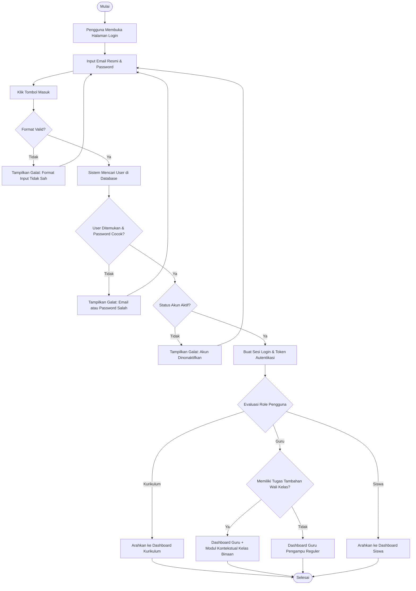
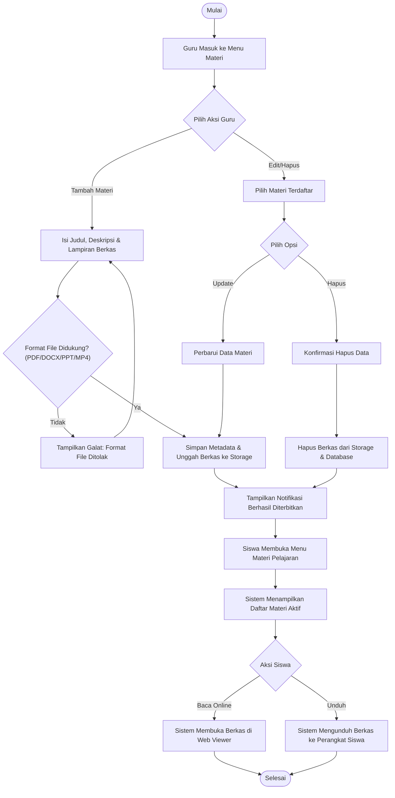
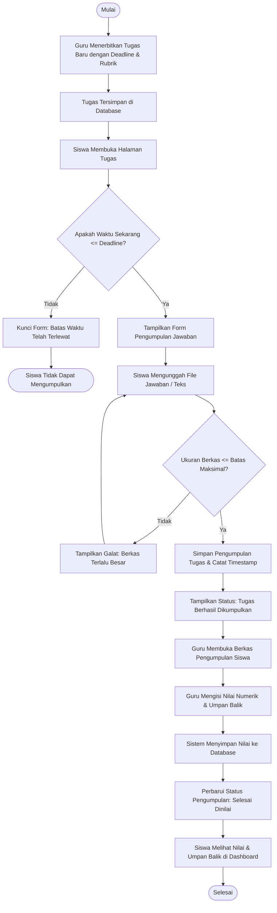
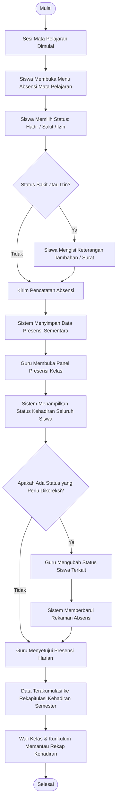
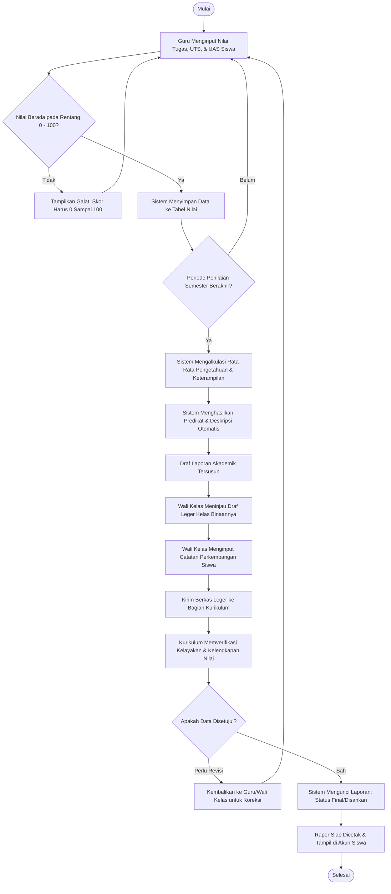
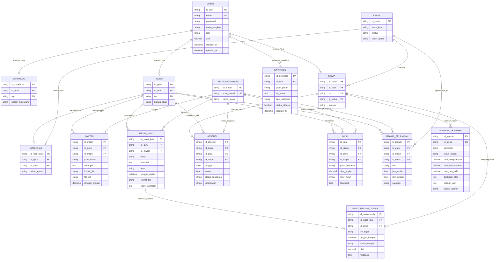
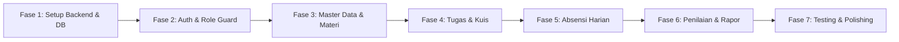

# Product Requirement Document (PRD)
## Learning Management System (LMS) SMA Negeri 2 Padalarang

| Atribut | Keterangan |
| :--- | :--- |
| **Mata Kuliah** | Prak. Implementasi dan Pengujian Sistem Informasi |
| **Proyek** | Learning Management System (LMS) Berbasis Web |
| **Institusi** | SMA Negeri 2 Padalarang & Program Studi Sistem Informasi UNJANI |
| **Tim Pengembang** | 1. Velma Dwinda Syabila (2450231038)<br>2. Mochammad Hafidz Nugraha (2450231039) – Developer<br>3. Kirana Novitasari (2450231050)<br>4. Muhamad Ariq Mubaroq (2450231052) |
| **Versi Dokumen** | v1.0.0 |
| **Status** | Final / Siap Implementasi |
| **Tech Stack** | Go Fiber (Backend REST API), Next.js (Frontend Web), PostgreSQL Supabase, Supabase Storage |

---

Dokumen ini merupakan spesifikasi kebutuhan produk (*Product Requirement Document* / PRD) resmi untuk pengembangan platform berbasis web **Learning Management System (LMS) SMAN 2 Padalarang**. Dokumen ini disusun sebagai panduan teknis tunggal (*single source of truth*) yang mengintegrasikan seluruh spesifikasi dari:
1. **Software Requirements Specification (SRS)** Tim (71 Halaman)
2. **Software Design Document (SDD)** Tim (143 Halaman)
3. Implementasi Domain Model Java pada direktori `model/` dan Sequence Workflow pada direktori `sequence/`.

---

## 1. Ikhtisar Produk (Product Overview)

### 1.1 Latar Belakang & Problem Statement
SMA Negeri 2 Padalarang sebagai institusi pendidikan menengah atas berkomitmen untuk meningkatkan mutu dan efisiensi kegiatan belajar mengajar. Namun, dalam operasional harian sekolah masih ditemukan sejumlah kendala operasional akibat ketergantungan pada prosedur manual:
- **Pencatatan Presensi Manual**: Presensi siswa dilakukan di atas lembar kertas kelas, rentan terhadap kehilangan rekam jejak, keterlambatan rekapitulasi, dan potensi kesalahan penghitungan persentase kehadiran untuk rapor.
- **Pengumpulan & Pengelolaan Tugas Konvensional**: Penyerahan tugas dalam bentuk fisik atau melalui media perpesanan yang terfragmentasi menyulitkan guru dalam pelacakan batas waktu pengumpulan (*deadline*) serta evaluasi transparansi nilai.
- **Distribusi Materi Terfragmentasi**: Bahan ajar berupa dokumen, presentasi, dan video pembelajaran belum terpusat secara digital, sehingga menyulitkan siswa untuk mengulang materi secara mandiri di luar jam sekolah.
- **Integrasi Nilai & Laporan Akademik**: Proses kompilasi nilai tugas, ulangan harian, dan ujian untuk menghasilkan buku leger nilai akhir membutuhkan waktu koordinasi yang lama antara guru mata pelajaran, wali kelas, dan bagian kurikulum.

### 1.2 Tujuan Produk
1. **Sentralisasi Pembelajaran**: Membangun satu platform terpadu untuk mendistribusikan bahan ajar digital kapan saja dan di mana saja.
2. **Digitalisasi & Validasi Presensi**: Menyediakan fitur absensi mandiri siswa berbasis mata pelajaran harian dengan validasi langsung oleh guru pengampu.
3. **Efisiensi Pengelolaan Penugasan**: Memfasilitasi penerbitan tugas terstruktur, pengunggahan berkas jawaban siswa, validasi tenggat waktu pengerjaan otomatis, dan penilaian berbasis rubrik.
4. **Otomasi Rekapitulasi Akademik**: Menyederhanakan kalkulasi rata-rata nilai pengetahuan, keterampilan, serta presensi menjadi draf laporan akademik (*leger*) yang siap ditinjau oleh wali kelas dan disahkan oleh kurikulum.
5. **Transparansi Hasil Belajar**: Memungkinkan siswa dan orang tua untuk memantau progres belajar, riwayat nilai, serta menerima umpan balik (*feedback*) konstruktif secara berkala.

### 1.3 Ruang Lingkup Sistem (Product Scope)
Sistem dirancang sebagai aplikasi web responsif (*responsive web-based application*) yang dapat diakses dengan optimal melalui peramban web modern (*desktop* maupun *mobile browser*) oleh seluruh sivitas akademika SMAN 2 Padalarang.

---

## 2. Karakteristik Pengguna & Matriks Hak Akses (RBAC)

Sistem mengimplementasikan skema *Role-Based Access Control* (RBAC) terpadu dengan arsitektur **Dynamic Contextual Duty** yang merefleksikan proses bisnis operasional sekolah nyata di Indonesia:

| Peran (Role) | Deskripsi Tanggung Jawab | Kredensial Utama |
| :--- | :--- | :--- |
| **Kurikulum** | Administrator data akademik tingkat sekolah. Bertanggung jawab penuh atas master data siswa, guru, kelas, plotting jadwal pelajaran bebas bentrok, pemantauan absensi lintas kelas, dan finalisasi/pengesahan buku leger nilai akhir sekolah. | NIP & Email Resmi |
| **Guru** | Tenaga pendidik yang mengampu mata pelajaran. Berwenang mengelola materi ajar, membuat dan menilai tugas/kuis, serta memvalidasi kehadiran siswa pada sesinya. Apabila ditugaskan sebagai **Wali Kelas** (tugas tambahan), guru mendapatkan hak akses kontekstual untuk membina rombelnya. | NIP & Email Resmi |
| **Siswa** | Peserta didik terdaftar. Berhak mengakses dan mengunduh materi, melakukan absensi mandiri pada jam pelajaran, mengumpulkan tugas, serta melihat riwayat nilai dan umpan balik. | NIS & Email Resmi |
| **Wali Kelas (Tugas Tambahan)** | Peran penugasan kontekstual yang diemban oleh Guru aktif. Berhak memantau rekap absensi harian kelas binaannya, meninjau kompilasi draf nilai rapor seluruh mapel rombel, serta memberikan catatan pembinaan karakter pada buku leger. | NIP & Email Resmi |

> [!NOTE]
> **Arsitektur Wewenang Ganda (Dual Role) Guru & Wali Kelas:**
> Di sekolah nyata (khususnya jenjang SMA di Indonesia), Wali Kelas bukanlah profesi yang berdiri sendiri tanpa mengajar, melainkan guru aktif yang memperoleh penugasan pembinaan satu rombongan belajar (rombel). Oleh karena itu, sistem mengadopsi prinsip *Dynamic Contextual Duty*:
> 1. Akun pengguna dasar bagi seluruh pendidik adalah `guru`.
> 2. Penugasan sebagai **Wali Kelas** ditentukan secara dinamis melalui relasi rombel (`kelas.wali_guru_id`).
> 3. Seorang guru yang ditugaskan sebagai wali kelas dapat mengakses modul pembelajaran mata pelajarannya secara penuh (materi, tugas, kuis, nilai), sekaligus mengakses panel pembinaan rombel (*monitoring kehadiran kelas binaan dan pengisian catatan rapor*) dalam satu sesi akun tunggal tanpa perlu berganti login.

### Matriks Akses Data (CRUD Permissions)
Berdasarkan dokumen SRS Bab V Bagian 4.1.B:

| Modul Data | Kurikulum | Guru Pengampu | Siswa | Wali Kelas (Kelas Binaan) |
| :--- | :---: | :---: | :---: | :---: |
| **Master Data User & Siswa** | **CRUD** (Penuh) | **R** (Hanya Baca) | **R** (Profil Pribadi) | **R** (Hanya Baca) |
| **Materi Pembelajaran** | **R** (Monitoring) | **CRUD** (Milik Sendiri) | **R** / Download | **R** (Hanya Baca) |
| **Tugas & Kuis** | **R** (Monitoring) | **CRUD** (Milik Sendiri) | **R** (Lihat Instruksi) | **R** (Hanya Baca) |
| **Pengumpulan Tugas** | **R** (Monitoring) | **RU** (Evaluasi & Beri Nilai) | **CRU** (Kumpul/Update Jawaban) | **R** (Hanya Baca) |
| **Data Presensi / Absensi** | **R** (Rekap Sekolah) | **RU** (Validasi/Koreksi Status) | **CR** (Presensi Mandiri) | **R** (Rekap Kelas Binaan) |
| **Nilai Akademik** | **RU** (Rekap Leger) | **CRUD** (Input Skor & Feedback) | **R** (Nilai Sendiri) | **R** (Nilai Kelas Binaan) |
| **Laporan Akademik (Leger)** | **CRUD** (Finalisasi/Pengesahan)| **R** (Nilai Mapel Terkait) | **R** (Rapor Pribadi) | **RU** (Input Catatan Wali) |

---

## 3. Spesifikasi Kebutuhan Fungsional (Functional Requirements)

Terdapat 28 skenario *use case* yang dikelompokkan ke dalam 7 modul fungsional utama:

### Modul 1: Autentikasi & Manajemen Sesi Pengguna
- **FR-AUTH-01 (Login Multi-Role)**: Pengguna dapat masuk ke sistem menggunakan email resmi sekolah dan kata sandi yang telah terenkripsi.
- **FR-AUTH-02 (Verifikasi Sesi)**: Sistem memverifikasi kredensial dan mencocokkan status akun (`aktif = true`). Jika tidak aktif atau tidak cocok, sistem menolak autentikasi dan menampilkan pesan galat.
- **FR-AUTH-03 (Role-Based Routing & Contextual Navigation)**: Setelah login berhasil, sistem secara otomatis mengarahkan pengguna ke *dashboard* yang sesuai dengan perannya (`/admin/jadwal` untuk Kurikulum, `/guru` untuk Guru/Wali Kelas, `/siswa` untuk Siswa). Bagi guru yang mengemban tugas tambahan sebagai wali kelas, sistem secara otomatis mengaktifkan modul navigasi kontekstual *Kelas Binaan* (`/wali-kelas`) di dalam dashboard gurunya.
- **FR-AUTH-04 (Remember Me & Keamanan Sesi)**: Opsi pengingat sesi berbasis token aman (*HTTP-only cookies*) dan kemampuan logout untuk menghancurkan token sesi.

### Modul 2: Pengelolaan Data Master Akademik & Pengguna (Kurikulum)
- **FR-MST-01 (Manajemen Data Siswa)**: Bagian Kurikulum dapat menambah, melihat rincian, memperbarui data diri, dan menonaktifkan/menghapus data siswa (NIS, nama, kelas, jurusan).
- **FR-MST-02 (Manajemen Data Guru & Penugasan)**: Kurikulum dapat mengelola akun guru beserta pemetaan mata pelajaran yang diampu.
- **FR-MST-03 (Manajemen Kelas & Rombel)**: Pengaturan tahun ajaran, tingkat kelas, dan penugasan wali kelas.

### Modul 3: Manajemen Materi Pembelajaran
- **FR-MAT-01 (Unggah Materi Ajar)**: Guru dapat menambahkan materi pembelajaran dengan melampirkan berkas (PDF, DOCX, PPT, MP4/Video) atau tautan media luar, dilengkapi judul, deskripsi, dan mata pelajaran.
- **FR-MAT-02 (Akses & Streaming Materi)**: Siswa dapat membaca materi secara daring (*view/stream*) atau mengunduh (*download*) berkas materi untuk dipelajari secara luring (*offline*).
- **FR-MAT-03 (Pembaruan & Penghapusan Materi)**: Guru pengampu dapat memperbarui deskripsi/berkas materi atau menghapusnya secara permanen dari basis data.

### Modul 4: Pengelolaan Tugas & Kuis
- **FR-TG-01 (Penerbitan Tugas & Kuis)**: Guru dapat menyusun tugas dengan instruksi pengerjaan, format pengumpulan yang diizinkan (teks, berkas PDF, dokumen, gambar), tenggat waktu pengumpulan (*deadline*), dan rubrik penilaian.
- **FR-TG-02 (Pengumpulan Jawaban Siswa)**: Siswa dapat mengirimkan respon jawaban tugas sebelum batas waktu berakhir. Sistem mencatat stempel waktu (*timestamp*) pengumpulan.
- **FR-TG-03 (Pembaruan & Penghapusan Pengumpulan)**: Siswa dapat memperbarui berkas jawaban atau membatalkan kiriman selama tenggat waktu belum terlampaui. Sistem secara ketat menolak pengubahan jika waktu pengerjaan telah habis (*late submission lock*).
- **FR-TG-04 (Penilaian Tugas & Umpan Balik)**: Guru memeriksa berkas jawaban, menginput nilai numerik (0–100), dan memberikan umpan balik (*feedback*) evaluasi.

### Modul 5: Presensi & Absensi Siswa
- **FR-ABS-01 (Presensi Mandiri Siswa)**: Siswa melakukan pencatatan kehadiran mandiri pada saat sesi mata pelajaran dibuka.
- **FR-ABS-02 (Pilihan Status Kehadiran)**: Status kehadiran mencakup: `Hadir`, `Sakit`, `Izin`, dan `Alfa` (Tanpa Keterangan). Untuk status Sakit atau Izin, siswa wajib mengisi kolom keterangan/alasan.
- **FR-ABS-03 (Validasi & Pembaruan oleh Guru)**: Guru pengampu dapat memeriksa daftar kehadiran kelas secara langsung (*real-time*) dan berhak mengubah status absensi siswa jika ditemukan ketidaksesuaian.
- **FR-ABS-04 (Rekapitulasi Kehadiran)**: Sistem mengalkulasi akumulasi kehadiran per semester secara otomatis untuk dipantau oleh Wali Kelas dan Kurikulum.

### Modul 6: Penilaian Akademik
- **FR-NIL-01 (Input Nilai Mata Pelajaran)**: Guru dapat menginput nilai berdasarkan kategori asesmen: Tugas, Ulangan Harian, Ujian Tengah Semester (UTS), dan Ujian Akhir Semester (UAS).
- **FR-NIL-02 (Perhitungan Rata-Rata Otomatis)**: Sistem menghitung bobot nilai pengetahuan dan keterampilan secara terprogram berdasarkan rumus kurikulum sekolah.
- **FR-NIL-03 (Pembaruan & Penghapusan Nilai)**: Guru dapat mengoreksi data nilai sebelum periode penilaian dikunci (*locked*) oleh Kurikulum.
- **FR-NIL-04 (Transparansi Siswa)**: Siswa dapat melihat riwayat nilai transparan beserta skor huruf (A/B/C/D) dan catatan guru.

### Modul 7: Laporan Akademik (Leger & Rapor) & Sistem Notifikasi
- **FR-LAP-01 (Generasi Leger Nilai Otomatis)**: Sistem mengompilasi seluruh nilai mata pelajaran dan rekap presensi menjadi draf laporan akademik siswa secara terotomatisasi.
- **FR-LAP-02 (Penambahan Catatan Wali Kelas)**: Wali kelas meninjau draf laporan dan menambahkan deskripsi capaian perkembangan kepribadian/akademik siswa.
- **FR-LAP-03 (Pengesahan Kurikulum)**: Kurikulum melakukan verifikasi akhir dan mengunci laporan untuk dicetak menjadi rapor resmi.
- **FR-NOTIF-01 (Notifikasi Otomatis)**: Sistem mengirimkan pemberitahuan otomatis ke dashboard pengguna:
  - *Siswa*: Notifikasi penerbitan tugas baru dan peringatan mendekati deadline (H-1).
  - *Guru*: Notifikasi jadwal presensi kelas dan pengingat koreksi tugas yang belum dinilai.
  - *Wali Kelas*: Notifikasi ketersediaan rekapitulasi presensi dan nilai akhir kelas binaan.

---

## 4. Flowchart Alur Sistem (Mermaid Activity Diagrams)

Berikut adalah visualisasi diagram alir proses bisnis utama yang ditranslasikan dari *Activity Diagrams* (SDD Bab 3.4 Hal. 64–91):

### 4.1 Flowchart 1: Autentikasi Pengguna & Penentuan Dashboard
Menjelaskan proses login universal dan validasi keamanan akun:



---

### 4.2 Flowchart 2: Alur Siklus Materi Pembelajaran
Menjelaskan alur dari pengunggahan materi oleh guru hingga pengunduhan oleh siswa:



---

### 4.3 Flowchart 3: Alur Siklus Tugas & Kuis
Menjelaskan alur penerbitan tugas, pengumpulan oleh siswa, validasi batas waktu, dan penilaian:



---

### 4.4 Flowchart 4: Alur Pencatatan & Verifikasi Presensi Siswa
Menjelaskan pencatatan presensi mandiri oleh siswa dan validasi serta koreksi oleh guru:



---

### 4.5 Flowchart 5: Alur Pengolahan Nilai & Generasi Laporan Akademik
Menjelaskan konsolidasi nilai mata pelajaran menjadi draf laporan akademik (*leger*):



---

## 5. Skema Basis Data Relasional & Kamus Data

Skema basis data diturunkan secara presisi dari:
1. **SRS Bab V Hal. 68–70** (*Detail Atribut Data Input & Data Requirements*).
2. **SDD Bab 3.2 Hal. 50** (*Class Diagram*) serta berkas kode Java pada folder `model/`.

### 5.1 Entity-Relationship Diagram (ERD Mermaid)



---

### 5.2 Kamus Data Detail (Data Dictionary - Supabase PostgreSQL)

Struktur tabel di bawah ini dioptimalkan untuk dialek **PostgreSQL (Supabase)** menggunakan tipe data native (`UUID`, `TIMESTAMPTZ`, `NUMERIC`, `TEXT`, serta `CHECK constraint` untuk konsistensi nilai):

#### 1. Tabel `users`
Menyimpan identitas akun seluruh pengguna sistem (Autentikasi terpusat).
- `id_user` : `UUID` - **Primary Key**, default: `gen_random_uuid()`.
- `email` : `VARCHAR(100)` - **Unique**, **Not Null**. Alamat surat elektronik resmi sekolah.
- `password` : `VARCHAR(255)` - **Not Null**. Hash kata sandi terenkripsi (Bcrypt/Argon2).
- `nama_lengkap` : `VARCHAR(150)` - **Not Null**. Nama lengkap pengguna sesuai data resmi.
- `role` : `VARCHAR(20)` - **Not Null**, `CHECK (role IN ('Kurikulum', 'Guru', 'Siswa', 'WaliKelas'))`.
- `aktif` : `BOOLEAN` - **Default: true**. Status keaktifan akun.
- `created_at` : `TIMESTAMPTZ` - **Default: CURRENT_TIMESTAMP**.
- `updated_at` : `TIMESTAMPTZ` - **Default: CURRENT_TIMESTAMP**.

#### 2. Tabel `kurikulum`
Entitas spesifik staf kurikulum sekolah.
- `id_kurikulum` : `UUID` - **Primary Key**, default: `gen_random_uuid()`.
- `id_user` : `UUID` - **Foreign Key** ke `users(id_user)` ON DELETE CASCADE.
- `nip` : `VARCHAR(30)` - **Unique**, **Not Null**. Nomor Induk Pegawai.
- `bagian_kurikulum` : `VARCHAR(100)` - Divisi/spesialisasi tugas kurikulum.

#### 3. Tabel `guru`
Entitas tenaga pendidik mata pelajaran.
- `id_guru` : `UUID` - **Primary Key**, default: `gen_random_uuid()`.
- `id_user` : `UUID` - **Foreign Key** ke `users(id_user)` ON DELETE CASCADE.
- `nip` : `VARCHAR(30)` - **Unique**, **Not Null**. Nomor Induk Pegawai.
- `bidang_studi` : `VARCHAR(100)` - **Not Null**. Bidang studi utama yang diampu (misal: Matematika, Fisika).

#### 4. Tabel `kelas`
Master data ruang kelas/rombongan belajar.
- `id_kelas` : `UUID` - **Primary Key**, default: `gen_random_uuid()`.
- `nama_kelas` : `VARCHAR(50)` - **Not Null**. Contoh: "XII MIPA 1", "X IPS 2".
- `tingkat` : `VARCHAR(10)` - **Not Null**, `CHECK (tingkat IN ('X', 'XI', 'XII'))`.
- `tahun_ajaran` : `VARCHAR(20)` - **Not Null**. Contoh: "2024/2025".

#### 5. Tabel `siswa`
Entitas peserta didik aktif.
- `id_siswa` : `UUID` - **Primary Key**, default: `gen_random_uuid()`.
- `id_user` : `UUID` - **Foreign Key** ke `users(id_user)` ON DELETE CASCADE.
- `nis` : `VARCHAR(30)` - **Unique**, **Not Null**. Nomor Induk Siswa.
- `id_kelas` : `UUID` - **Foreign Key** ke `kelas(id_kelas)` ON DELETE RESTRICT.
- `jurusan` : `VARCHAR(50)` - **Not Null**. Peminatan: MIPA, IPS, atau Bahasa.

#### 6. Tabel `wali_kelas`
Penugasan guru sebagai pembina kelas tertentu per tahun ajaran.
- `id_wali_kelas` : `UUID` - **Primary Key**, default: `gen_random_uuid()`.
- `id_guru` : `UUID` - **Foreign Key** ke `guru(id_guru)` ON DELETE RESTRICT.
- `id_kelas` : `UUID` - **Foreign Key** ke `kelas(id_kelas)` ON DELETE RESTRICT.
- `tahun_ajaran` : `VARCHAR(20)` - **Not Null**.

#### 7. Tabel `mata_pelajaran`
Master data mata pelajaran sekolah.
- `id_mapel` : `UUID` - **Primary Key**, default: `gen_random_uuid()`.
- `kode_mapel` : `VARCHAR(20)` - **Unique**, **Not Null**. Contoh: "BIO-XII", "MAT-W-X".
- `nama_mapel` : `VARCHAR(100)` - **Not Null**.

#### 8. Tabel `materi`
Rekaman berkas materi pembelajaran yang diunggah guru.
- `id_materi` : `UUID` - **Primary Key**, default: `gen_random_uuid()`.
- `id_guru` : `UUID` - **Foreign Key** ke `guru(id_guru)` ON DELETE RESTRICT.
- `id_mapel` : `UUID` - **Foreign Key** ke `mata_pelajaran(id_mapel)` ON DELETE RESTRICT.
- `judul_materi` : `VARCHAR(200)` - **Not Null**.
- `deskripsi` : `TEXT` - Ringkasan atau catatan instruksional materi.
- `format_file` : `VARCHAR(20)` - Ekstensi berkas: PDF, DOCX, PPTX, MP4, atau LINK.
- `file_url` : `TEXT` - **Not Null**. URL publik/terproteksi pada **Supabase Storage** (bucket: `materi-pelajaran`).
- `tanggal_unggah` : `TIMESTAMPTZ` - **Default: CURRENT_TIMESTAMP**.

#### 9. Tabel `tugas_kuis`
Data penugasan dan kuis dari guru.
- `id_tugas_kuis` : `UUID` - **Primary Key**, default: `gen_random_uuid()`.
- `id_guru` : `UUID` - **Foreign Key** ke `guru(id_guru)` ON DELETE RESTRICT.
- `id_mapel` : `UUID` - **Foreign Key** ke `mata_pelajaran(id_mapel)` ON DELETE RESTRICT.
- `judul` : `VARCHAR(200)` - **Not Null**.
- `instruksi` : `TEXT` - **Not Null**. Arahan pengerjaan tugas.
- `jenis` : `VARCHAR(20)` - **Default: 'Tugas'**, `CHECK (jenis IN ('Tugas', 'Kuis', 'Proyek'))`.
- `tenggat_waktu` : `TIMESTAMPTZ` - **Not Null**. Batas akhir pengumpulan jawaban.
- `format_file` : `VARCHAR(100)` - Ekstensi yang diperbolehkan (misal: "pdf,docx,zip").
- `rubrik_penilaian` : `TEXT` - Kriteria pemberian skor tugas.

#### 10. Tabel `pengumpulan_tugas`
Rekaman jawaban siswa terhadap tugas tertentu.
- `id_pengumpulan` : `UUID` - **Primary Key**, default: `gen_random_uuid()`.
- `id_tugas_kuis` : `UUID` - **Foreign Key** ke `tugas_kuis(id_tugas_kuis)` ON DELETE CASCADE.
- `id_siswa` : `UUID` - **Foreign Key** ke `siswa(id_siswa)` ON DELETE RESTRICT.
- `file_tugas` : `TEXT` - URL berkas jawaban pada **Supabase Storage** (bucket: `pengumpulan-tugas`).
- `tanggal_kumpul` : `TIMESTAMPTZ` - **Default: CURRENT_TIMESTAMP**.
- `status_kumpul` : `VARCHAR(20)` - **Not Null**, `CHECK (status_kumpul IN ('Tepat Waktu', 'Terlambat'))`.
- `nilai` : `NUMERIC(5,2)` - **Nullable**. Skor akhir (0.00 – 100.00).
- `feedback` : `TEXT` - Umpan balik koreksi dari guru.

#### 11. Tabel `absensi`
Pencatatan rekam kehadiran siswa pada mata pelajaran.
- `id_absensi` : `UUID` - **Primary Key**, default: `gen_random_uuid()`.
- `id_siswa` : `UUID` - **Foreign Key** ke `siswa(id_siswa)` ON DELETE RESTRICT.
- `id_guru` : `UUID` - **Foreign Key** ke `guru(id_guru)` ON DELETE RESTRICT.
- `id_mapel` : `UUID` - **Foreign Key** ke `mata_pelajaran(id_mapel)` ON DELETE RESTRICT.
- `tanggal` : `DATE` - **Not Null**.
- `waktu` : `TIME` - **Not Null**.
- `status_kehadiran` : `VARCHAR(20)` - **Not Null**, `CHECK (status_kehadiran IN ('Hadir', 'Sakit', 'Izin', 'Alfa'))`.
- `keterangan` : `VARCHAR(255)` - Catatan tambahan / bukti surat.

#### 12. Tabel `nilai`
Rekapitulasi skor evaluasi hasil belajar siswa.
- `id_nilai` : `UUID` - **Primary Key**, default: `gen_random_uuid()`.
- `id_siswa` : `UUID` - **Foreign Key** ke `siswa(id_siswa)` ON DELETE RESTRICT.
- `id_guru` : `UUID` - **Foreign Key** ke `guru(id_guru)` ON DELETE RESTRICT.
- `id_mapel` : `UUID` - **Foreign Key** ke `mata_pelajaran(id_mapel)` ON DELETE RESTRICT.
- `jenis_penilaian` : `VARCHAR(20)` - **Not Null**, `CHECK (jenis_penilaian IN ('Tugas', 'UlanganHarian', 'UTS', 'UAS'))`.
- `skor_angka` : `NUMERIC(5,2)` - **Not Null** (0.00 – 100.00).
- `skor_huruf` : `CHAR(2)` - Nilai konversi (A, B, C, D).
- `feedback` : `TEXT` - Catatan guru atas performa siswa.

#### 13. Tabel `laporan_akademik`
Draf dan pengesahan buku leger/rapor akhir semester.
- `id_laporan` : `UUID` - **Primary Key**, default: `gen_random_uuid()`.
- `id_siswa` : `UUID` - **Foreign Key** ke `siswa(id_siswa)` ON DELETE RESTRICT.
- `semester` : `VARCHAR(10)` - **Not Null**, `CHECK (semester IN ('Ganjil', 'Genap'))`.
- `tahun_ajaran` : `VARCHAR(20)` - **Not Null**.
- `nilai_pengetahuan` : `NUMERIC(5,2)` - Nilai rata-rata kognitif.
- `nilai_keterampilan` : `NUMERIC(5,2)` - Nilai rata-rata psikomotorik.
- `rata_rata_akhir` : `NUMERIC(5,2)` - Rata-rata komprehensif.
- `deskripsi_nilai` : `TEXT` - Deskripsi capaian kompetensi otomatis dari rubrik.
- `catatan_wali` : `TEXT` - Ulasan pembinaan karakter dari wali kelas.
- `status_laporan` : `VARCHAR(25)` - **Default: 'Draf'**, `CHECK (status_laporan IN ('Draf', 'DitinjauWali', 'DisahkanKurikulum'))`.

#### 14. Tabel `notifikasi`
Daftar antrean pengingat sistem kepada pengguna.
- `id_notifikasi` : `UUID` - **Primary Key**, default: `gen_random_uuid()`.
- `id_user` : `UUID` - **Foreign Key** ke `users(id_user)` ON DELETE CASCADE.
- `judul_pesan` : `VARCHAR(150)` - **Not Null**.
- `isi_pesan` : `TEXT` - **Not Null**.
- `tipe_notifikasi` : `VARCHAR(20)` - **Not Null**, `CHECK (tipe_notifikasi IN ('Tugas', 'Absensi', 'Nilai', 'Sistem'))`.
- `status_dibaca` : `BOOLEAN` - **Default: false**.
- `created_at` : `TIMESTAMPTZ` - **Default: CURRENT_TIMESTAMP**.

#### 15. Tabel `jadwal_pelajaran`
Pemetaan jadwal kegiatan belajar mengajar per kelas, guru, dan mata pelajaran (pengunci sesi absensi otomatis).
- `id_jadwal` : `UUID` - **Primary Key**, default: `gen_random_uuid()`.
- `id_guru` : `UUID` - **Foreign Key** ke `guru(id_guru)` ON DELETE RESTRICT.
- `id_mapel` : `UUID` - **Foreign Key** ke `mata_pelajaran(id_mapel)` ON DELETE RESTRICT.
- `id_kelas` : `UUID` - **Foreign Key** ke `kelas(id_kelas)` ON DELETE RESTRICT.
- `hari` : `VARCHAR(10)` - **Not Null**, `CHECK (hari IN ('Senin', 'Selasa', 'Rabu', 'Kamis', 'Jumat', 'Sabtu'))`.
- `jam_mulai` : `TIME` - **Not Null**. Jam dimulainya sesi (misal: 07:00:00).
- `jam_selesai` : `TIME` - **Not Null**. Jam berakhirnya sesi (misal: 08:30:00).
- `ruangan` : `VARCHAR(30)` - Nama ruang kelas / laboratorium.
- `created_at` : `TIMESTAMPTZ` - **Default: CURRENT_TIMESTAMP**.
- `updated_at` : `TIMESTAMPTZ` - **Default: CURRENT_TIMESTAMP**.
- `deleted_at` : `TIMESTAMPTZ` - **Nullable** (*GORM Soft Delete index*).

### 5.3 Kebijakan Audit Trail & Soft Deletion (`deleted_at`)
Seluruh tabel transaksional dan master (`users`, `siswa`, `guru`, `materi`, `tugas_kuis`, `absensi`, `nilai`, `laporan_akademik`, `jadwal_pelajaran`) dilengkapi dengan kolom `deleted_at TIMESTAMPTZ NULL`. GORM secara otomatis menyaring data aktif melalui klausa `WHERE deleted_at IS NULL`, menjamin kepatuhan audit sehingga histori nilai dan presensi tetap terjaga secara konsisten.

---

## 6. Kebutuhan Non-Fungsional (Non-Functional Requirements)

Berdasarkan dokumen SRS Bab IV dan SDD Bab VI:

### 6.1 Kinerja (Performance)
- **Waktu Respons**: Waktu pemuatan halaman dan eksekusi kueri umum basis data tidak boleh melebihi 3 detik pada kondisi jaringan internet stabil.
- **Konkurensi**: Sistem mampu menangani setidaknya 300 koneksi pengguna secara simultan tanpa penurunan performa drastis, khususnya pada jam dimulainya absensi pelajaran.

### 6.2 Keamanan & Enkripsi (Security)
- **Enkripsi Kredensial**: Penyimpanan password wajib menggunakan fungsi hash satu arah yang aman (*salt-based hashing* seperti Bcrypt dengan *cost factor* minimal 10 atau Argon2id).
- **Proteksi Injeksi & Penyerangan**: Sistem wajib memvalidasi dan menyaring seluruh data masukan (*input sanitization*) guna mencegah kerentanan SQL Injection, Cross-Site Scripting (XSS), serta mengimplementasikan token anti-CSRF pada setiap form mutasi data.
- **Perlindungan Berkas Unggahan**: Validasi tipe MIME asli (*MIME-type sniffing prevention*) untuk mencegah pengunggahan berkas skrip berbahaya (*executable scripts*).

### 6.3 Kepatuhan Hukum & Privasi Data Pribadi
Sesuai kepatuhan hukum yang tercantum pada dokumen SRS Bagian 4:
- **UU ITE No. 11/2008 & UU No. 19/2016**: Seluruh rekam jejak transaksi data akademik dienkripsi dan dilindungi integritasnya.
- **Permenkominfo No. 20/2016 tentang Perlindungan Data Pribadi dalam Sistem Elektronik**:
  - *Pasal 2 ayat (2)*: Data pribadi peserta didik (nama, NIS, riwayat akademik, catatan presensi) hanya digunakan untuk kepentingan pendidikan internal SMAN 2 Padalarang.
  - *Pasal 9 ayat (1)*: Penyediaan antarmuka yang transparan mengenai penggunaan hak data pengguna.

### 6.4 Ketersediaan & Pemulihan (Availability & Reliability)
- **Waktu Aktif (Uptime)**: Layanan ditargetkan memiliki tingkat ketersediaan *uptime* minimal 99% selama hari operasional sekolah (Senin – Jumat).
- **Integritas Transaksional (ACID)**: Seluruh operasi pengubahan nilai dan generasi buku leger wajib dieksekusi di dalam blok transaksi basis data (*database transactions*) untuk mencegah anomali data jika terjadi kegagalan sistem di tengah jalan.

---

## 7. Rencana Antarmuka & Pemetaan Layar (UI/UX Mapping)

Berdasarkan rancangan antarmuka pengguna pada dokumen SDD Bab V (Halaman 100–138):

1. **Halaman Publik / Autentikasi**:
   - `UI-01`: Splash Screen SMAN 2 Padalarang (Hal. 100).
   - `UI-02`: Halaman Login Multi-Role (Hal. 102).
2. **Dashboard Pengguna**:
   - `UI-03`: Dashboard Kurikulum (Statistik Sekolah & Navigasi Master Data).
   - `UI-04`: Dashboard Guru (Jadwal Mengajar, Notifikasi Koreksi Tugas & Absensi).
   - `UI-05`: Dashboard Siswa (Kartu Tugas Mendekati Deadline & Rangkuman Kehadiran).
   - `UI-06`: Dashboard Wali Kelas (Status Kehadiran & Leger Kelas Binaan).
3. **Modul Pembelajaran & Penugasan**:
   - `UI-07`: Daftar & Form Unggah Materi (Hal. 104).
   - `UI-08`: Detail Materi & Web Stream/Download Viewer.
   - `UI-09`: Daftar Tugas & Form Pembuatan Tugas/Kuis (Hal. 108).
   - `UI-10`: Halaman Pengumpulan Tugas Siswa (Hal. 112).
   - `UI-11`: Lembar Penilaian Guru & Umpan Balik (Hal. 116).
4. **Modul Presensi & Rekap**:
   - `UI-12`: Form Absensi Mandiri Siswa (Hal. 120).
   - `UI-13`: Panel Validasi & Koreksi Presensi Guru (Hal. 124).
   - `UI-14`: Rekapitulasi Presensi Kelas & Sekolah.
5. **Modul Laporan Akademik**:
   - `UI-15`: Halaman Kompilasi Nilai & Draf Leger (Hal. 130).
   - `UI-16`: Form Catatan Wali Kelas.
   - `UI-17`: Halaman Rapor Siswa & Cetak PDF.

---

## 8. Arsitektur Teknis & Spesifikasi Teknologi (Technology Stack)

Sesuai arahan dan kesepakatan perancangan, sistem LMS SMAN 2 Padalarang mengadopsi arsitektur terpisah (*Decoupled Client-Server Architecture*) berbasis **RESTful API** dengan pembagian tumpukan teknologi (*technology stack*) sebagai berikut:

### 8.1 Tumpukan Teknologi Terpilih
1. **Backend Service (REST API)**:
   - **Bahasa Pemrograman**: **Go (Golang)** versi 1.22+.
   - **Web Framework**: **Go Fiber** (v2) – Framework web berkinerja tinggi berbasis engine `fasthttp` dengan alokasi memori minimal (*zero memory allocation*), ideal untuk menangani ribuan *request* presensi simultan.
   - **Object-Relational Mapping (ORM)**: **GORM** – Memetakan 14 model tabel relasional secara *type-safe* dengan fitur *AutoMigrate* dan dukungan transaksi basis data terintegrasi.
   - **Autentikasi & Keamanan Dual-Token**:
     - **Access Token**: JWT berumur pendek (15 menit), ditransmisikan via header `Authorization: Bearer <token>`, memuat payload `user_id`, `email`, dan `role`.
     - **Refresh Token**: JWT berumur panjang (7 hari), disimpan secara aman di dalam *HTTP-only Secure SameSite=Lax Cookie* untuk rotasi perpanjangan sesi otomatis via endpoint `/api/v1/auth/refresh`.
     - **Password Hashing**: **Bcrypt** (*cost factor* 10) dengan salt unik per pengguna.
     - **Middleware Pipeline Fiber**: `cors.New()`, `logger.New()`, `recover.New()`, `limiter.New()` (rate limiting 60 req/min).
2. **Frontend Client Application**:
   - **Framework**: **Next.js** (versi 14/15) dengan paradigma **App Router**.
   - **Bahasa**: **TypeScript** untuk kepastian tipe data data kontrak API.
   - **Styling & UI Components**: **Tailwind CSS**, **Lucide React** (ikonografi resmi), dan komponen modular **Shadcn UI**.
   - **State Management & Data Fetching**: **TanStack Query (React Query)** / Axios / Native `fetch` dengan *client-side caching* dan penanganan mutasi data otomatis.
3. **Basis Data & Cloud Object Storage (Supabase Ecosystem)**:
   - **RDBMS**: **PostgreSQL dari Supabase** – Managed PostgreSQL instance dengan performa tinggi, kepatuhan ACID penuh, dan keandalan skalabilitas cloud.
   - **Database Driver di Go**: `gorm.io/driver/postgres` menggunakan koneksi terenkripsi SSL (`sslmode=require`).
   - **Connection Pooling**: Supabase connection pooler via Supavisor (Port 5432 untuk Session Mode atau Port 6543 untuk Transaction Mode).
   - **Cloud Object Storage (Supabase Storage)**:
     - Bucket `materi-pelajaran`: Menyimpan berkas materi guru (PDF, PPT, DOCX, MP4) dengan akses baca terautentikasi/publik untuk streaming di Next.js.
     - Bucket `pengumpulan-tugas`: Menyimpan berkas jawaban siswa dengan akses privat terproteksi (*Signed URL*) guna menjamin kerahasiaan data hasil pengerjaan siswa.
   - **Kebijakan Batas Ukuran & Validasi Berkas (Upload Policy)**:
     - Berkas Tugas Siswa: Maksimal **10 MB** (ekstensi: PDF, DOCX, ZIP, JPG, PNG).
     - Berkas Dokumen Materi Guru: Maksimal **25 MB** (ekstensi: PDF, PPTX, DOCX, XLSX).
     - Berkas Video Pembelajaran: Maksimal **100 MB** (MP4). Untuk video berukuran lebih besar, disediakan opsi input URL eksternal (YouTube/Drive).
     - Validasi *Magic Bytes / MIME-Type* di backend Go Fiber sebelum berkas dialihkan ke Supabase Storage.
   - **Row Level Security (RLS)**: Pemanfaatan kapabilitas PostgreSQL RLS bawaan Supabase untuk isolasi dan proteksi data tingkat baris.

---

### 8.2 Struktur Direktori Repositori (Clean Monorepo)
Repositori ditata dalam bentuk monorepo modular yang memisahkan aplikasi backend dan frontend secara mandiri tanpa mengubah berkas riwayat praktikum:

```text
LMS-SMAN2-PADALARANG/
├── backend/                             # RESTful API Service (Go Fiber)
│   ├── cmd/
│   │   └── api/
│   │       └── main.go                  # Entry point inisialisasi server & router
│   ├── internal/
│   │   ├── config/                      # Konfigurasi environment & koneksi database
│   │   ├── handler/                     # HTTP Handler / Controller per modul
│   │   │   ├── auth_handler.go
│   │   │   ├── user_handler.go
│   │   │   ├── materi_handler.go
│   │   │   ├── tugas_handler.go
│   │   │   ├── absensi_handler.go
│   │   │   ├── nilai_handler.go
│   │   │   └── laporan_handler.go
│   │   ├── middleware/                  # Middleware JWT, Role Guard (RBAC), CORS, Logger
│   │   ├── model/                       # Go Structs memetakan 14 tabel database
│   │   ├── repository/                  # Lapisan akses database (GORM queries)
│   │   └── service/                     # Lapisan logika bisnis & validasi aturan akademik
│   ├── pkg/
│   │   ├── response/                    # Helper format JSON response terstandar
│   │   └── utils/                       # Hashing Bcrypt, token JWT, validasi waktu
│   ├── go.mod
│   └── go.sum
│
├── frontend/                            # Web Client Application (Next.js)
│   ├── src/
│   │   ├── app/                         # App Router (Next.js)
│   │   │   ├── (auth)/login/            # Halaman Login Multi-Role (UI-02)
│   │   │   ├── dashboard/
│   │   │   │   ├── kurikulum/           # Dashboard & Kelola Data Master (UI-03)
│   │   │   │   ├── guru/                # Dashboard Guru: Materi, Tugas, Absen (UI-04)
│   │   │   │   ├── siswa/               # Dashboard Siswa: Tugas, Absen, Nilai (UI-05)
│   │   │   │   └── walikelas/           # Dashboard Wali Kelas: Leger & Rekap (UI-06)
│   │   ├── components/                  # Reusable UI (Sidebar, Navbar, Modal, Data Table)
│   │   ├── hooks/                       # Custom hooks (useAuth, useMateri, useAbsensi)
│   │   ├── lib/                         # Axios/API client instance, cookie/token storage
│   │   └── types/                       # TypeScript interfaces mencocokkan kontrak REST API
│   ├── package.json
│   ├── tailwind.config.ts
│   └── tsconfig.json
│
├── model/                               # [EXISTING] 11 Berkas Java Class Diagram
├── sequence/                            # [EXISTING] 27 Berkas Java Sequence Diagram
├── PRD.md                               # Dokumen Product Requirement Document
├── README.md
├── SOFTWARE REQUIREMENT SPESIFICATION_KELOMPOK 6.pdf
└── SofwareDesignDocument_kelompok6.pdf
```

---

### 8.3 Diagram Arsitektur Komunikasi REST API

```text
+-----------------------------------------------------------------------------------+
|                        FRONTEND CLIENT (Next.js on :3000)                         |
|  - App Router: (auth), /admin, /guru, /siswa, /wali-kelas                         |
|  - UI Layer: Tailwind CSS + Lucide Icons + Responsive Data Tables                 |
|  - API Client: Axios/Fetch + JWT Bearer Token Header                              |
+-----------------------------------------------------------------------------------+
                                          |
                                          | HTTP / HTTPS Requests (JSON Payload / Multipart)
                                          | CORS: Allow-Origin http://localhost:3000
                                          v
+-----------------------------------------------------------------------------------+
|                         BACKEND SERVICE (Go Fiber on :8080)                       |
|  +-----------------------------------------------------------------------------+  |
|  | Middleware Pipeline: Logger -> Recover -> CORS -> Limiter -> JWT Auth Guard |  |
|  +-----------------------------------------------------------------------------+  |
|                                         |                                         |
|                                         v                                         |
|  +-----------------------------------------------------------------------------+  |
|  | Handlers (Controllers) -> Services (Business Logic) -> Repositories (GORM)  |  |
|  +-----------------------------------------------------------------------------+  |
+-----------------------------------------------------------------------------------+
                                          |
                                          | SQL Queries (Connection Pool, ACID Transactions)
                                          v
+-----------------------------------------------------------------------------------+
|                        SUPABASE CLOUD INFRASTRUCTURE                              |
|  +-----------------------------------------------------------------------------+  |
|  | MANAGED POSTGRESQL (Supavisor Connection Pooler :6543 / Direct :5432)       |  |
|  | 14 Tabel Relasional: users, siswa, guru, materi, tugas, absensi, nilai, dll.|  |
|  +-----------------------------------------------------------------------------+  |
|  | SUPABASE STORAGE (S3-Compatible Cloud Storage)                              |  |
|  | - Bucket 'materi-pelajaran' (Streaming Video, PDF, Dokumen Ajar)            |  |
|  | - Bucket 'pengumpulan-tugas' (Berkas Respon Jawaban Siswa)                   |  |
|  +-----------------------------------------------------------------------------+  |
+-----------------------------------------------------------------------------------+
```

---

## 9. Spesifikasi Kontrak REST API (API Contract & Endpoints)

### 9.1 Format Standar Respon JSON (Universal Response Payload)

Seluruh endpoint REST API Go Fiber akan mengembalikan struktur JSON terstandar untuk mempermudah konsumsi data di Next.js:

#### Respon Berhasil - Entitas Tunggal (Single Object - HTTP 200 / 201)
```json
{
  "success": true,
  "message": "Operasi berhasil dieksekusi",
  "data": {
    "id": "c1f7a2d4-8391-4e2b-98a7-5ef2b6e19034",
    "attribute": "value"
  },
  "error": null
}
```

#### Respon Berhasil - Daftar Koleksi & Pagination (Paginated Collection - HTTP 200)
Query parameter standar: `?page=1&limit=20&search=...&sort_by=created_at&sort_order=desc`
```json
{
  "success": true,
  "message": "Data berhasil dimuat",
  "data": [
    {
      "id": "c1f7a2d4-8391-4e2b-98a7-5ef2b6e19034",
      "nama_lengkap": "Siswa Teladan",
      "nis": "202401001"
    }
  ],
  "meta": {
    "page": 1,
    "limit": 20,
    "total_items": 360,
    "total_pages": 18
  },
  "error": null
}
```

#### Respon Gagal / Validasi (Error Response - HTTP 400 / 401 / 403 / 404 / 500)
```json
{
  "success": false,
  "message": "Deskripsi kesalahan yang terjadi",
  "data": null,
  "error": {
    "code": "DEADLINE_EXPIRED",
    "details": "Batas waktu pengumpulan tugas telah terlewati"
  }
}
```

---

### 9.2 Matriks Endpoint REST API per Modul

#### 1. Modul Autentikasi (`/api/v1/auth`)
| Method | Endpoint | Akses Role | Deskripsi Fungsional |
| :--- | :--- | :--- | :--- |
| `POST` | `/api/v1/auth/login` | Publik | Autentikasi email & password, mengembalikan `access_token` (15m) dan set HTTP-only cookie `refresh_token` (7d). |
| `POST` | `/api/v1/auth/refresh` | Publik (Cookie) | Rotasi *silent token refresh* menerbitkan `access_token` baru tanpa logout paksa. |
| `POST` | `/api/v1/auth/logout` | Terautentikasi | Menghancurkan sesi pengguna dan menghapus cookie refresh token. |
| `GET` | `/api/v1/auth/me` | Terautentikasi | Mengambil profil pengguna yang sedang login berdasarkan Access Token JWT. |

#### 2. Modul Data Master & Pengguna (`/api/v1/users`, `/api/v1/master`)
| Method | Endpoint | Akses Role | Deskripsi Fungsional |
| :--- | :--- | :--- | :--- |
| `GET` | `/api/v1/users` | Kurikulum | Menampilkan daftar seluruh pengguna dengan filter per role. |
| `POST` | `/api/v1/users` | Kurikulum | Menambah akun pengguna baru (Guru, Siswa, Wali Kelas). |
| `PUT` | `/api/v1/users/:id` | Kurikulum | Memperbarui data pengguna atau mengubah status aktif akun. |
| `DELETE`| `/api/v1/users/:id` | Kurikulum | Menonaktifkan (*soft delete*) akun pengguna. |
| `GET` | `/api/v1/master/kelas` | Kurikulum, Guru | Mengambil daftar kelas dan rombongan belajar. |
| `GET` | `/api/v1/master/mapel` | Kurikulum, Guru | Mengambil daftar mata pelajaran sekolah. |

#### 3. Modul Materi Pembelajaran (`/api/v1/materi`)
| Method | Endpoint | Akses Role | Deskripsi Fungsional |
| :--- | :--- | :--- | :--- |
| `GET` | `/api/v1/materi` | Semua Role | Menampilkan daftar materi pelajaran (filter per mapel / kelas). |
| `GET` | `/api/v1/materi/:id` | Semua Role | Mengambil rincian materi dan tautan streaming/viewer online. |
| `POST` | `/api/v1/materi` | Guru | Mengunggah materi baru beserta lampiran berkas (multipart/form-data). |
| `PUT` | `/api/v1/materi/:id` | Guru Pengampu | Memperbarui judul, deskripsi, atau mengganti berkas materi. |
| `DELETE`| `/api/v1/materi/:id`| Guru Pengampu | Menghapus materi ajar dari penyimpanan dan database. |
| `GET` | `/api/v1/materi/:id/download` | Siswa, Guru | Mengunduh berkas materi secara aman untuk pembelajaran luring. |

#### 4. Modul Tugas & Kuis (`/api/v1/tugas`, `/api/v1/submissions`)
| Method | Endpoint | Akses Role | Deskripsi Fungsional |
| :--- | :--- | :--- | :--- |
| `GET` | `/api/v1/tugas` | Semua Role | Daftar tugas aktif dan riwayat penugasan. |
| `GET` | `/api/v1/tugas/:id` | Semua Role | Rincian instruksi tugas, format lampiran, dan batas deadline. |
| `POST` | `/api/v1/tugas` | Guru | Menerbitkan tugas atau kuis baru lengkap dengan tenggat dan rubrik. |
| `PUT` | `/api/v1/tugas/:id` | Guru Pembuat | Memperbarui data tugas (Sequence 25). |
| `DELETE`| `/api/v1/tugas/:id`| Guru Pembuat | Menghapus tugas dari sistem jika belum ada respon (Sequence 27). |
| `POST` | `/api/v1/tugas/:id/submit` | Siswa | Mengirimkan berkas/teks jawaban tugas sebelum batas waktu berakhir. |
| `PUT` | `/api/v1/submissions/:id` | Siswa | Mengganti berkas jawaban tugas (hanya jika waktu belum habis). |
| `GET` | `/api/v1/tugas/:id/submissions` | Guru | Melihat daftar pengumpulan jawaban seluruh siswa satu kelas. |
| `POST` | `/api/v1/submissions/:id/grade` | Guru | Menginput nilai angka (0-100) dan umpan balik (*feedback*) evaluasi. |

#### 5. Modul Presensi & Absensi (`/api/v1/absensi`)
| Method | Endpoint | Akses Role | Deskripsi Fungsional |
| :--- | :--- | :--- | :--- |
| `GET` | `/api/v1/absensi/session` | Semua Role | Memeriksa sesi absensi mata pelajaran yang sedang aktif hari ini. |
| `POST` | `/api/v1/absensi/self` | Siswa | Pencatatan kehadiran mandiri (Hadir/Sakit/Izin/Alfa). |
| `GET` | `/api/v1/absensi/kelas/:id_kelas` | Guru, Wali Kelas | Menampilkan status absensi seluruh siswa pada sesi tertentu. |
| `PUT` | `/api/v1/absensi/:id` | Guru Pengampu | Memvalidasi atau mengoreksi status presensi siswa (Sequence 28). |
| `GET` | `/api/v1/absensi/rekap` | Wali Kelas, Kurikulum | Mengambil akumulasi persentase kehadiran per siswa atau per kelas. |

#### 6. Modul Penilaian Akademik (`/api/v1/nilai`)
| Method | Endpoint | Akses Role | Deskripsi Fungsional |
| :--- | :--- | :--- | :--- |
| `GET` | `/api/v1/nilai/siswa/:id_siswa` | Siswa, Wali Kelas | Menampilkan rekaman nilai siswa pada seluruh kategori asesmen. |
| `GET` | `/api/v1/nilai/kelas/:id_kelas` | Guru, Kurikulum | Menampilkan daftar nilai mata pelajaran per kelas rombel. |
| `POST` | `/api/v1/nilai` | Guru | Menginput skor nilai Tugas/UH/UTS/UAS siswa. |
| `PUT` | `/api/v1/nilai/:id` | Guru Pengampu | Mengoreksi nilai siswa sebelum periode penilaian ditutup. |
| `DELETE`| `/api/v1/nilai/:id` | Guru Pengampu | Menghapus entri nilai jika terdapat kesalahan input. |

#### 7. Modul Laporan Akademik (Leger/Rapor) (`/api/v1/laporan`)
| Method | Endpoint | Akses Role | Deskripsi Fungsional |
| :--- | :--- | :--- | :--- |
| `GET` | `/api/v1/laporan/kelas/:id_kelas`| Wali Kelas, Kurikulum | Melihat draf buku leger nilai akhir satu kelas binaan. |
| `POST` | `/api/v1/laporan/generate` | Kurikulum | Menginisiasi kalkulasi rata-rata otomatis dan pembentukan draf leger. |
| `PUT` | `/api/v1/laporan/:id/catatan-wali` | Wali Kelas | Menambahkan catatan perkembangan karakter & kepribadian siswa. |
| `PUT` | `/api/v1/laporan/:id/finalize` | Kurikulum | Mengunci dan mengesahkan nilai rapor semester (*read-only lock*). |
| `GET` | `/api/v1/laporan/:id/pdf` | Semua Role | Menghasilkan berkas cetak rapor resmi dalam format PDF. |

#### 8. Modul Jadwal Pelajaran (`/api/v1/jadwal`)
| Method | Endpoint | Akses Role | Deskripsi Fungsional |
| :--- | :--- | :--- | :--- |
| `GET` | `/api/v1/jadwal` | Semua Role | Menampilkan jadwal KBM mingguan (filter per kelas atau per guru). |
| `POST` | `/api/v1/jadwal` | Kurikulum | Menetapkan plotting guru pengampu, mata pelajaran, kelas, dan jam. |
| `PUT` | `/api/v1/jadwal/:id` | Kurikulum | Memperbarui jadwal pelajaran atau ruangan kelas. |
| `DELETE`| `/api/v1/jadwal/:id`| Kurikulum | Menghapus entri jadwal pelajaran (*soft delete*). |

---

## 10. Rencana Tahapan Eksekusi & Roadmap Implementasi

Rencana implementasi dibagi menjadi 7 fase terstruktur dan bertahap guna memastikan keandalan sistem:



### Rincian Tiap Fase:

1. **Fase 1: Inisialisasi Backend Go Fiber & Supabase PostgreSQL**
   - Pembuatan project baru di Supabase Dashboard (memperoleh URL project, API Keys, dan koneksi PostgreSQL).
   - Inisialisasi struktur direktori `backend/` dengan Go Module.
   - Setup driver GORM PostgreSQL (`gorm.io/driver/postgres`) dengan string koneksi Supabase (`sslmode=require`).
   - Pembuatan bucket di Supabase Storage (`materi-pelajaran` dan `pengumpulan-tugas`).
   - Implementasi 15 struct entitas database sesuai Kamus Data Bagian 5 (termasuk tabel `jadwal_pelajaran`) dan eksekusi GORM *AutoMigrate* langsung ke instance Supabase.
   - Konfigurasi middleware dasar: CORS, Logger, dan Recover.
   - *Definition of Done (DoD)*: Server Go Fiber berjalan di port `:8080`, terkoneksi sukses ke Supabase PostgreSQL, dan 15 tabel terbentuk sempurna dengan seluruh relasi foreign key di Supabase Table Editor.

2. **Fase 2: Autentikasi Pengguna & Frontend Scaffolding**
   - Pembuatan endpoint login, verifikasi hash Bcrypt, dan pembuatan token JWT di Go Fiber.
   - *Scaffolding* direktori `frontend/` menggunakan Next.js (App Router), TypeScript, dan Tailwind CSS.
   - Pembuatan antarmuka Splash Screen (UI-01) dan Form Login Multi-Role (UI-02).
   - Implementasi proteksi route di Next.js Middleware berdasarkan role pengguna.
   - *Definition of Done (DoD)*: Pengguna dapat login dan diarahkan ke dashboard masing-masing sesuai perannya.

3. **Fase 3: Modul Master Data (Kurikulum) & Manajemen Materi (Guru/Siswa)**
   - Backend: CRUD akun siswa/guru/kelas oleh Kurikulum.
   - Backend: Endpoint upload materi ajar (multipart), streaming berkas, dan unduh berkas.
   - Frontend: Dashboard Kurikulum untuk mengelola data siswa.
   - Frontend: Dashboard Guru untuk upload berkas materi & Dashboard Siswa untuk membaca/mengunduh materi.
   - *Definition of Done (DoD)*: Berkas materi PDF/Video berhasil diunggah guru dan dapat diakses siswa.

4. **Fase 4: Modul Pengelolaan Tugas & Kuis**
   - Backend: CRUD penugasan oleh guru dengan batasan tenggat waktu (*deadline validation*).
   - Backend: Endpoint pengumpulan tugas siswa dan kunci keterlambatan (*late submission lock*).
   - Frontend: Form pembuatan tugas oleh guru dan form unggah jawaban oleh siswa.
   - Frontend: Panel evaluasi tugas bagi guru untuk memberikan skor angka dan umpan balik.
   - *Definition of Done (DoD)*: Siswa dapat mengumpulkan tugas sebelum deadline, dan guru dapat memberikan penilaian.

5. **Fase 5: Modul Presensi & Absensi Siswa**
   - Backend: Endpoint presensi mandiri siswa pada sesi pelajaran aktif.
   - Backend: Endpoint validasi dan koreksi status kehadiran oleh guru pengampu (Sequence 28).
   - Frontend: Form presensi satu-klik untuk siswa dan panel tabel kehadiran *real-time* untuk guru.
   - Frontend: Panel rekapitulasi kehadiran kelas bagi wali kelas dan kurikulum.
   - *Definition of Done (DoD)*: Presensi mandiri siswa tercatat dan guru dapat memvalidasi data presensi.

6. **Fase 6: Modul Penilaian Akademik & Laporan Akademik (Leger/Rapor)**
   - Backend: Input nilai tugas/ulangan/ujian, kalkulasi rata-rata otomatis, dan pembentukan draf buku leger.
   - Backend: Fitur catatan wali kelas dan penguncian laporan (*finalization lock*) oleh kurikulum.
   - Frontend: Tabel leger nilai akhir untuk peninjauan wali kelas dan pencetakan rapor PDF.
   - *Definition of Done (DoD)*: Seluruh nilai terakumulasi otomatis ke dalam buku leger dan rapor siap dicetak.

7. **Fase 7: Pengujian Terpadu, Hardening Keamanan, dan Polishing Antarmuka**
   - Pengujian keamanan: Proteksi CSRF, sanitasi input terhadap XSS, dan validasi MIME-type unggahan berkas.
   - Penyesuaian responsivitas antarmuka di layar desktop dan ponsel cerdas (*mobile responsive*).
   - Pembersihan kode sumber dan penyusunan dokumentasi OpenAPI/Swagger untuk REST API.
   - *Definition of Done (DoD)*: Seluruh use case pada PRD teruji dan aplikasi siap dipresentasikan.

