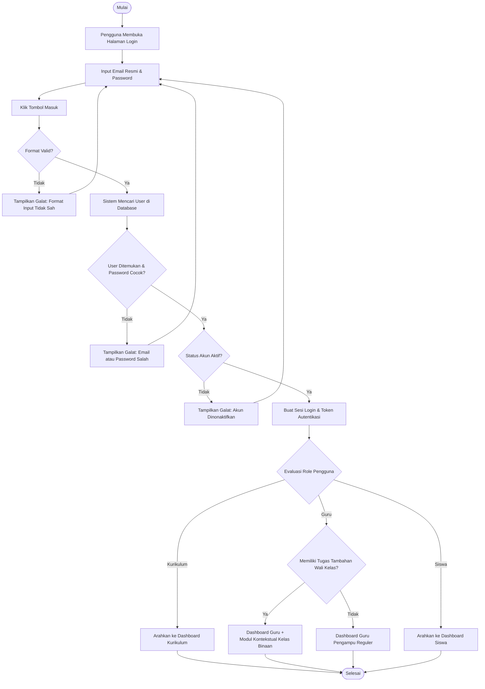
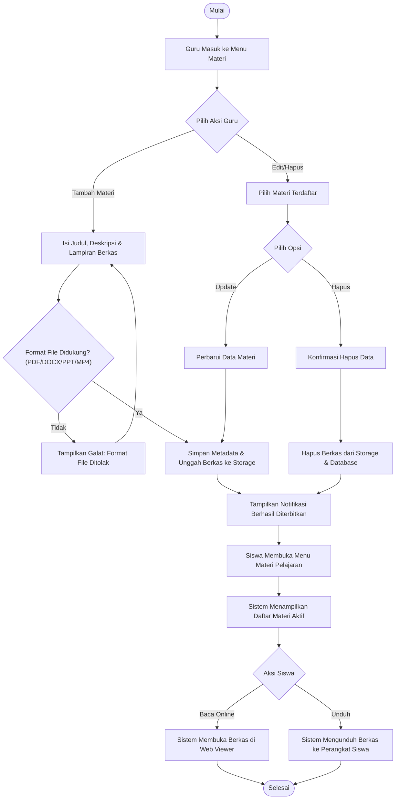
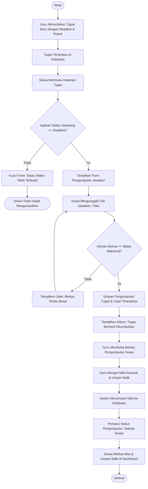
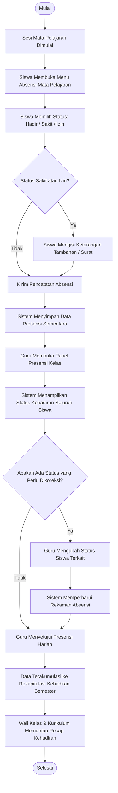
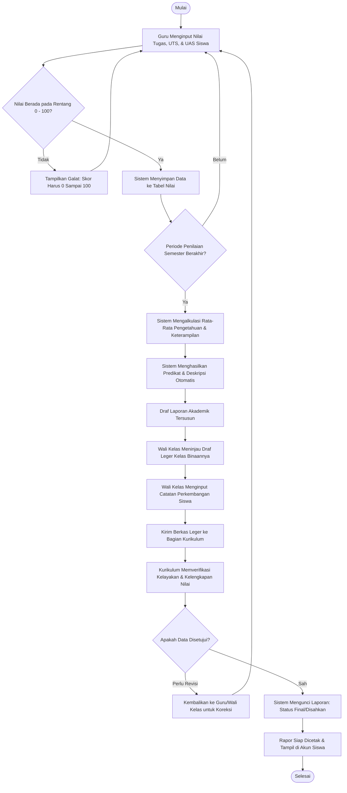
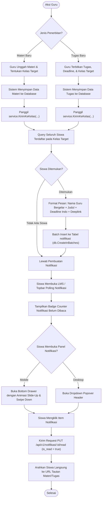
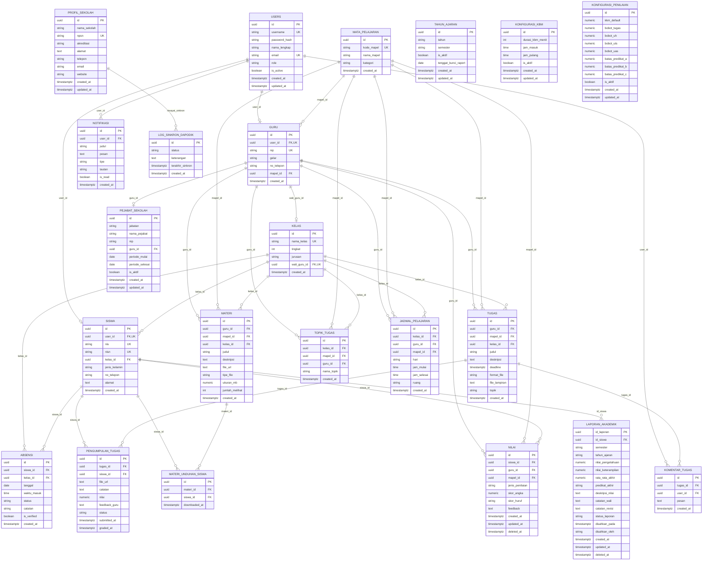
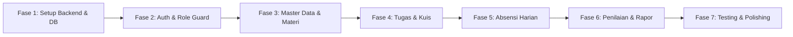

# Product Requirement Document (PRD)
## Learning Management System (LMS) SMA Negeri 2 Padalarang

| Atribut | Keterangan |
| :--- | :--- |
| **Mata Kuliah** | Prak. Implementasi dan Pengujian Sistem Informasi |
| **Proyek** | Learning Management System (LMS) Berbasis Web |
| **Institusi** | SMA Negeri 2 Padalarang & Program Studi Sistem Informasi UNJANI |
| **Tim Pengembang** | 1. Velma Dwinda Syabila (2450231038)<br>2. Mochammad Hafidz Nugraha (2450231039) – Developer<br>3. Kirana Novitasari (2450231050)<br>4. Muhamad Ariq Mubaroq (2450231052) |
| **Versi Dokumen** | v1.1.0 (Skema Produksi Terverifikasi) |
| **Status** | Terverifikasi Sesuai Sistem / Produksi |
| **Tech Stack** | Go Fiber (Backend REST API), Next.js 14/15 App Router (Frontend Web), PostgreSQL Supabase (22 Tabel Relasional), Supabase Storage |

---

Dokumen ini merupakan spesifikasi kebutuhan produk (*Product Requirement Document* / PRD) resmi untuk pengembangan platform berbasis web **Learning Management System (LMS) SMAN 2 Padalarang**. Dokumen ini disusun sebagai panduan teknis tunggal (*single source of truth*) yang mengintegrasikan seluruh spesifikasi dari:
1. **Software Requirements Specification (SRS)** Tim (71 Halaman)
2. **Software Design Document (SDD)** Tim (143 Halaman)
3. Implementasi Domain Model Java pada direktori `model/` dan Sequence Workflow pada direktori `sequence/`.

---

## 1. Ikhtisar Produk (Product Overview)

### 1.1 Latar Belakang & Problem Statement
SMA Negeri 2 Padalarang sebagai institusi pendidikan menengah atas berkomitmen untuk meningkatkan mutu dan efisiensi kegiatan belajar mengajar. Namun, dalam operasional harian sekolah masih ditemukan sejumlah kendala operasional akibat ketergantungan pada prosedur manual:
- **Pencatatan Presensi Manual**: Presensi siswa dilakukan di atas lembar kertas kelas, rentan terhadap kehilangan rekam jejak, keterlambatan rekapitulasi, dan potensi kesalahan penghitungan persentase kehadiran untuk rapor.
- **Pengumpulan & Pengelolaan Tugas Konvensional**: Penyerahan tugas dalam bentuk fisik atau melalui media perpesanan yang terfragmentasi menyulitkan guru dalam pelacakan batas waktu pengumpulan (*deadline*) serta evaluasi transparansi nilai.
- **Distribusi Materi Terfragmentasi**: Bahan ajar berupa dokumen, presentasi, dan video pembelajaran belum terpusat secara digital, sehingga menyulitkan siswa untuk mengulang materi secara mandiri di luar jam sekolah.
- **Integrasi Nilai & Laporan Akademik**: Proses kompilasi nilai tugas, ulangan harian, dan ujian untuk menghasilkan buku leger nilai akhir membutuhkan waktu koordinasi yang lama antara guru mata pelajaran, wali kelas, dan bagian kurikulum.

### 1.2 Tujuan Produk
1. **Sentralisasi Pembelajaran**: Membangun satu platform terpadu untuk mendistribusikan bahan ajar digital kapan saja dan di mana saja.
2. **Digitalisasi & Validasi Presensi**: Menyediakan fitur absensi mandiri siswa berbasis mata pelajaran harian dengan validasi langsung oleh guru pengampu.
3. **Efisiensi Pengelolaan Penugasan**: Memfasilitasi penerbitan tugas terstruktur, pengunggahan berkas jawaban siswa, validasi tenggat waktu pengerjaan otomatis, dan penilaian berbasis rubrik.
4. **Otomasi Rekapitulasi Akademik**: Menyederhanakan kalkulasi rata-rata nilai pengetahuan, keterampilan, serta presensi menjadi draf laporan akademik (*leger*) yang siap ditinjau oleh wali kelas dan disahkan oleh kurikulum.
5. **Transparansi Hasil Belajar**: Memungkinkan siswa dan orang tua untuk memantau progres belajar, riwayat nilai, serta menerima umpan balik (*feedback*) konstruktif secara berkala.

### 1.3 Ruang Lingkup Sistem (Product Scope)
Sistem dirancang sebagai aplikasi web responsif (*responsive web-based application*) yang dapat diakses dengan optimal melalui peramban web modern (*desktop* maupun *mobile browser*) oleh seluruh sivitas akademika SMAN 2 Padalarang.

---

## 2. Karakteristik Pengguna & Matriks Hak Akses (RBAC)

Sistem mengimplementasikan skema *Role-Based Access Control* (RBAC) terpadu dengan arsitektur **Dynamic Contextual Duty** yang merefleksikan proses bisnis operasional sekolah nyata di Indonesia:

| Peran (Role) | Deskripsi Tanggung Jawab | Kredensial Utama |
| :--- | :--- | :--- |
| **Kurikulum** | Administrator data akademik tingkat sekolah. Bertanggung jawab penuh atas master data siswa, guru, kelas, plotting jadwal pelajaran bebas bentrok, pemantauan absensi lintas kelas, dan finalisasi/pengesahan buku leger nilai akhir sekolah. | NIP & Email Resmi |
| **Guru** | Tenaga pendidik yang mengampu mata pelajaran. Berwenang mengelola materi ajar, membuat dan menilai tugas/kuis, serta memvalidasi kehadiran siswa pada sesinya. Apabila ditugaskan sebagai **Wali Kelas** (tugas tambahan), guru mendapatkan hak akses kontekstual untuk membina rombelnya. | NIP & Email Resmi |
| **Siswa** | Peserta didik terdaftar. Berhak mengakses dan mengunduh materi, melakukan absensi mandiri pada jam pelajaran, mengumpulkan tugas, serta melihat riwayat nilai dan umpan balik. | NIS & Email Resmi |
| **Wali Kelas (Tugas Tambahan)** | Peran penugasan kontekstual yang diemban oleh Guru aktif. Berhak memantau rekap absensi harian kelas binaannya, meninjau kompilasi draf nilai rapor seluruh mapel rombel, serta memberikan catatan pembinaan karakter pada buku leger. | NIP & Email Resmi |

> [!NOTE]
> **Arsitektur Wewenang Ganda (Dual Role) Guru & Wali Kelas:**
> Di sekolah nyata (khususnya jenjang SMA di Indonesia), Wali Kelas bukanlah profesi yang berdiri sendiri tanpa mengajar, melainkan guru aktif yang memperoleh penugasan pembinaan satu rombongan belajar (rombel). Oleh karena itu, sistem mengadopsi prinsip *Dynamic Contextual Duty*:
> 1. Akun pengguna dasar bagi seluruh pendidik adalah `guru`.
> 2. Penugasan sebagai **Wali Kelas** ditentukan secara dinamis melalui relasi rombel (`kelas.wali_guru_id`).
> 3. Seorang guru yang ditugaskan sebagai wali kelas dapat mengakses modul pembelajaran mata pelajarannya secara penuh (materi, tugas, kuis, nilai), sekaligus mengakses panel pembinaan rombel (*monitoring kehadiran kelas binaan dan pengisian catatan rapor*) dalam satu sesi akun tunggal tanpa perlu berganti login.

### Matriks Akses Data (CRUD Permissions)
Berdasarkan dokumen SRS Bab V Bagian 4.1.B:

| Modul Data | Kurikulum | Guru Pengampu | Siswa | Wali Kelas (Kelas Binaan) |
| :--- | :---: | :---: | :---: | :---: |
| **Master Data User & Siswa** | **CRUD** (Penuh) | **R** (Hanya Baca) | **R** (Profil Pribadi) | **R** (Hanya Baca) |
| **Materi Pembelajaran** | **R** (Monitoring) | **CRUD** (Milik Sendiri) | **R** / Download | **R** (Hanya Baca) |
| **Tugas & Kuis** | **R** (Monitoring) | **CRUD** (Milik Sendiri) | **R** (Lihat Instruksi) | **R** (Hanya Baca) |
| **Pengumpulan Tugas** | **R** (Monitoring) | **RU** (Evaluasi & Beri Nilai) | **CRU** (Kumpul/Update Jawaban) | **R** (Hanya Baca) |
| **Data Presensi / Absensi** | **R** (Rekap Sekolah) | **RU** (Validasi/Koreksi Status) | **CR** (Presensi Mandiri) | **R** (Rekap Kelas Binaan) |
| **Nilai Akademik** | **RU** (Rekap Leger) | **CRUD** (Input Skor & Feedback) | **R** (Nilai Sendiri) | **R** (Nilai Kelas Binaan) |
| **Laporan Akademik (Leger)** | **CRUD** (Finalisasi/Pengesahan)| **R** (Nilai Mapel Terkait) | **R** (Rapor Pribadi) | **RU** (Input Catatan Wali) |

---

## 3. Spesifikasi Kebutuhan Fungsional (Functional Requirements)

Terdapat 28 skenario *use case* yang dikelompokkan ke dalam 7 modul fungsional utama:

### Modul 1: Autentikasi & Manajemen Sesi Pengguna
- **FR-AUTH-01 (Login Multi-Role)**: Pengguna dapat masuk ke sistem menggunakan email resmi sekolah dan kata sandi yang telah terenkripsi.
- **FR-AUTH-02 (Verifikasi Sesi)**: Sistem memverifikasi kredensial dan mencocokkan status akun (`aktif = true`). Jika tidak aktif atau tidak cocok, sistem menolak autentikasi dan menampilkan pesan galat.
- **FR-AUTH-03 (Role-Based Routing & Contextual Navigation)**: Setelah login berhasil, sistem secara otomatis mengarahkan pengguna ke *dashboard* yang sesuai dengan perannya (`/admin/jadwal` untuk Kurikulum, `/guru` untuk Guru/Wali Kelas, `/siswa` untuk Siswa). Bagi guru yang mengemban tugas tambahan sebagai wali kelas, sistem secara otomatis mengaktifkan modul navigasi kontekstual *Kelas Binaan* (`/wali-kelas`) di dalam dashboard gurunya.
- **FR-AUTH-04 (Remember Me & Keamanan Sesi)**: Opsi pengingat sesi berbasis token aman (*HTTP-only cookies*) dan kemampuan logout untuk menghancurkan token sesi.

### Modul 2: Pengelolaan Data Master Akademik & Pengguna (Kurikulum)
- **FR-MST-01 (Manajemen Data Siswa & Kredensial Otomatis)**: Bagian Kurikulum dapat menambah, melihat rincian, memperbarui data diri, dan menonaktifkan/menghapus data siswa (NIS, nama, kelas, jurusan). Pada pembuatan akun siswa baru, sistem mengimplementasikan *Smart Credential Generation* secara otomatis:
  - **Email Siswa**: Diformulasikan otomatis menjadi `<inisial>.<kode_tahun>@siswa.sman2padalarang.sch.id` (misalnya nama *"Mochammad Hafidz Nugraha"* pada tahun ajaran aktif `2026/2027` menghasilkan `mhn.26@siswa.sman2padalarang.sch.id`). Nilai `kode_tahun` diambil langsung secara dinamis dari tabel `tahun_ajaran` dengan status `is_aktif = true` (tanpa *hardcode*).
  - **Username Siswa**: Diformulasikan menjadi `siswa_<inisial><kode_tahun>` (misal `siswa_mhn26`).
  - **Pencegahan Tabrakan (*Collision Resolution*)**: Sebelum disajikan, sistem memvalidasi ketersediaan ke basis data. Jika inisial telah digunakan oleh siswa lain, sistem secara otomatis menambahkan sufiks numerik inkremental (`mhn2.26@...`, `siswa_mhn26_2`).
  - **Manual Override**: Admin tetap berhak mengubah nilai secara manual atau mengembalikan ke format otomatis (*reset*) melalui tombol aksi interaktif pada formulir.
- **FR-MST-02 (Manajemen Data Guru & Kredensial Otomatis)**: Kurikulum dapat mengelola akun guru beserta pemetaan mata pelajaran yang diampu. Pada pembuatan akun guru baru:
  - **Penyaringan Gelar Akademik**: Sistem menyaring dan membersihkan gelar kehormatan serta gelar akademik (*title stripping* seperti `Drs.`, `Dr.`, `H.`, `Hj.`, `S.Pd`, `M.Pd`, `S.Si`, `S.Kom`, dsb.) agar nama bersih digunakan sebagai basis kredensial.
  - **Email Guru**: Diformulasikan menjadi `<nama_depan>.<nama_belakang>@guru.sman2padalarang.sch.id` (contoh: *"Drs. H. Parhan Romdhoni, S.Si"* menghasilkan `parhan.romdhoni@guru.sman2padalarang.sch.id`).
  - **Username Guru**: Diformulasikan menjadi `guru_<nama_lengkap_tanpa_spasi>` (contoh: `guru_parhanromdhoni`).
  - **Pencegahan Tabrakan (*Collision Resolution*)**: Jika nama guru serupa telah terdaftar di database, sistem menambahkan sufiks numerik secara otomatis (`parhan.romdhoni2@...`, `guru_parhanromdhoni2`).
- **FR-MST-03 (Manajemen Kelas & Rombel)**: Pengaturan tahun ajaran, tingkat kelas, dan penugasan wali kelas secara dinamis.
- **FR-MST-04 (Pengaturan Lembaga & Siklus Akademik)**: Kurikulum mengelola identitas profil sekolah, siklus tahun ajaran dan semester aktif, masa jabatan pejabat sekolah (Kepala Sekolah & Waka Kurikulum), konfigurasi jam operasional KBM, serta audit sinkronisasi Dapodik.

### Modul 3: Manajemen Materi Pembelajaran
- **FR-MAT-01 (Unggah Materi Ajar)**: Guru dapat menambahkan materi pembelajaran dengan melampirkan berkas (PDF, DOCX, PPT, MP4/Video) atau tautan media luar, dilengkapi judul, deskripsi, dan mata pelajaran.
- **FR-MAT-02 (Akses & Streaming Materi)**: Siswa dapat membaca materi secara daring (*view/stream*) atau mengunduh (*download*) berkas materi untuk dipelajari secara luring (*offline*).
- **FR-MAT-03 (Pembaruan & Penghapusan Materi)**: Guru pengampu dapat memperbarui deskripsi/berkas materi atau menghapusnya secara permanen dari basis data.
- **FR-MAT-04 (Pelacakan Unduhan Siswa Unik)**: Sistem mencatat rekam riwayat setiap siswa yang mengunduh berkas materi melalui tabel `materi_unduhan_siswa`. Metrik `jumlah_melihat` dihitung secara tepat berdasarkan jumlah siswa unik yang telah mengakses berkas tersebut guna mencegah manipulasi angka klik ganda.

### Modul 4: Pengelolaan Tugas & Kuis
- **FR-TG-01 (Penerbitan Tugas Terstruktur, Topik Unit, & Lampiran Multi-Sumber)**: Guru dapat menyusun tugas dengan instruksi pengerjaan, format pengumpulan yang diizinkan (teks, berkas PDF, dokumen, gambar), tenggat waktu pengumpulan (*deadline*), penugasan kategori unit topik pembelajaran (`topik_tugas`), serta melampirkan berkas referensi guru (Google Drive, YouTube, File Lokal, Link Tautan) yang disimpan dalam format JSON terstruktur (`file_lampiran`).
- **FR-TG-02 (Pengumpulan Jawaban Siswa & Tampilan Accordion Interaktif)**: Siswa dapat mengirimkan respon jawaban tugas sebelum batas waktu berakhir. Pada antarmuka siswa, daftar tugas disajikan dalam format *accordion* interaktif yang terkelompokkan rapi per topik pembelajaran dengan indikator visual ketepatan waktu (*Tepat Waktu*, *Mendesak*, *Terlambat*).
- **FR-TG-03 (Pembaruan & Penghapusan Pengumpulan)**: Siswa dapat memperbarui berkas jawaban atau membatalkan kiriman selama tenggat waktu belum terlampaui. Sistem secara ketat menolak pengubahan jika waktu pengerjaan telah habis (*late submission lock*).
- **FR-TG-04 (Penilaian Tugas & Umpan Balik Evaluasi)**: Guru memeriksa berkas jawaban, menginput nilai numerik (0–100), dan memberikan umpan balik (*feedback*) evaluasi.
- **FR-TG-05 (Forum Komentar Kelas / Interaksi Tugas)**: Guru dan siswa dapat berkomunikasi melalui kolom diskusi komentar tugas (`komentar_tugas`) untuk tanya jawab instruksional seputar tugas yang sedang aktif secara terbuka bagi seluruh anggota kelas.
- **FR-TG-06 (Tab Orang / Direktori Rombel Kelas Siswa)**: Pada halaman kelas tugas siswa, disediakan navigasi tab terpadu mencakup:
  - **Tugas Kelas**: Menampilkan daftar tugas terstruktur, materi penugasan, dan pengumpulan jawaban.
  - **Orang (Direktori Rombel)**: Menampilkan profil Pengajar lengkap beserta gelar akademik (contoh: *"Euis, S.Pd"*) serta daftar nama seluruh Teman Sekelas yang terdaftar aktif dalam rombongan belajar yang sama.

### Modul 5: Presensi & Absensi Siswa
- **FR-ABS-01 (Presensi Mandiri Siswa)**: Siswa melakukan pencatatan kehadiran mandiri pada saat sesi mata pelajaran dibuka.
- **FR-ABS-02 (Pilihan Status Kehadiran)**: Status kehadiran mencakup: `Hadir`, `Sakit`, `Izin`, dan `Alfa` (Tanpa Keterangan). Untuk status Sakit atau Izin, siswa wajib mengisi kolom keterangan/alasan.
- **FR-ABS-03 (Validasi & Pembaruan oleh Guru)**: Guru pengampu dapat memeriksa daftar kehadiran kelas secara langsung (*real-time*) dan berhak mengubah status absensi siswa jika ditemukan ketidaksesuaian.
- **FR-ABS-04 (Rekapitulasi Kehadiran)**: Sistem mengalkulasi akumulasi kehadiran per semester secara otomatis untuk dipantau oleh Wali Kelas dan Kurikulum.

### Modul 6: Penilaian Akademik
- **FR-NIL-01 (Input Nilai Mata Pelajaran)**: Guru dapat menginput nilai berdasarkan kategori asesmen: Tugas, Ulangan Harian, Ujian Tengah Semester (UTS), dan Ujian Akhir Semester (UAS).
- **FR-NIL-02 (Perhitungan Rata-Rata Otomatis & Terbobot Dinamis)**: Sistem menghitung bobot nilai (Tugas, UH, UTS, UAS) secara terprogram berdasarkan persentase bobot dinamis yang ditentukan oleh Kurikulum (`konfigurasi_penilaian`).
- **FR-NIL-03 (Pembaruan & Penghapusan Nilai)**: Guru dapat mengoreksi data nilai sebelum periode penilaian dikunci (*locked*) oleh Kurikulum.
- **FR-NIL-04 (Transparansi Siswa)**: Siswa dapat melihat riwayat nilai transparan beserta skor huruf (A/B/C/D) dan catatan guru.
- **FR-NIL-05 (Standarisasi Penilaian Kurikulum & Konversi Predikat Dinamis)**: Kurikulum dapat mengatur batas KKM sekolah, rasio pembobotan komponen asesmen (harus tepat 100%), dan ambang batas predikat huruf (A, B, C, D) melalui menu Pengaturan Sekolah (`/admin/pengaturan`) tanpa hardcode. Seluruh modul (Guru, Siswa, Wali Kelas Leger, dan Rapor) mengonsumsi konfigurasi ini secara terpusat.

### Modul 7: Laporan Akademik (Leger & Rapor) & Sistem Notifikasi
- **FR-LAP-01 (Generasi Leger Nilai Otomatis)**: Sistem mengompilasi seluruh nilai mata pelajaran dan rekap presensi menjadi draf laporan akademik siswa secara terotomatisasi.
- **FR-LAP-02 (Penambahan Catatan Wali Kelas)**: Wali kelas meninjau draf laporan dan menambahkan deskripsi capaian perkembangan kepribadian/akademik siswa.
- **FR-LAP-03 (Pengesahan Kurikulum & Integrasi Identitas Resmi Dokumen Rapor)**: Kurikulum melakukan verifikasi akhir dan mengunci laporan untuk dicetak menjadi rapor resmi. Format cetak dan pratinjau rapor secara dinamis mengintegrasikan identitas lembaga (nama sekolah, alamat, kontak) serta pejabat penandatangan resmi (Kepala Sekolah & Waka Kurikulum beserta NIP) langsung dari tabel basis data pengaturan sekolah (*pejabat_sekolah* dan *profil_sekolah*) tanpa nilai statis (*zero hardcode*).
- **FR-LAP-04 (Integritas Data Dinamis & Arsitektur Fail-Closed)**: Seluruh modul verifikasi raport dan endpoint pelaporan beroperasi dengan prinsip *fail-closed* tanpa ketergantungan pada data *mock*, objek tiruan (*dummy UUIDs*), atau tahun ajaran statis. Jika tahun ajaran tidak dispesifikasikan oleh klien, sistem secara otomatis mengekstrak tahun ajaran dan semester aktif dari tabel `tahun_ajaran` (`is_aktif = true`). Seluruh kegagalan request/validasi menghasilkan respons penolakan valid (HTTP 400/422) dan antarmuka pengguna menampilkan *Empty State* informatif alih-alih menyuntikkan data tiruan.
- **FR-NOTIF-01 (Notifikasi Penerbitan Materi Baru)**: Saat guru mengunggah materi ajar baru pada suatu kelas, sistem secara otomatis menerbitkan notifikasi ke seluruh siswa aktif pada kelas/rombel target tersebut. Pesan memuat nama guru pengampu beserta gelar akademik lengkap (jika tersedia), mata pelajaran, judul materi, serta deeplink langsung (`/siswa/materi?search=...`).
- **FR-NOTIF-02 (Notifikasi Penerbitan Tugas & Tenggat Waktu)**: Saat guru menerbitkan tugas baru pada target kelas, sistem secara otomatis mendistribusikan notifikasi ke seluruh siswa di kelas target. Pesan notifikasi mencantumkan nama guru bergelar, judul tugas, tenggat waktu (*deadline*) dalam format resmi Bahasa Indonesia (contoh: *"Tenggat Waktu: Minggu, 15 November 2026 pukul 23:59 WIB"*), serta tautan langsung ke modul tugas siswa (`/siswa/tugas`).
- **FR-NOTIF-03 (Manajemen Status Keterbacaan & Unread Counter)**: Sistem menyediakan counter notifikasi belum dibaca (*unread count badge*) secara real-time pada header navigasi. Pengguna dapat menandai notifikasi telah dibaca secara satuan (`PUT /api/v1/notifikasi/:id/read`) atau menandai seluruh notifikasi sekaligus (`PUT /api/v1/notifikasi/read-all`).
- **FR-NOTIF-04 (Antarmuka Responsif & Mobile Native Drawer)**:
  - *Desktop*: Notifikasi disajikan melalui popover dropdown interaktif pada ikon lonceng header navigasi.
  - *Mobile/Tablet*: Notifikasi disajikan melalui *bottom drawer* yang muncul dari bawah layar (*slide-up entrance*) dan dapat ditutup menggunakan *gesture swipe down* ke bawah (*slide-down exit*) dengan kurva transisi GPU `cubic-bezier(0.32, 0.72, 0, 1)`.
  - *Dashboard Siswa*: Kartu sorotan materi baru muncul di bagian atas dashboard dengan tombol cepat *"Pelajari Sekarang"* yang otomatis menandai notifikasi telah dibaca dan mengarahkan ke halaman materi terkait.

---

## 4. Flowchart Alur Sistem (Mermaid Activity Diagrams)

Berikut adalah visualisasi diagram alir proses bisnis utama yang ditranslasikan dari *Activity Diagrams* (SDD Bab 3.4 Hal. 64–91):

### 4.1 Flowchart 1: Autentikasi Pengguna & Penentuan Dashboard
Menjelaskan proses login universal dan validasi keamanan akun:



---

### 4.2 Flowchart 2: Alur Siklus Materi Pembelajaran
Menjelaskan alur dari pengunggahan materi oleh guru hingga pengunduhan oleh siswa:



---

### 4.3 Flowchart 3: Alur Siklus Tugas & Kuis
Menjelaskan alur penerbitan tugas, pengumpulan oleh siswa, validasi batas waktu, dan penilaian:



---

### 4.4 Flowchart 4: Alur Pencatatan & Verifikasi Presensi Siswa
Menjelaskan pencatatan presensi mandiri oleh siswa dan validasi serta koreksi oleh guru:



---

### 4.5 Flowchart 5: Alur Pengolahan Nilai & Generasi Laporan Akademik
Menjelaskan konsolidasi nilai mata pelajaran menjadi draf laporan akademik (*leger*):



---

### 4.6 Flowchart 6: Siklus Distribusi & Interaksi Notifikasi Terisolasi
Menjelaskan penerbitan notifikasi otomatis saat guru mengunggah materi atau menerbitkan tugas, serta alur penanganan keterbacaan oleh siswa:



---

## 5. Skema Basis Data Relasional & Kamus Data

Skema basis data ditranslasikan dari spesifikasi SRS/SDD dan telah diimplementasikan secara penuh pada **PostgreSQL (Supabase)** dengan total **22 tabel relasional aktif** yang dikelola melalui GORM pada backend Go Fiber:

### 5.1 Entity-Relationship Diagram (ERD Mermaid)



---

### 5.2 Kamus Data Detail (Data Dictionary - Supabase PostgreSQL)

Struktur tabel di bawah ini merefleksikan 100% skema produksi **Supabase PostgreSQL** menggunakan tipe data native (`UUID`, `TIMESTAMPTZ`, `NUMERIC`, `TEXT`, `DATE`, `TIME`, `BOOLEAN`, serta *check & unique constraints* aktif):

#### 1. Tabel `users`
Menyimpan identitas akun seluruh pengguna sistem (Autentikasi terpusat multi-role).
- `id` : `UUID` - **Primary Key**, default: `uuid_generate_v4()`.
- `username` : `VARCHAR(50)` - **Unique**, **Not Null**. Username unik pengguna.
- `password_hash` : `VARCHAR(255)` - **Not Null**. Hash kata sandi aman (Bcrypt cost factor 10).
- `nama_lengkap` : `VARCHAR(100)` - **Not Null**. Nama lengkap pengguna.
- `email` : `VARCHAR(100)` - **Unique**, **Not Null**. Alamat email resmi sekolah.
- `role` : `VARCHAR(20)` - **Not Null**, `CHECK (role IN ('kurikulum', 'guru', 'wali_kelas', 'siswa'))`.
- `is_active` : `BOOLEAN` - **Default: true**. Status keaktifan akun.
- `created_at` : `TIMESTAMPTZ` - **Default: CURRENT_TIMESTAMP**.
- `updated_at` : `TIMESTAMPTZ` - **Default: CURRENT_TIMESTAMP**.

#### 2. Tabel `guru`
Profil tenaga pendidik dan pemetaan mata pelajaran yang diampu.
- `id` : `UUID` - **Primary Key**, default: `uuid_generate_v4()`.
- `user_id` : `UUID` - **Foreign Key** ke `users(id)` ON DELETE CASCADE, **Unique**, **Not Null**.
- `nip` : `VARCHAR(30)` - **Unique**, **Not Null**, `CHECK (nip ~ '^[0-9]+$')`. Nomor Induk Pegawai berupa digit numerik.
- `gelar` : `VARCHAR(50)` - Gelar akademik (contoh: "S.Pd", "M.Kom.", "Drs. M.Pd").
- `no_telepon` : `VARCHAR(20)` - Nomor kontak aktif guru.
- `mapel_id` : `UUID` - **Foreign Key** ke `mata_pelajaran(id)` ON DELETE SET NULL. Mata pelajaran utama yang diampu.
- `created_at` : `TIMESTAMPTZ` - **Default: CURRENT_TIMESTAMP**.

#### 3. Tabel `kelas`
Master data rombongan belajar (rombel) dan penugasan wali kelas.
- `id` : `UUID` - **Primary Key**, default: `uuid_generate_v4()`.
- `nama_kelas` : `VARCHAR(20)` - **Unique**, **Not Null**. Contoh: "X RPL 1", "XII IPA 1".
- `tingkat` : `INT` - **Not Null**, `CHECK (tingkat IN (10, 11, 12))`.
- `jurusan` : `VARCHAR(20)` - **Not Null**. Jurusan rombel (misal: "RPL", "MIPA", "IPS").
- `wali_guru_id` : `UUID` - **Foreign Key** ke `guru(id)` ON DELETE SET NULL, **Unique** (`uq_kelas_wali_guru`). Menjamin 1 guru hanya membina 1 rombel.
- `created_at` : `TIMESTAMPTZ` - **Default: CURRENT_TIMESTAMP**.

#### 4. Tabel `siswa`
Profil peserta didik terdaftar pada rombel aktif.
- `id` : `UUID` - **Primary Key**, default: `uuid_generate_v4()`.
- `user_id` : `UUID` - **Foreign Key** ke `users(id)` ON DELETE CASCADE, **Unique**, **Not Null**.
- `nis` : `VARCHAR(20)` - **Unique**, **Not Null**, `CHECK (nis ~ '^[0-9]+$')`. Nomor Induk Siswa.
- `nisn` : `VARCHAR(20)` - **Unique**, **Not Null**, `CHECK (nisn ~ '^[0-9]+$')`. Nomor Induk Siswa Nasional.
- `kelas_id` : `UUID` - **Foreign Key** ke `kelas(id)` ON DELETE SET NULL.
- `jenis_kelamin` : `VARCHAR(10)` - **Not Null**, `CHECK (jenis_kelamin IN ('Laki-laki', 'Perempuan'))`.
- `no_telepon` : `VARCHAR(20)` - Nomor kontak siswa / wali.
- `alamat` : `TEXT` - Alamat domisili siswa.
- `created_at` : `TIMESTAMPTZ` - **Default: CURRENT_TIMESTAMP**.

#### 5. Tabel `mata_pelajaran`
Master katalog mata pelajaran sekolah.
- `id` : `UUID` - **Primary Key**, default: `uuid_generate_v4()`.
- `kode_mapel` : `VARCHAR(20)` - **Unique**, **Not Null**. Contoh: "MTK-X", "BIO-XII".
- `nama_mapel` : `VARCHAR(100)` - **Not Null**. Nama lengkap mata pelajaran.
- `kategori` : `VARCHAR(30)` - Kategori kelompok kurikulum (misal: "Muatan Umum", "Peminatan MIPA").
- `created_at` : `TIMESTAMPTZ` - **Default: CURRENT_TIMESTAMP**.

#### 6. Tabel `jadwal_pelajaran`
Plotting alokasi jadwal kegiatan belajar mengajar harian kelas dan guru.
- `id` : `UUID` - **Primary Key**, default: `uuid_generate_v4()`.
- `kelas_id` : `UUID` - **Foreign Key** ke `kelas(id)` ON DELETE CASCADE, **Not Null**.
- `guru_id` : `UUID` - **Foreign Key** ke `guru(id)` ON DELETE CASCADE, **Not Null**.
- `mapel_id` : `UUID` - **Foreign Key** ke `mata_pelajaran(id)` ON DELETE RESTRICT, **Not Null**.
- `hari` : `VARCHAR(10)` - **Not Null**, `CHECK (hari IN ('Senin', 'Selasa', 'Rabu', 'Kamis', 'Jumat', 'Sabtu'))`.
- `jam_mulai` : `TIME` - **Not Null**. Waktu mulai KBM (contoh: '07:00:00').
- `jam_selesai` : `TIME` - **Not Null**. Waktu selesai KBM (contoh: '08:30:00').
- `ruang` : `VARCHAR(30)` - **Default: 'Kelas Reguler'**. Ruang kelas / laboratorium.
- `created_at` : `TIMESTAMPTZ` - **Default: CURRENT_TIMESTAMP**.
- `CONSTRAINT chk_jam_jadwal` : `CHECK (jam_mulai < jam_selesai)`.

#### 7. Tabel `materi`
Distribusi bahan ajar digital guru (dokumen/video/tautan).
- `id` : `UUID` - **Primary Key**, default: `uuid_generate_v4()`.
- `guru_id` : `UUID` - **Foreign Key** ke `guru(id)` ON DELETE CASCADE, **Not Null**.
- `mapel_id` : `UUID` - **Foreign Key** ke `mata_pelajaran(id)` ON DELETE RESTRICT, **Not Null**.
- `kelas_id` : `UUID` - **Foreign Key** ke `kelas(id)` ON DELETE CASCADE, **Not Null**.
- `judul` : `VARCHAR(200)` - **Not Null**. Judul bab / modul ajar.
- `deskripsi` : `TEXT` - Ringkasan materi atau catatan instruksional.
- `file_url` : `TEXT` - **Not Null**. URL berkas pada bucket Supabase Storage (`materi-pelajaran`) atau URL luar.
- `tipe_file` : `VARCHAR(20)` - **Default: 'PDF'**. Format materi (PDF, DOCX, MP4, LINK, dsb).
- `ukuran_mb` : `NUMERIC(5,2)` - **Default: 0.00**. Ukuran berkas dalam Megabyte.
- `jumlah_melihat` : `INT` - **Default: 0**. Akumulasi jumlah siswa unik yang telah membuka/mengunduh materi.
- `created_at` : `TIMESTAMPTZ` - **Default: CURRENT_TIMESTAMP**.

#### 8. Tabel `materi_unduhan_siswa`
Pencatatan riwayat siswa unik yang mengakses/mengunduh materi ajar untuk metrik akurat tanpa duplikasi.
- `id` : `UUID` - **Primary Key**, default: `gen_random_uuid()`.
- `materi_id` : `UUID` - **Foreign Key** ke `materi(id)` ON DELETE CASCADE, **Not Null**.
- `siswa_id` : `UUID` - **Foreign Key** ke `siswa(id)` ON DELETE CASCADE, **Not Null**.
- `downloaded_at` : `TIMESTAMPTZ` - **Default: now()**, **Not Null**. Stempel waktu akses unduhan.
- `CONSTRAINT uq_materi_siswa_unduhan` : `UNIQUE (materi_id, siswa_id)`.

#### 9. Tabel `tugas`
Penerbitan tugas terstruktur dan penugasan kelas ala Google Classroom.
- `id` : `UUID` - **Primary Key**, default: `uuid_generate_v4()`.
- `guru_id` : `UUID` - **Foreign Key** ke `guru(id)` ON DELETE CASCADE, **Not Null**.
- `mapel_id` : `UUID` - **Foreign Key** ke `mata_pelajaran(id)` ON DELETE RESTRICT, **Not Null**.
- `kelas_id` : `UUID` - **Foreign Key** ke `kelas(id)` ON DELETE CASCADE, **Not Null**.
- `judul` : `VARCHAR(200)` - **Not Null**. Judul tugas / praktikum.
- `deskripsi` : `TEXT` - Petunjuk teknis pengerjaan tugas.
- `deadline` : `TIMESTAMPTZ` - **Not Null**. Batas akhir pengumpulan jawaban.
- `format_file` : `VARCHAR(100)` - **Default: 'pdf, docx'**. Batasan ekstensi berkas yang diizinkan.
- `file_lampiran` : `TEXT` - **Default: ''**. Representasi string JSON berstruktur memuat lampiran referensi guru (Google Drive, YouTube, File Lokal, Link Tautan).
- `topik` : `VARCHAR(100)` - **Default: ''**. Kategori topik pengelompokan materi tugas (misal: "Tugas Terstruktur", "Praktikum").
- `created_at` : `TIMESTAMPTZ` - **Default: CURRENT_TIMESTAMP**.

#### 10. Tabel `topik_tugas`
Kategori unit pembelajaran / topik tugas dinamis per kelas dan mata pelajaran.
- `id` : `UUID` - **Primary Key**, default: `gen_random_uuid()`.
- `kelas_id` : `UUID` - **Foreign Key** ke `kelas(id)` ON DELETE CASCADE, **Not Null**.
- `mapel_id` : `UUID` - **Foreign Key** ke `mata_pelajaran(id)` ON DELETE CASCADE, **Not Null**.
- `guru_id` : `UUID` - **Foreign Key** ke `guru(id)` ON DELETE SET NULL. Guru pembuat topik.
- `nama_topik` : `VARCHAR(100)` - **Not Null**. Nama topik (misal: "Algoritma Pemrograman", "Basis Data Relasional").
- `created_at` : `TIMESTAMPTZ` - **Default: CURRENT_TIMESTAMP**.
- `CONSTRAINT uq_topik_kelas_mapel_nama` : `UNIQUE (kelas_id, mapel_id, LOWER(nama_topik))`.

#### 11. Tabel `komentar_tugas`
Forum diskusi kelas dan tanya-jawab interaktif pada setiap penugasan.
- `id` : `UUID` - **Primary Key**, default: `gen_random_uuid()`.
- `tugas_id` : `UUID` - **Foreign Key** ke `tugas(id)` ON DELETE CASCADE, **Not Null**.
- `user_id` : `UUID` - **Foreign Key** ke `users(id)` ON DELETE CASCADE, **Not Null**. Penulis komentar (guru atau siswa).
- `pesan` : `TEXT` - **Not Null**. Isi pesan komentar.
- `created_at` : `TIMESTAMPTZ` - **Default: CURRENT_TIMESTAMP**.

#### 12. Tabel `pengumpulan_tugas`
Penyimpanan hasil pengerjaan, berkas jawaban siswa, dan catatan evaluasi guru.
- `id` : `UUID` - **Primary Key**, default: `uuid_generate_v4()`.
- `tugas_id` : `UUID` - **Foreign Key** ke `tugas(id)` ON DELETE CASCADE, **Not Null**.
- `siswa_id` : `UUID` - **Foreign Key** ke `siswa(id)` ON DELETE CASCADE, **Not Null**.
- `file_url` : `TEXT` - **Not Null**. URL berkas jawaban pada Supabase Storage bucket `pengumpulan-tugas`.
- `catatan` : `TEXT` - Catatan pengantar atau komentar siswa saat mengumpulkan tugas.
- `nilai` : `NUMERIC(5,2)` - Skor angka hasil penilaian guru (0.00 – 100.00).
- `feedback_guru` : `TEXT` - Ulasan evaluasi dan catatan pembinaan dari guru.
- `status` : `VARCHAR(20)` - **Default: 'dikumpulkan'**, `CHECK (status IN ('dikumpulkan', 'dinilai', 'terlambat'))`.
- `submitted_at` : `TIMESTAMPTZ` - **Default: CURRENT_TIMESTAMP**. Waktu penyerahan tugas.
- `graded_at` : `TIMESTAMPTZ` - Waktu guru menyelesaikan penilaian.
- `CONSTRAINT uq_siswa_tugas` : `UNIQUE (tugas_id, siswa_id)`.

#### 13. Tabel `absensi`
Pencatatan rekam presensi harian siswa per sesi kelas.
- `id` : `UUID` - **Primary Key**, default: `uuid_generate_v4()`.
- `siswa_id` : `UUID` - **Foreign Key** ke `siswa(id)` ON DELETE CASCADE, **Not Null**.
- `kelas_id` : `UUID` - **Foreign Key** ke `kelas(id)` ON DELETE CASCADE, **Not Null**.
- `tanggal` : `DATE` - **Not Null**. Tanggal pencatatan presensi.
- `waktu_masuk` : `TIME` - Jam pencatatan kehadiran mandiri (contoh: '07:15:00').
- `status` : `VARCHAR(20)` - **Not Null**, `CHECK (status IN ('hadir', 'sakit', 'izin', 'alpa', 'terlambat'))`.
- `catatan` : `VARCHAR(255)` - Keterangan surat izin/dokter atau alasan keterlambatan.
- `is_verified` : `BOOLEAN` - **Default: false**. Status validasi verifikasi oleh guru pengampu.
- `created_at` : `TIMESTAMPTZ` - **Default: CURRENT_TIMESTAMP**.
- `CONSTRAINT uq_absensi_siswa_hari` : `UNIQUE (siswa_id, tanggal)`.

#### 14. Tabel `nilai`
Rekapitulasi skor evaluasi formatif dan sumatif siswa per mata pelajaran.
- `id` : `UUID` - **Primary Key**, default: `uuid_generate_v4()`.
- `siswa_id` : `UUID` - **Foreign Key** ke `siswa(id)` ON DELETE CASCADE, **Not Null**.
- `guru_id` : `UUID` - **Foreign Key** ke `guru(id)` ON DELETE CASCADE, **Not Null**.
- `mapel_id` : `UUID` - **Foreign Key** ke `mata_pelajaran(id)` ON DELETE RESTRICT, **Not Null**.
- `jenis_penilaian` : `VARCHAR(20)` - **Not Null**, `CHECK (jenis_penilaian IN ('Tugas', 'UlanganHarian', 'UTS', 'UAS'))`.
- `skor_angka` : `NUMERIC(5,2)` - **Not Null**, `CHECK (skor_angka >= 0 AND skor_angka <= 100)`.
- `skor_huruf` : `CHAR(2)` - Konversi huruf predikat (A, B, C, D).
- `feedback` : `TEXT` - Catatan umpan balik konstruktif guru.
- `created_at` : `TIMESTAMPTZ` - **Default: CURRENT_TIMESTAMP**.
- `updated_at` : `TIMESTAMPTZ` - **Default: CURRENT_TIMESTAMP**.
- `deleted_at` : `TIMESTAMPTZ` - **Nullable** (*GORM soft delete timestamp*).

#### 15. Tabel `laporan_akademik`
Kompilasi leger nilai akhir semester dan pencetakan buku rapor resmi.
- `id_laporan` : `UUID` - **Primary Key**, default: `gen_random_uuid()`.
- `id_siswa` : `UUID` - **Foreign Key** ke `siswa(id)` ON DELETE CASCADE, **Not Null**.
- `semester` : `VARCHAR(10)` - **Not Null**, `CHECK (semester IN ('Ganjil', 'Genap'))`.
- `tahun_ajaran` : `VARCHAR(20)` - **Not Null**. Siklus tahun ajaran aktif (misal: '2026/2027').
- `nilai_pengetahuan` : `NUMERIC(5,2)` - Rata-rata kompetensi pengetahuan (kognitif).
- `nilai_keterampilan` : `NUMERIC(5,2)` - Rata-rata kompetensi keterampilan (psikomotorik).
- `rata_rata_akhir` : `NUMERIC(5,2)` - Rata-rata gabungan terbobot nilai akhir semester.
- `predikat_akhir` : `VARCHAR(5)` - Predikat akhir rapor (A, B, C, D).
- `deskripsi_nilai` : `TEXT` - Uraian capaian kompetensi akademik siswa.
- `catatan_wali` : `TEXT` - Catatan bimbingan kepribadian dan akhlak dari wali kelas.
- `catatan_revisi` : `TEXT` - Catatan instruksi perbaikan dari Waka Kurikulum saat peninjauan leger.
- `status_laporan` : `VARCHAR(25)` - **Default: 'Draf'**, `CHECK (status_laporan IN ('Draf', 'DitinjauWali', 'DisahkanKurikulum'))`.
- `disahkan_pada` : `TIMESTAMPTZ` - Stempel waktu pengesahan resmi oleh Kurikulum.
- `disahkan_oleh` : `VARCHAR(100)` - Nama pejabat kurikulum yang mengesahkan buku rapor.
- `created_at` : `TIMESTAMPTZ` - **Default: CURRENT_TIMESTAMP**.
- `updated_at` : `TIMESTAMPTZ` - **Default: CURRENT_TIMESTAMP**.
- `deleted_at` : `TIMESTAMPTZ` - **Nullable** (*GORM soft delete timestamp*).

#### 16. Tabel `notifikasi`
Antrean notifikasi in-app untuk distribusi pemberitahuan materi baru, tugas baru, dan pengumuman.
- `id` : `UUID` - **Primary Key**, default: `gen_random_uuid()`.
- `user_id` : `UUID` - **Foreign Key** ke `users(id)` ON DELETE CASCADE, **Not Null**.
- `judul` : `VARCHAR(200)` - **Not Null**. Judul ringkas notifikasi.
- `pesan` : `TEXT` - **Not Null**. Rincian pesan lengkap mencantumkan nama guru bergelar dan deadline.
- `tipe` : `VARCHAR(50)` - **Default: 'materi'**, **Not Null**. Kategori notifikasi ('materi', 'tugas', 'pengumuman', 'nilai').
- `tautan` : `VARCHAR(255)` - **Default: '/siswa/materi'**. URL tujuan navigasi cepat (*deeplink*).
- `is_read` : `BOOLEAN` - **Default: false**, **Not Null**. Penanda keterbacaan pesan oleh user.
- `created_at` : `TIMESTAMPTZ` - **Default: now()**, **Not Null**.

#### 17. Tabel `profil_sekolah`
Identitas pokok resmi kelembagaan satuan pendidikan SMAN 2 Padalarang.
- `id` : `UUID` - **Primary Key**, default: `gen_random_uuid()`.
- `nama_sekolah` : `VARCHAR(150)` - **Default: 'SMA Negeri 2 Padalarang'**, **Not Null**.
- `npsn` : `VARCHAR(20)` - **Default: '20227927'**, **Unique**, **Not Null**. Nomor Pokok Sekolah Nasional.
- `akreditasi` : `VARCHAR(5)` - **Default: 'A'**, **Not Null**.
- `alamat` : `TEXT` - **Default: 'Jalan Raya Padalarang No. 45, Kertajaya, Padalarang, Kabupaten Bandung Barat, Jawa Barat 40553'**, **Not Null**.
- `telepon` : `VARCHAR(30)` - **Default: '(022) 6806123'**.
- `email` : `VARCHAR(100)` - **Default: 'info@sman2padalarang.sch.id'**.
- `website` : `VARCHAR(100)` - **Default: 'https://sman2padalarang.sch.id'**.
- `created_at` : `TIMESTAMPTZ` - **Default: CURRENT_TIMESTAMP**.
- `updated_at` : `TIMESTAMPTZ` - **Default: CURRENT_TIMESTAMP**.

#### 18. Tabel `tahun_ajaran`
Kalender akademik aktif, histori semester, dan batas penguncian nilai rapor.
- `id` : `UUID` - **Primary Key**, default: `gen_random_uuid()`.
- `tahun` : `VARCHAR(20)` - **Not Null**. Format tahun ajaran (misal: '2026/2027').
- `semester` : `VARCHAR(10)` - **Not Null**, `CHECK (semester IN ('Ganjil', 'Genap'))`.
- `is_aktif` : `BOOLEAN` - **Default: false**, **Not Null**. Penanda siklus akademik yang sedang berjalan.
- `tenggat_kunci_raport` : `DATE` - Batas waktu penguncian penginputan nilai rapor oleh guru.
- `created_at` : `TIMESTAMPTZ` - **Default: CURRENT_TIMESTAMP**.
- `updated_at` : `TIMESTAMPTZ` - **Default: CURRENT_TIMESTAMP**.
- `CONSTRAINT uq_tahun_semester` : `UNIQUE (tahun, semester)`.

#### 19. Tabel `pejabat_sekolah`
Mencatat pimpinan lembaga struktural (Kepala Sekolah & Waka Kurikulum) untuk penandatanganan sah dokumen rapor.
- `id` : `UUID` - **Primary Key**, default: `gen_random_uuid()`.
- `jabatan` : `VARCHAR(50)` - **Not Null**. Nama posisi jabatan (misal: 'Kepala Sekolah', 'Waka Kurikulum').
- `nama_pejabat` : `VARCHAR(150)` - **Not Null**. Nama pejabat lengkap beserta gelar kehormatan dan akademik.
- `nip` : `VARCHAR(30)` - Nomor Induk Pegawai resmi.
- `guru_id` : `UUID` - **Foreign Key** ke `guru(id)` ON DELETE SET NULL.
- `periode_mulai` : `DATE` - **Default: CURRENT_DATE**, **Not Null**. Tanggal mulai masa bakti.
- `periode_selesai` : `DATE` - Tanggal selesai masa jabatan (*null jika masih menjabat aktif*).
- `is_aktif` : `BOOLEAN` - **Default: true**, **Not Null**. Status aktif jabatan saat ini.
- `created_at` : `TIMESTAMPTZ` - **Default: CURRENT_TIMESTAMP**.
- `updated_at` : `TIMESTAMPTZ` - **Default: CURRENT_TIMESTAMP**.

#### 20. Tabel `konfigurasi_kbm`
Parameter operasional kegiatan belajar mengajar harian, jam masuk, jam pulang, dan durasi jam pelajaran (JP).
- `id` : `UUID` - **Primary Key**, default: `gen_random_uuid()`.
- `durasi_kbm_menit` : `INT` - **Default: 45**, **Not Null**. Durasi standar 1 Jam Pelajaran (JP).
- `jam_masuk` : `TIME` - **Default: '07:00:00'**, **Not Null**. Jam masuk KBM sekolah.
- `jam_pulang` : `TIME` - **Default: '15:30:00'**, **Not Null**. Jam kepulangan KBM sekolah.
- `is_aktif` : `BOOLEAN` - **Default: true**, **Not Null**.
- `created_at` : `TIMESTAMPTZ` - **Default: CURRENT_TIMESTAMP**.
- `updated_at` : `TIMESTAMPTZ` - **Default: CURRENT_TIMESTAMP**.

#### 21. Tabel `log_sinkron_dapodik`
Catatan rekam jejak (*audit trail*) pertukaran data dan verifikasi sinkronisasi dengan server Dapodik Kemdikbudristek.
- `id` : `UUID` - **Primary Key**, default: `gen_random_uuid()`.
- `status` : `VARCHAR(50)` - **Default: 'Terhubung'**, **Not Null**. Status transaksi sinkronisasi.
- `keterangan` : `TEXT` - Catatan ringkasan respons atau log transaksi Dapodik.
- `terakhir_sinkron` : `TIMESTAMPTZ` - **Default: CURRENT_TIMESTAMP**. Stempel waktu audit.
- `created_at` : `TIMESTAMPTZ` - **Default: CURRENT_TIMESTAMP**.

#### 22. Tabel `konfigurasi_penilaian`
Konfigurasi terpusat KKM satuan pendidikan, persentase bobot asesmen, dan ambang batas konversi predikat (A, B, C, D) yang dikelola fleksibel oleh Kurikulum tanpa *hardcode*.
- `id` : `UUID` - **Primary Key**, default: `gen_random_uuid()`.
- `kkm_default` : `NUMERIC(5,2)` - **Default: 75.00**, **Not Null**, `CHECK (kkm_default >= 0 AND kkm_default <= 100)`. Batas KKM minimal kelulusan kompetensi.
- `bobot_tugas` : `NUMERIC(5,2)` - **Default: 30.00**, **Not Null**. Bobot persentase tugas/portofolio.
- `bobot_uh` : `NUMERIC(5,2)` - **Default: 20.00**, **Not Null**. Bobot persentase ulangan harian.
- `bobot_uts` : `NUMERIC(5,2)` - **Default: 25.00**, **Not Null**. Bobot persentase ujian tengah semester.
- `bobot_uas` : `NUMERIC(5,2)` - **Default: 25.00**, **Not Null**. Bobot persentase ujian akhir semester.
- `batas_predikat_a` : `NUMERIC(5,2)` - **Default: 85.00**, **Not Null**. Skor minimal predikat A (Sangat Baik).
- `batas_predikat_b` : `NUMERIC(5,2)` - **Default: 75.00**, **Not Null**. Skor minimal predikat B (Baik).
- `batas_predikat_c` : `NUMERIC(5,2)` - **Default: 65.00**, **Not Null**. Skor minimal predikat C (Cukup). Nilai di bawah ini otomatis predikat D.
- `is_aktif` : `BOOLEAN` - **Default: true**, **Not Null**. Status konfigurasi yang sedang aktif.
- `created_at` : `TIMESTAMPTZ` - **Default: CURRENT_TIMESTAMP**.
- `updated_at` : `TIMESTAMPTZ` - **Default: CURRENT_TIMESTAMP**.
- `CONSTRAINT chk_bobot_total` : `CHECK (ROUND(bobot_tugas + bobot_uh + bobot_uts + bobot_uas, 2) = 100.00)`.
- `CONSTRAINT chk_batas_predikat` : `CHECK (batas_predikat_a > batas_predikat_b AND batas_predikat_b > batas_predikat_c)`.

> [!NOTE]
> **Tabel Opsional `kuis`**: Basis data juga memuat tabel `kuis` (`id UUID PK`, `guru_id`, `mapel_id`, `kelas_id`, `judul`, `durasi_menit`, `jumlah_soal`, `deadline`, `koreksi_otomatis`, `acak_soal`, `created_at`) yang disediakan untuk pengembangan modul mesin kuis daring mandiri (*future enhancement*).

### 5.3 Kebijakan Audit Trail & Manajemen Data Aktif
1. **Soft Deletion (`deleted_at`)**: Tabel evaluasi dan pelaporan bernilai historis kritis (`nilai` dan `laporan_akademik`) dilengkapi dengan kolom `deleted_at TIMESTAMPTZ NULL`. GORM secara otomatis menyaring data aktif melalui klausa `WHERE deleted_at IS NULL` sehingga rekam jejak akademik tetap dapat diaudit.
2. **Status Keaktifan Boolean (`is_active` / `is_aktif`)**: Tabel master dan konfigurasi (`users`, `tahun_ajaran`, `pejabat_sekolah`, `konfigurasi_kbm`, `konfigurasi_penilaian`) menggunakan flag boolean aktif guna menjaga konsistensi referensial tanpa menghapus rekaman fisik dari basis data.
3. **Integritas Foreign Key**: Penghapusan entitas master dilindungi melalui relasi `ON DELETE RESTRICT` pada tabel mata pelajaran dan `ON DELETE CASCADE` pada detail terkait (misalnya profil siswa/guru saat akun user terkait dihapus).

---

## 6. Kebutuhan Non-Fungsional (Non-Functional Requirements)

Berdasarkan dokumen SRS Bab IV dan SDD Bab VI:

### 6.1 Kinerja (Performance)
- **Waktu Respons**: Waktu pemuatan halaman dan eksekusi kueri umum basis data tidak boleh melebihi 3 detik pada kondisi jaringan internet stabil.
- **Konkurensi**: Sistem mampu menangani setidaknya 300 koneksi pengguna secara simultan tanpa penurunan performa drastis, khususnya pada jam dimulainya absensi pelajaran.

### 6.2 Keamanan & Enkripsi (Security)
- **Enkripsi Kredensial**: Penyimpanan password wajib menggunakan fungsi hash satu arah yang aman (*salt-based hashing* seperti Bcrypt dengan *cost factor* minimal 10 atau Argon2id).
- **Proteksi Injeksi & Penyerangan**: Sistem wajib memvalidasi dan menyaring seluruh data masukan (*input sanitization*) guna mencegah kerentanan SQL Injection, Cross-Site Scripting (XSS), serta mengimplementasikan token anti-CSRF pada setiap form mutasi data.
- **Perlindungan Berkas Unggahan**: Validasi tipe MIME asli (*MIME-type sniffing prevention*) untuk mencegah pengunggahan berkas skrip berbahaya (*executable scripts*).

### 6.3 Kepatuhan Hukum & Privasi Data Pribadi
Sesuai kepatuhan hukum yang tercantum pada dokumen SRS Bagian 4:
- **UU ITE No. 11/2008 & UU No. 19/2016**: Seluruh rekam jejak transaksi data akademik dienkripsi dan dilindungi integritasnya.
- **Permenkominfo No. 20/2016 tentang Perlindungan Data Pribadi dalam Sistem Elektronik**:
  - *Pasal 2 ayat (2)*: Data pribadi peserta didik (nama, NIS, riwayat akademik, catatan presensi) hanya digunakan untuk kepentingan pendidikan internal SMAN 2 Padalarang.
  - *Pasal 9 ayat (1)*: Penyediaan antarmuka yang transparan mengenai penggunaan hak data pengguna.

### 6.4 Ketersediaan & Pemulihan (Availability & Reliability)
- **Waktu Aktif (Uptime)**: Layanan ditargetkan memiliki tingkat ketersediaan *uptime* minimal 99% selama hari operasional sekolah (Senin – Jumat).
- **Integritas Transaksional (ACID)**: Seluruh operasi pengubahan nilai dan generasi buku leger wajib dieksekusi di dalam blok transaksi basis data (*database transactions*) untuk mencegah anomali data jika terjadi kegagalan sistem di tengah jalan.

---

## 7. Rencana Antarmuka & Pemetaan Layar (UI/UX Mapping)

Berdasarkan rancangan antarmuka pengguna pada dokumen SDD Bab V (Halaman 100–138):

1. **Halaman Publik / Autentikasi**:
   - `UI-01`: Splash Screen SMAN 2 Padalarang (Hal. 100).
   - `UI-02`: Halaman Login Multi-Role (Hal. 102).
2. **Dashboard Pengguna**:
   - `UI-03`: Dashboard Kurikulum (Statistik Sekolah & Navigasi Master Data).
   - `UI-04`: Dashboard Guru (Jadwal Mengajar, Notifikasi Koreksi Tugas & Absensi).
   - `UI-05`: Dashboard Siswa (Kartu Tugas Mendekati Deadline & Rangkuman Kehadiran).
   - `UI-06`: Dashboard Wali Kelas (Status Kehadiran & Leger Kelas Binaan).
3. **Modul Pembelajaran & Penugasan**:
   - `UI-07`: Daftar & Form Unggah Materi (Hal. 104).
   - `UI-08`: Detail Materi & Web Stream/Download Viewer.
   - `UI-09`: Daftar Tugas & Form Pembuatan Tugas/Kuis (Hal. 108).
   - `UI-10`: Halaman Pengumpulan Tugas Siswa (Hal. 112).
   - `UI-11`: Lembar Penilaian Guru & Umpan Balik (Hal. 116).
4. **Modul Presensi & Rekap**:
   - `UI-12`: Form Absensi Mandiri Siswa (Hal. 120).
   - `UI-13`: Panel Validasi & Koreksi Presensi Guru (Hal. 124).
   - `UI-14`: Rekapitulasi Presensi Kelas & Sekolah.
5. **Modul Laporan Akademik**:
   - `UI-15`: Halaman Kompilasi Nilai & Draf Leger (Hal. 130).
   - `UI-16`: Form Catatan Wali Kelas.
   - `UI-17`: Halaman Rapor Siswa & Cetak PDF.

---

## 8. Arsitektur Teknis & Spesifikasi Teknologi (Technology Stack)

Sesuai arahan dan kesepakatan perancangan, sistem LMS SMAN 2 Padalarang mengadopsi arsitektur terpisah (*Decoupled Client-Server Architecture*) berbasis **RESTful API** dengan pembagian tumpukan teknologi (*technology stack*) sebagai berikut:

### 8.1 Tumpukan Teknologi Terpilih
1. **Backend Service (REST API)**:
   - **Bahasa Pemrograman**: **Go (Golang)** versi 1.22+.
   - **Web Framework**: **Go Fiber** (v2) – Framework web berkinerja tinggi berbasis engine `fasthttp` dengan alokasi memori minimal (*zero memory allocation*), ideal untuk menangani ribuan *request* presensi simultan.
   - **Object-Relational Mapping (ORM)**: **GORM** – Memetakan 22 model tabel relasional secara *type-safe* dengan fitur *AutoMigrate* dan dukungan transaksi basis data terintegrasi.
   - **Autentikasi & Keamanan Dual-Token**:
     - **Access Token**: JWT berumur pendek (15 menit), ditransmisikan via header `Authorization: Bearer <token>`, memuat payload `user_id`, `email`, dan `role`.
     - **Refresh Token**: JWT berumur panjang (7 hari), disimpan secara aman di dalam *HTTP-only Secure SameSite=Lax Cookie* untuk rotasi perpanjangan sesi otomatis via endpoint `/api/v1/auth/refresh`.
     - **Password Hashing**: **Bcrypt** (*cost factor* 10) dengan salt unik per pengguna.
     - **Middleware Pipeline Fiber**: `cors.New()`, `logger.New()`, `recover.New()`, `limiter.New()` (rate limiting 60 req/min).
2. **Frontend Client Application**:
   - **Framework**: **Next.js** (versi 14/15) dengan paradigma **App Router**.
   - **Bahasa**: **TypeScript** untuk kepastian tipe data data kontrak API.
   - **Styling & UI Components**: **Tailwind CSS**, **Lucide React** (ikonografi resmi), dan komponen modular **Shadcn UI**.
   - **State Management & Data Fetching**: **TanStack Query (React Query)** / Axios / Native `fetch` dengan *client-side caching* dan penanganan mutasi data otomatis.
3. **Basis Data & Cloud Object Storage (Supabase Ecosystem)**:
   - **RDBMS**: **PostgreSQL dari Supabase** – Managed PostgreSQL instance dengan performa tinggi, kepatuhan ACID penuh, dan keandalan skalabilitas cloud.
   - **Database Driver di Go**: `gorm.io/driver/postgres` menggunakan koneksi terenkripsi SSL (`sslmode=require`).
   - **Connection Pooling**: Supabase connection pooler via Supavisor (Port 5432 untuk Session Mode atau Port 6543 untuk Transaction Mode).
   - **Cloud Object Storage (Supabase Storage)**:
     - Bucket `materi-pelajaran`: Menyimpan berkas materi guru (PDF, PPT, DOCX, MP4) dengan akses baca terautentikasi/publik untuk streaming di Next.js.
     - Bucket `pengumpulan-tugas`: Menyimpan berkas jawaban siswa dengan akses privat terproteksi (*Signed URL*) guna menjamin kerahasiaan data hasil pengerjaan siswa.
   - **Kebijakan Batas Ukuran & Validasi Berkas (Upload Policy)**:
     - Berkas Tugas Siswa: Maksimal **10 MB** (ekstensi: PDF, DOCX, ZIP, JPG, PNG).
     - Berkas Dokumen Materi Guru: Maksimal **25 MB** (ekstensi: PDF, PPTX, DOCX, XLSX).
     - Berkas Video Pembelajaran: Maksimal **100 MB** (MP4). Untuk video berukuran lebih besar, disediakan opsi input URL eksternal (YouTube/Drive).
     - Validasi *Magic Bytes / MIME-Type* di backend Go Fiber sebelum berkas dialihkan ke Supabase Storage.
   - **Row Level Security (RLS)**: Pemanfaatan kapabilitas PostgreSQL RLS bawaan Supabase untuk isolasi dan proteksi data tingkat baris.

---

### 8.2 Struktur Direktori Repositori (Clean Monorepo)
Repositori ditata dalam bentuk monorepo modular yang memisahkan aplikasi backend dan frontend secara mandiri tanpa mengubah berkas riwayat praktikum:

```text
LMS-SMAN2-PADALARANG/
├── backend/                             # RESTful API Service (Go Fiber)
│   ├── cmd/
│   │   ├── api/
│   │   │   └── main.go                  # Entry point inisialisasi server & router
│   │   └── migrate/
│   │       └── main.go                  # Runner migrasi skema database
│   ├── config/                          # Konfigurasi aplikasi & database
│   ├── internal/
│   │   ├── app/                         # Integration test suites
│   │   ├── handler/                     # HTTP Handlers per modul fungsional
│   │   │   ├── auth.go
│   │   │   ├── master.go
│   │   │   ├── materi_handler.go
│   │   │   ├── guru_handler.go          # Modul Guru: Materi, Tugas, Rubrik, Nilai
│   │   │   ├── siswa_tugas_handler.go   # Modul Siswa: Submissions, Komentar, Accordion, Tab Orang
│   │   │   ├── absensi.go
│   │   │   ├── laporan.go
│   │   │   ├── pengaturan.go            # Konfigurasi Sekolah, Penilaian, KBM
│   │   │   └── notifikasi_handler.go    # Endpoint notifikasi (list, read, read-all)
│   │   ├── middleware/                  # Middleware JWT, Role Guard (RBAC), CORS, Logger
│   │   ├── model/                       # Go Structs memetakan 22 tabel database
│   │   │   ├── entity.go
│   │   │   └── response.go
│   │   └── service/                     # Domain service terpusat (notifikasi_service.go, dsb.)
│   ├── migrations/                      # 17 Skrip migrasi SQL (000001 s.d. 000017)
│   ├── pkg/
│   │   ├── response/                    # Helper format JSON response terstandar
│   │   └── utils/                       # Hashing Bcrypt, token JWT, validasi waktu
│   ├── seeds/                           # Skrip data awal demonstrasi (laporan, nilai, dsb.)
│   ├── go.mod
│   └── go.sum
│
├── frontend/                            # Web Client Application (Next.js)
│   ├── src/
│   │   ├── app/                         # App Router (Next.js)
│   │   │   ├── (auth)/login/            # Halaman Login Multi-Role (UI-02)
│   │   │   ├── (dashboard)/
│   │   │   │   ├── admin/               # Dashboard Kurikulum: Jadwal, Master, Pengaturan (UI-03)
│   │   │   │   ├── guru/                # Dashboard Guru: Materi, Tugas, Absen (UI-04)
│   │   │   │   ├── siswa/               # Dashboard Siswa: Tugas (Accordion & Tab Orang), Absen, Nilai (UI-05)
│   │   │   │   └── wali-kelas/          # Dashboard Wali Kelas: Leger & Rekap (UI-06)
│   │   ├── components/                  # Reusable UI (Sidebar, Topbar/Drawer, Modal, Data Table)
│   │   ├── hooks/                       # Custom hooks (useAuth, useNotifikasi, useMateri)
│   │   ├── services/                    # Client services (notifikasiService.ts, dsb.)
│   │   ├── lib/                         # Axios/API client instance, cookie/token storage
│   │   └── types/                       # TypeScript interfaces mencocokkan kontrak REST API
│   ├── package.json
│   ├── tailwind.config.ts
│   └── tsconfig.json
│
├── model/                               # [EXISTING] 11 Berkas Java Class Diagram
├── sequence/                            # [EXISTING] 27 Berkas Java Sequence Diagram
├── PRD.md                               # Dokumen Product Requirement Document
├── README.md
├── SOFTWARE REQUIREMENT SPESIFICATION_KELOMPOK 6.pdf
└── SofwareDesignDocument_kelompok6.pdf
```

---

### 8.3 Diagram Arsitektur Komunikasi REST API

```text
+-----------------------------------------------------------------------------------+
|                        FRONTEND CLIENT (Next.js on :3000)                         |
|  - App Router: (auth), /admin, /guru, /siswa, /wali-kelas                         |
|  - UI Layer: Tailwind CSS + Lucide Icons + Responsive Data Tables                 |
|  - Fitur Baru: Google Classroom Style (Topik, Lampiran, Komentar, Tab Orang)       |
|  - API Client: Axios/Fetch + JWT Bearer Token Header                              |
+-----------------------------------------------------------------------------------+
                                          |
                                          | HTTP / HTTPS Requests (JSON Payload / Multipart)
                                          | CORS: Allow-Origin http://localhost:3000
                                          v
+-----------------------------------------------------------------------------------+
|                         BACKEND SERVICE (Go Fiber on :8080)                       |
|  +-----------------------------------------------------------------------------+  |
|  | Middleware Pipeline: Logger -> Recover -> CORS -> Limiter -> JWT Auth Guard |  |
|  +-----------------------------------------------------------------------------+  |
|                                         |                                         |
|                                         v                                         |
|  +-----------------------------------------------------------------------------+  |
|  | Handlers (Controllers) -> Services (Business Logic) -> Repositories (GORM)  |  |
|  +-----------------------------------------------------------------------------+  |
+-----------------------------------------------------------------------------------+
                                          |
                                          | SQL Queries (Connection Pool, ACID Transactions)
                                          v
+-----------------------------------------------------------------------------------+
|                        SUPABASE CLOUD INFRASTRUCTURE                              |
|  +-----------------------------------------------------------------------------+  |
|  | MANAGED POSTGRESQL (Supavisor Connection Pooler :6543 / Direct :5432)       |  |
|  | 22 Tabel Relasional Aktif: users, siswa, guru, materi, tugas, absensi, dll. |  |
|  +-----------------------------------------------------------------------------+  |
|  | SUPABASE STORAGE (S3-Compatible Cloud Storage)                              |  |
|  | - Bucket 'materi-pelajaran' (Streaming Video, PDF, Dokumen Ajar)            |  |
|  | - Bucket 'pengumpulan-tugas' (Berkas Respon Jawaban Siswa)                   |  |
|  +-----------------------------------------------------------------------------+  |
+-----------------------------------------------------------------------------------+
```
```

---

## 9. Spesifikasi Kontrak REST API (API Contract & Endpoints)

### 9.1 Format Standar Respon JSON (Universal Response Payload)

Seluruh endpoint REST API Go Fiber akan mengembalikan struktur JSON terstandar untuk mempermudah konsumsi data di Next.js:

#### Respon Berhasil - Entitas Tunggal (Single Object - HTTP 200 / 201)
```json
{
  "success": true,
  "message": "Operasi berhasil dieksekusi",
  "data": {
    "id": "c1f7a2d4-8391-4e2b-98a7-5ef2b6e19034",
    "attribute": "value"
  },
  "error": null
}
```

#### Respon Berhasil - Daftar Koleksi & Pagination (Paginated Collection - HTTP 200)
Query parameter standar: `?page=1&limit=20&search=...&sort_by=created_at&sort_order=desc`
```json
{
  "success": true,
  "message": "Data berhasil dimuat",
  "data": [
    {
      "id": "c1f7a2d4-8391-4e2b-98a7-5ef2b6e19034",
      "nama_lengkap": "Siswa Teladan",
      "nis": "202401001"
    }
  ],
  "meta": {
    "page": 1,
    "limit": 20,
    "total_items": 360,
    "total_pages": 18
  },
  "error": null
}
```

#### Respon Gagal / Validasi (Error Response - HTTP 400 / 401 / 403 / 404 / 500)
```json
{
  "success": false,
  "message": "Deskripsi kesalahan yang terjadi",
  "data": null,
  "error": {
    "code": "DEADLINE_EXPIRED",
    "details": "Batas waktu pengumpulan tugas telah terlewati"
  }
}
```

---

### 9.2 Matriks Endpoint REST API per Modul

#### 1. Modul Autentikasi (`/api/v1/auth`)
| Method | Endpoint | Akses Role | Deskripsi Fungsional |
| :--- | :--- | :--- | :--- |
| `POST` | `/api/v1/auth/login` | Publik | Autentikasi email & password, mengembalikan `access_token` (15m) dan set HTTP-only cookie `refresh_token` (7d). |
| `POST` | `/api/v1/auth/refresh` | Publik (Cookie) | Rotasi *silent token refresh* menerbitkan `access_token` baru tanpa logout paksa. |
| `POST` | `/api/v1/auth/logout` | Terautentikasi | Menghancurkan sesi pengguna dan menghapus cookie refresh token. |
| `GET` | `/api/v1/auth/me` | Terautentikasi | Mengambil profil pengguna yang sedang login berdasarkan Access Token JWT. |

#### 2. Modul Data Master & Pengguna (`/api/v1/users`, `/api/v1/master`)
| Method | Endpoint | Akses Role | Deskripsi Fungsional |
| :--- | :--- | :--- | :--- |
| `GET` | `/api/v1/users` | Kurikulum | Menampilkan daftar seluruh pengguna dengan filter per role. |
| `GET` | `/api/v1/users/generate-credentials` | Kurikulum | Menghasilkan saran username dan email sekolah unik secara otomatis (format inisial/nama + tahun ajaran aktif) dengan resolusi tabrakan duplikasi (*collision avoidance*). |
| `GET` | `/api/v1/users/check-availability` | Kurikulum | Memvalidasi ketersediaan username dan email secara *real-time* saat penginputan manual. |
| `POST` | `/api/v1/users` | Kurikulum | Menambah akun pengguna baru (Guru, Siswa, Wali Kelas). |
| `PUT` | `/api/v1/users/:id` | Kurikulum | Memperbarui data pengguna atau mengubah status aktif akun. |
| `DELETE`| `/api/v1/users/:id` | Kurikulum | Menonaktifkan (*soft delete*) akun pengguna. |
| `GET` | `/api/v1/master/kelas` | Kurikulum, Guru | Mengambil daftar kelas dan rombongan belajar. |
| `GET` | `/api/v1/master/mapel` | Kurikulum, Guru | Mengambil daftar mata pelajaran sekolah. |

#### 3. Modul Materi Pembelajaran (`/api/v1/materi`)
| Method | Endpoint | Akses Role | Deskripsi Fungsional |
| :--- | :--- | :--- | :--- |
| `GET` | `/api/v1/materi` | Semua Role | Menampilkan daftar materi pelajaran (filter per mapel / kelas). |
| `GET` | `/api/v1/materi/:id` | Semua Role | Mengambil rincian materi dan tautan streaming/viewer online. |
| `POST` | `/api/v1/materi` | Guru | Mengunggah materi baru beserta lampiran berkas (multipart/form-data). |
| `PUT` | `/api/v1/materi/:id` | Guru Pengampu | Memperbarui judul, deskripsi, atau mengganti berkas materi. |
| `DELETE`| `/api/v1/materi/:id`| Guru Pengampu | Menghapus materi ajar dari penyimpanan dan database. |
| `GET` | `/api/v1/materi/:id/download` | Siswa, Guru | Mengunduh berkas materi secara aman untuk pembelajaran luring. |

#### 4. Modul Tugas, Topik, & Diskusi Komentar (`/api/v1/guru/tugas`, `/api/v1/siswa/tugas`, `/api/v1/tugas`)
| Method | Endpoint | Akses Role | Deskripsi Fungsional |
| :--- | :--- | :--- | :--- |
| `GET` | `/api/v1/guru/tugas` | Guru | Daftar tugas yang dibuat guru dengan filter kelas dan mapel. |
| `POST` | `/api/v1/guru/tugas` | Guru | Menerbitkan tugas baru (judul, deskripsi, topik, format_file, file_lampiran JSON, deadline). |
| `POST` | `/api/v1/guru/tugas/upload` | Guru | Mengunggah berkas lampiran materi penugasan guru ke direktori lokal / Supabase Storage. |
| `GET` | `/api/v1/guru/tugas/:id` | Guru | Rincian lengkap penugasan guru beserta berkas lampiran dan statistik pengumpulan. |
| `PUT` | `/api/v1/guru/tugas/:id` | Guru Pembuat | Memperbarui instruksi, tenggat waktu, atau topik tugas. |
| `DELETE`| `/api/v1/guru/tugas/:id`| Guru Pembuat | Menghapus tugas dari sistem. |
| `GET` | `/api/v1/guru/topik` | Guru | Mengambil daftar topik penugasan per kelas dan mapel. |
| `POST` | `/api/v1/guru/topik` | Guru | Membuat topik unit pembelajaran baru ala Google Classroom. |
| `GET` | `/api/v1/guru/tugas/:id/submissions` | Guru | Melihat daftar pengumpulan jawaban seluruh siswa satu rombel kelas. |
| `POST` | `/api/v1/guru/tugas/:id/grade` | Guru | Menginput nilai angka (0-100) dan umpan balik (*feedback*) evaluasi siswa. |
| `GET` | `/api/v1/siswa/tugas` | Siswa | Menampilkan daftar tugas terstruktur terkelompok per topik dalam format accordion. |
| `GET` | `/api/v1/siswa/tugas/:id` | Siswa | Rincian tugas, materi lampiran, dan status pengerjaan siswa. |
| `POST` | `/api/v1/siswa/tugas/:id/submit` | Siswa | Mengirimkan berkas jawaban tugas sebelum batas waktu berakhir. |
| `PUT` | `/api/v1/siswa/submissions/:id` | Siswa | Mengganti atau membatalkan pengiriman berkas jawaban tugas (selama belum lewat deadline). |
| `GET` | `/api/v1/siswa/anggota-kelas` | Siswa | Menampilkan daftar pengajar (beserta gelar akademik) dan seluruh teman sekelas pada rombel aktif (Tab Orang). |
| `GET` | `/api/v1/tugas/:id/komentar` | Siswa, Guru | Memuat seluruh komentar kelas dan diskusi publik pada tugas tertentu. |
| `POST` | `/api/v1/tugas/:id/komentar` | Siswa, Guru | Mengirimkan pesan komentar baru pada forum tugas. |
| `DELETE`| `/api/v1/tugas/:id/komentar/:komentarId` | Pemilik, Guru | Menghapus komentar pesan tugas. |

#### 5. Modul Presensi & Absensi (`/api/v1/absensi`)
| Method | Endpoint | Akses Role | Deskripsi Fungsional |
| :--- | :--- | :--- | :--- |
| `GET` | `/api/v1/absensi/session` | Semua Role | Memeriksa sesi absensi mata pelajaran yang sedang aktif hari ini. |
| `POST` | `/api/v1/absensi/self` | Siswa | Pencatatan kehadiran mandiri (Hadir/Sakit/Izin/Alfa). |
| `GET` | `/api/v1/absensi/kelas/:id_kelas` | Guru, Wali Kelas | Menampilkan status absensi seluruh siswa pada sesi tertentu. |
| `PUT` | `/api/v1/absensi/:id` | Guru Pengampu | Memvalidasi atau mengoreksi status presensi siswa (Sequence 28). |
| `GET` | `/api/v1/absensi/rekap` | Wali Kelas, Kurikulum | Mengambil akumulasi persentase kehadiran per siswa atau per kelas. |

#### 6. Modul Penilaian Akademik (`/api/v1/nilai`)
| Method | Endpoint | Akses Role | Deskripsi Fungsional |
| :--- | :--- | :--- | :--- |
| `GET` | `/api/v1/nilai/siswa/:id_siswa` | Siswa, Wali Kelas | Menampilkan rekaman nilai siswa pada seluruh kategori asesmen. |
| `GET` | `/api/v1/nilai/kelas/:id_kelas` | Guru, Kurikulum | Menampilkan daftar nilai mata pelajaran per kelas rombel. |
| `POST` | `/api/v1/nilai` | Guru | Menginput skor nilai Tugas/UH/UTS/UAS siswa. |
| `PUT` | `/api/v1/nilai/:id` | Guru Pengampu | Mengoreksi nilai siswa sebelum periode penilaian ditutup. |
| `DELETE`| `/api/v1/nilai/:id` | Guru Pengampu | Menghapus entri nilai jika terdapat kesalahan input. |

#### 7. Modul Laporan Akademik (Leger/Rapor) (`/api/v1/laporan`)
| Method | Endpoint | Akses Role | Deskripsi Fungsional |
| :--- | :--- | :--- | :--- |
| `GET` | `/api/v1/laporan/kelas/:id_kelas`| Wali Kelas, Kurikulum | Melihat draf buku leger nilai akhir satu kelas binaan. |
| `POST` | `/api/v1/laporan/generate` | Kurikulum | Menginisiasi kalkulasi rata-rata otomatis dan pembentukan draf leger. |
| `PUT` | `/api/v1/laporan/:id/catatan-wali` | Wali Kelas | Menambahkan catatan perkembangan karakter & kepribadian siswa. |
| `PUT` | `/api/v1/laporan/:id/finalize` | Kurikulum | Mengunci dan mengesahkan nilai rapor semester (*read-only lock*). |
| `GET` | `/api/v1/laporan/:id/pdf` | Semua Role | Menghasilkan berkas cetak rapor resmi dalam format PDF. |

#### 8. Modul Jadwal Pelajaran (`/api/v1/jadwal`)
| Method | Endpoint | Akses Role | Deskripsi Fungsional |
| :--- | :--- | :--- | :--- |
| `GET` | `/api/v1/jadwal` | Semua Role | Menampilkan jadwal KBM mingguan (filter per kelas atau per guru). |
| `POST` | `/api/v1/jadwal` | Kurikulum | Menetapkan plotting guru pengampu, mata pelajaran, kelas, dan jam. |
| `PUT` | `/api/v1/jadwal/:id` | Kurikulum | Memperbarui jadwal pelajaran atau ruangan kelas. |
| `DELETE`| `/api/v1/jadwal/:id`| Kurikulum | Menghapus entri jadwal pelajaran (*soft delete*). |

#### 9. Modul Notifikasi Pengguna (`/api/v1/notifikasi`)
| Method | Endpoint | Akses Role | Deskripsi Fungsional |
| :--- | :--- | :--- | :--- |
| `GET` | `/api/v1/notifikasi` | Semua Role | Mengambil riwayat hingga 50 notifikasi terbaru milik pengguna terautentikasi dan menghitung jumlah notifikasi belum dibaca (`unread_count`). Parameter opsional: `?limit=50`. |
| `PUT` | `/api/v1/notifikasi/:id/read` | Semua Role | Menandai satu entitas notifikasi spesifik sebagai telah dibaca (`is_read = true`). Mencegah akses IDOR (hanya pemilik notifikasi yang dapat memperbarui). |
| `PUT` | `/api/v1/notifikasi/read-all` | Semua Role | Menandai seluruh notifikasi yang belum dibaca (`is_read = false`) milik pengguna yang sedang login menjadi terbaca (`is_read = true`) dalam satu transaksi. |

##### Contoh Payload Respon `GET /api/v1/notifikasi` (HTTP 200)
```json
{
  "success": true,
  "message": "Data notifikasi berhasil dimuat",
  "data": {
    "unread_count": 2,
    "items": [
      {
        "id": "e4b2d3c1-4567-4890-a123-b56789abcdef",
        "user_id": "c1f7a2d4-8391-4e2b-98a7-5ef2b6e19034",
        "judul": "Tugas Baru: Latihan Algoritma Percabangan",
        "pesan": "Drs. H. Parhan Romdhoni, M.Kom. menerbitkan tugas baru untuk mata pelajaran Pemrograman Web - X. Tenggat Waktu: Minggu, 15 November 2026 pukul 23:59 WIB.",
        "tipe": "tugas",
        "tautan": "/siswa/tugas",
        "is_read": false,
        "created_at": "2026-11-08T20:30:00Z"
      },
      {
        "id": "d1a2b3c4-1234-4567-8901-abcdef123456",
        "user_id": "c1f7a2d4-8391-4e2b-98a7-5ef2b6e19034",
        "judul": "Materi Baru: Pengenalan HTML & CSS",
        "pesan": "Euis, S.Pd mengunggah materi baru untuk mata pelajaran Pemrograman Web - X.",
        "tipe": "materi",
        "tautan": "/siswa/materi?search=Pemrograman%20Web",
        "is_read": true,
        "created_at": "2026-11-08T18:15:00Z"
      }
    ]
  },
  "error": null
}
```

#### 10. Modul Pengaturan Lembaga & Standar Penilaian (`/api/v1/admin/pengaturan`)
| Method | Endpoint | Akses Role | Deskripsi Fungsional |
| :--- | :--- | :--- | :--- |
| `GET` | `/api/v1/admin/pengaturan` | Kurikulum | Mengambil seluruh konfigurasi terpadu: profil sekolah, pejabat penandatangan, tahun ajaran aktif, durasi KBM, status Dapodik, serta bobot penilaian dinamis. |
| `PUT` | `/api/v1/admin/pengaturan` | Kurikulum | Memperbarui parameter profil sekolah, masa bakti pejabat, KKM standar, bobot nilai (harus tepat 100%), serta ambang predikat huruf (A, B, C, D). |

---

## 10. Rencana Tahapan Eksekusi & Roadmap Implementasi

Rencana implementasi dibagi menjadi 7 fase terstruktur dan bertahap guna memastikan keandalan sistem:



### Rincian Tiap Fase:

1. **Fase 1: Inisialisasi Backend Go Fiber & Supabase PostgreSQL**
   - Pembuatan project baru di Supabase Dashboard (memperoleh URL project, API Keys, dan koneksi PostgreSQL).
   - Inisialisasi struktur direktori `backend/` dengan Go Module.
   - Setup driver GORM PostgreSQL (`gorm.io/driver/postgres`) dengan string koneksi Supabase (`sslmode=require`).
   - Pembuatan bucket di Supabase Storage (`materi-pelajaran` dan `pengumpulan-tugas`).
   - Implementasi 22 struct entitas database sesuai Kamus Data Bagian 5 dan eksekusi skrip migrasi SQL terstruktur langsung ke instance Supabase.
   - Konfigurasi middleware dasar: CORS, Logger, dan Recover.
   - *Definition of Done (DoD)*: Server Go Fiber berjalan di port `:8080`, terkoneksi sukses ke Supabase PostgreSQL, dan 22 tabel terbentuk sempurna dengan seluruh relasi foreign key di Supabase Table Editor.

2. **Fase 2: Autentikasi Pengguna & Frontend Scaffolding**
   - Pembuatan endpoint login, verifikasi hash Bcrypt, dan pembuatan token JWT di Go Fiber.
   - *Scaffolding* direktori `frontend/` menggunakan Next.js (App Router), TypeScript, dan Tailwind CSS.
   - Pembuatan antarmuka Splash Screen (UI-01) dan Form Login Multi-Role (UI-02).
   - Implementasi proteksi route di Next.js Middleware berdasarkan role pengguna.
   - *Definition of Done (DoD)*: Pengguna dapat login dan diarahkan ke dashboard masing-masing sesuai perannya.

3. **Fase 3: Modul Master Data (Kurikulum) & Manajemen Materi (Guru/Siswa)**
   - Backend: CRUD akun siswa/guru/kelas oleh Kurikulum.
   - Backend: Endpoint upload materi ajar (multipart), streaming berkas, dan unduh berkas.
   - Frontend: Dashboard Kurikulum untuk mengelola data siswa.
   - Frontend: Dashboard Guru untuk upload berkas materi & Dashboard Siswa untuk membaca/mengunduh materi.
   - *Definition of Done (DoD)*: Berkas materi PDF/Video berhasil diunggah guru dan dapat diakses siswa.

4. **Fase 4: Modul Pengelolaan Tugas & Kuis**
   - Backend: CRUD penugasan oleh guru dengan batasan tenggat waktu (*deadline validation*).
   - Backend: Endpoint pengumpulan tugas siswa dan kunci keterlambatan (*late submission lock*).
   - Frontend: Form pembuatan tugas oleh guru dan form unggah jawaban oleh siswa.
   - Frontend: Panel evaluasi tugas bagi guru untuk memberikan skor angka dan umpan balik.
   - *Definition of Done (DoD)*: Siswa dapat mengumpulkan tugas sebelum deadline, dan guru dapat memberikan penilaian.

5. **Fase 5: Modul Presensi & Absensi Siswa**
   - Backend: Endpoint presensi mandiri siswa pada sesi pelajaran aktif.
   - Backend: Endpoint validasi dan koreksi status kehadiran oleh guru pengampu (Sequence 28).
   - Frontend: Form presensi satu-klik untuk siswa dan panel tabel kehadiran *real-time* untuk guru.
   - Frontend: Panel rekapitulasi kehadiran kelas bagi wali kelas dan kurikulum.
   - *Definition of Done (DoD)*: Presensi mandiri siswa tercatat dan guru dapat memvalidasi data presensi.

6. **Fase 6: Modul Penilaian Akademik & Laporan Akademik (Leger/Rapor)**
   - Backend: Input nilai tugas/ulangan/ujian, kalkulasi rata-rata otomatis, dan pembentukan draf buku leger.
   - Backend: Fitur catatan wali kelas dan penguncian laporan (*finalization lock*) oleh kurikulum.
   - Frontend: Tabel leger nilai akhir untuk peninjauan wali kelas dan pencetakan rapor PDF.
   - *Definition of Done (DoD)*: Seluruh nilai terakumulasi otomatis ke dalam buku leger dan rapor siap dicetak.

7. **Fase 7: Pengujian Terpadu, Hardening Keamanan, dan Polishing Antarmuka**
   - Pengujian keamanan: Proteksi CSRF, sanitasi input terhadap XSS, dan validasi MIME-type unggahan berkas.
   - Penyesuaian responsivitas antarmuka di layar desktop dan ponsel cerdas (*mobile responsive*).
   - Pembersihan kode sumber dan penyusunan dokumentasi OpenAPI/Swagger untuk REST API.
   - *Definition of Done (DoD)*: Seluruh use case pada PRD teruji dan aplikasi siap dipresentasikan.

---

## 11. Panduan Arsitektur & Penggunaan Sistem Notifikasi (Developer Guide)

Bagian ini disusun sebagai pedoman teknis operasional bagi seluruh pengembang (*developer guide*) untuk memahami, memelihara, dan memperluas implementasi sistem notifikasi in-app pada LMS SMAN 2 Padalarang.

### 11.1 Filosofi Arsitektur: Domain Service Terpusat (Centralized Service Pattern)

Pada arsitektur awal, fungsi pembentukan notifikasi sempat tersebar langsung di dalam controller HTTP (*Fat Handler anti-pattern*). Hal ini menimbulkan redundansi kode (*violates DRY*) dan menyulitkan pemeliharaan. 

Oleh karena itu, arsitektur dirombak menjadi **Domain Service Terpusat** yang berlokasi di [`backend/internal/service/notifikasi_service.go`](file:///home/hafidz-nugraha/Documents/LMS-SMAN2-PADALARANG/backend/internal/service/notifikasi_service.go):
1. **Single Responsibility Principle (SRP)**: Handler HTTP ([`guru_handler.go`](file:///home/hafidz-nugraha/Documents/LMS-SMAN2-PADALARANG/backend/internal/handler/guru_handler.go), [`tugas_handler.go`](file:///home/hafidz-nugraha/Documents/LMS-SMAN2-PADALARANG/backend/internal/handler/tugas_handler.go)) hanya bertugas memvalidasi request HTTP, lalu mendelegasikan distribusi pemberitahuan ke modul service.
2. **Isolasi Rombel Otomatis**: Service secara otomatis melakukan query relasi siswa aktif di kelas target (`siswa.kelas_id = ?`) sehingga notifikasi tidak pernah bocor lintas kelas.
3. **High-Performance Batch Insert**: Menghindari eksekusi query satu-per-satu di dalam perulangan (*N-Query problem*). Service menggunakan `db.CreateInBatches(notifs, 100)` yang mengeksekusi operasi `INSERT` massal dalam satu round-trip database.
4. **Fail-Safe & Non-Blocking**: Kegagalan pengiriman notifikasi dicatat dalam log namun tidak menggagalkan transaksi utama pembuatan materi atau tugas (menggunakan prinsip *graceful degradation*).
5. **Testability Tinggi**: Logika pembagian notifikasi dapat diuji secara terisolasi via integration test ([`notifikasi_materi_test.go`](file:///home/hafidz-nugraha/Documents/LMS-SMAN2-PADALARANG/backend/internal/app/notifikasi_materi_test.go) & [`notifikasi_tugas_test.go`](file:///home/hafidz-nugraha/Documents/LMS-SMAN2-PADALARANG/backend/internal/app/notifikasi_tugas_test.go)) tanpa perlu me-mocking layer HTTP Fiber.

---

### 11.2 Referensi API Service Backend (`backend/internal/service`)

Berikut adalah fungsi-fungsi publik yang siap digunakan oleh modul lain:

| Fungsi | Parameter Input | Output | Deskripsi & Kegunaan |
| :--- | :--- | :--- | :--- |
| `KirimKeKelas` | `db *gorm.DB, kelasID uuid.UUID, judul, pesan, tipe, tautan string` | `(int, error)` | Mencari seluruh siswa pada `kelasID`, membentuk record notifikasi, dan menyimpannya secara batch. Mengembalikan jumlah notifikasi terkirim. |
| `KirimKeUser` | `db *gorm.DB, userID uuid.UUID, judul, pesan, tipe, tautan string` | `error` | Mengirim notifikasi personal ke satu akun user spesifik (misal: pemberitahuan nilai/revisi). |
| `KirimBatch` | `db *gorm.DB, notifs []model.Notifikasi` | `error` | Melakukan bulk-insert langsung dari koleksi objek `model.Notifikasi`. |
| `FormatNamaGuruWithGelar`| `nama string, gelar string` | `string` | Menggabungkan nama dan gelar secara rapi (contoh: `"Drs. H. Parhan Romdhoni"` + `"M.Kom."` $\rightarrow$ `"Drs. H. Parhan Romdhoni, M.Kom."`). |
| `FormatDeadlineIndo` | `t time.Time` | `string` | Mengonversi objek waktu menjadi format tanggal dan jam resmi Bahasa Indonesia (contoh: `"Minggu, 15 November 2026 pukul 23:59 WIB"`). |

---

### 11.3 Contoh Implementasi Backend (How to Trigger Notifications)

#### Contoh 1: Notifikasi Saat Guru Mengunggah Materi Baru
```go
// File: backend/internal/handler/guru_handler.go
import (
    "net/url"
    "github.com/hafidznugraha/lms-sman2-padalarang/backend/internal/service"
)

// Setelah entitas materi berhasil disimpan ke database:
namaGuruLengkap := service.FormatNamaGuruWithGelar(guruUser.NamaLengkap, guruProfile.Gelar)
judulNotif := "Materi Baru: " + newMateri.Judul
pesanNotif := fmt.Sprintf("%s mengunggah materi baru untuk mata pelajaran %s.", namaGuruLengkap, mapel.NamaMapel)
tautanNotif := "/siswa/materi?search=" + url.QueryEscape(mapel.NamaMapel)

if count, err := service.KirimKeKelas(h.DB, newMateri.KelasID, judulNotif, pesanNotif, "materi", tautanNotif); err != nil {
    log.Printf("[NOTIFIKASI WARNING] Gagal mengirim notifikasi materi: %v", err)
} else {
    log.Printf("[NOTIFIKASI INFO] Berhasil mengirim notifikasi materi ke %d siswa", count)
}
```

#### Contoh 2: Notifikasi Saat Guru Menerbitkan Tugas Baru
```go
// File: backend/internal/handler/guru_handler.go
import "github.com/hafidznugraha/lms-sman2-padalarang/backend/internal/service"

// Setelah entitas tugas berhasil disimpan ke database:
deadlineIndo := service.FormatDeadlineIndo(newTugas.Deadline)
namaGuruLengkap := service.FormatNamaGuruWithGelar(guruUser.NamaLengkap, guruProfile.Gelar)
judulNotif := "Tugas Baru: " + newTugas.Judul
pesanNotif := fmt.Sprintf(
    "%s menerbitkan tugas baru untuk mata pelajaran %s. Tenggat Waktu: %s.",
    namaGuruLengkap,
    mapel.NamaMapel,
    deadlineIndo,
)
tautanNotif := "/siswa/tugas"

if count, err := service.KirimKeKelas(h.DB, newTugas.KelasID, judulNotif, pesanNotif, "tugas", tautanNotif); err != nil {
    log.Printf("[NOTIFIKASI WARNING] Gagal mengirim notifikasi tugas: %v", err)
} else {
    log.Printf("[NOTIFIKASI INFO] Berhasil mengirim notifikasi tugas ke %d siswa", count)
}
```

---

### 11.4 Konsumsi Notifikasi pada Frontend (Next.js & React)

#### 1. Custom Hook `useNotifikasi()`
Berada di [`frontend/src/hooks/useNotifikasi.ts`](file:///home/hafidz-nugraha/Documents/LMS-SMAN2-PADALARANG/frontend/src/hooks/useNotifikasi.ts). Hook ini mengelola pengambilan data berkala (*auto-polling* setiap 30 detik) dan mutasi status baca:

```tsx
import { useNotifikasi } from "@/hooks/useNotifikasi";

export function KomponenHeader() {
  const { items, unreadCount, isLoading, markAsRead, markAllAsRead, refresh } = useNotifikasi();

  return (
    <div>
      <span>Pemberitahuan ({unreadCount})</span>
      {items.map((notif) => (
        <div key={notif.id} onClick={() => markAsRead(notif.id)}>
          <h4>{notif.judul}</h4>
          <p>{notif.pesan}</p>
        </div>
      ))}
    </div>
  );
}
```

#### 2. Panduan UX Responsif: Desktop Dropdown vs Mobile Bottom Drawer
Komponen navigasi atas ([`frontend/src/components/shared/topbar.tsx`](file:///home/hafidz-nugraha/Documents/LMS-SMAN2-PADALARANG/frontend/src/components/shared/topbar.tsx)) telah dioptimasi untuk seluruh ukuran layar:
- **Layar Desktop ($\ge$ 768px)**:
  - Menggunakan dropdown popover absolut yang melekat pada tombol lonceng.
  - Mendukung auto-close saat pengguna mengklik area luar (*click-outside detection*).
- **Layar Mobile (< 768px)**:
  - Menggunakan **Mobile Bottom Drawer** yang dirender ke `document.body` melalui React Portal (`createPortal`) untuk menghindari pemotongan visual (*z-index clipping / overflow issue*).
  - Dilengkapi *Backdrop Dimming* semi-transparan dengan efek blur halus.
  - **Animasi Fisika Alami**:
    - Animasi Masuk (*Entrance*): Bergeser dari bawah ke atas (*slide-up*) selama 320ms dengan kurva `cubic-bezier(0.32, 0.72, 0, 1)`.
    - Animasi Keluar (*Exit*): Bergeser kembali ke bawah (*slide-down*) selama 260ms sebelum unmount dari DOM.
  - **Dukungan Gestur Geser (*Swipe Down*)**: Pengguna dapat menyentuh *handle bar* di bagian atas drawer dan menariknya ke bawah untuk menutup drawer secara instan layaknya aplikasi mobile native (iOS/Android).

#### 3. Integrasi Dashboard Siswa
Pada halaman [`frontend/src/app/(dashboard)/siswa/page.tsx`](file:///home/hafidz-nugraha/Documents/LMS-SMAN2-PADALARANG/frontend/src/app/(dashboard)/siswa/page.tsx), jika terdeteksi ada notifikasi materi yang belum dibaca, sistem menampilkan kartu hero (*gradient banner*) interaktif:
- Siswa dapat langsung melihat judul materi dan guru yang mengunggah.
- Menekan tombol *"Pelajari Sekarang"* secara otomatis menandai notifikasi tersebut sebagai terbaca (`markNotifRead(notif.id)`) dan mengarahkan siswa ke halaman materi (`router.push(notif.tautan)`).

