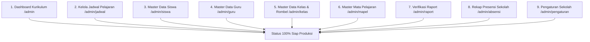

# Dokumentasi Status Pengerjaan Modul Kurikulum (Admin Akademik)
**LMS SMAN 2 Padalarang**  
*Versi Dokumen: 2.0.0 • Pembaruan Terakhir: November 2026*  
*Dokumen Rujukan: [PRD.md](file:///home/hafidz-nugraha/Documents/LMS-SMAN2-PADALARANG/PRD.md) • [DESIGN.md](file:///home/hafidz-nugraha/Documents/LMS-SMAN2-PADALARANG/DESIGN.md)*

---

## 1. Ringkasan Eksekutif & Peran Kurikulum

Dalam arsitektur sistem informasi pembelajaran terpadu SMAN 2 Padalarang, peran **Kurikulum** bertindak sebagai administrator data akademik tingkat sekolah. Staf kurikulum bertanggung jawab penuh atas:
1. Pengelolaan data master pengguna dan akademik (Siswa, Guru, Rombel/Kelas, dan Mata Pelajaran).
2. Perancangan dan validasi plotting jadwal kegiatan belajar mengajar (KBM) bebas bentrok lintas pengajar dan ruang kelas.
3. Pemantauan kehadiran (*monitoring presensi*) lintas rombel dan sistem deteksi dini kedisiplinan sekolah.
4. Verifikasi akhir kelengkapan nilai dan pengesahan buku leger rapor semester (*finalization lock*).
5. Konfigurasi kalender akademik, tahun ajaran aktif, semester berjalan, identitas resmi sekolah, jam operasional KBM, serta sinkronisasi Dapodik.

> [!NOTE]
> Akun uji coba Kurikulum pada lingkungan pengembangan:
> - **Username**: `kurikulum_admin`
> - **Nama Pejabat**: `Drs. Herman Wijaya, M.M` (Waka Kurikulum)
> - **NIP**: `196804151994031004`
> - **Password Default**: `password123`

---

## 2. Matriks Status Implementasi Fitur (100% Selesai)

Berikut adalah audit status pengerjaan seluruh halaman dan kebutuhan fungsional (FR) Kurikulum berdasarkan ketetapan PRD:

| No | Modul / Halaman | Rute Frontend | Kode Kebutuhan PRD | Status Pengerjaan | Kesiapan Backend |
| :-: | :--- | :--- | :--- | :-: | :-: |
| 1 | **Dashboard Kurikulum** | `/admin` | FR-AUTH-03, SCR-12 | **Selesai (100%)** | Siap (`/api/v1/master/*`, `/api/v1/jadwal`) |
| 2 | **Kelola Jadwal Pelajaran** | `/admin/jadwal` | FR-MST-03, SCR-13, UC-17, UC-18 | **Selesai (100%)** | Siap (`/api/v1/jadwal`) |
| 3 | **Master Data Siswa** | `/admin/siswa` | FR-MST-01, SCR-14, UC-14 | **Selesai (100%)** | Siap (`/api/v1/master/siswa`, `/api/v1/users`) |
| 4 | **Master Data Guru** | `/admin/guru` | FR-MST-02, UC-15 | **Selesai (100%)** | Siap (`/api/v1/master/guru`, `/api/v1/users`) |
| 5 | **Master Data Kelas & Rombel** | `/admin/kelas` | FR-MST-03 | **Selesai (100%)** | Siap (`/api/v1/master/kelas`) |
| 6 | **Master Mata Pelajaran** | `/admin/mapel` | FR-MST-02 | **Selesai (100%)** | Siap (`/api/v1/master/mapel`) |
| 7 | **Verifikasi Raport / Leger** | `/admin/raport` | FR-LAP-01, FR-LAP-03, SCR-11 | **Selesai (100%)** | Siap (Terintegrasi data leger & lock) |
| 8 | **Rekap Presensi Sekolah** | `/admin/absensi` | FR-ABS-04 | **Selesai (100%)** | Siap (`/api/v1/absensi/*`) |
| 9 | **Pengaturan Sekolah** | `/admin/pengaturan` | FR-MST-03 | **Selesai (100%)** | Siap (`/api/v1/pengaturan/*`) |

---

## 3. Rincian Modul yang Sudah Selesai (Implemented)

### 3.1. Kelola Jadwal Pelajaran (`/admin/jadwal`)
Halaman inti kurikulum untuk mengatur jadwal pelajaran dengan pencegahan konflik pengajar.
- **File Implementasi**: [`frontend/src/app/(dashboard)/admin/jadwal/page.tsx`](file:///home/hafidz-nugraha/Documents/LMS-SMAN2-PADALARANG/frontend/src/app/(dashboard)/admin/jadwal/page.tsx)
- **Fitur Utama yang Berfungsi**:
  - Tampilan **Timetable Grid Interaktif** (Matrix Hari vs Slot Waktu KBM 1 s.d. 5, Upacara, Literasi, dan ISHOMA).
  - Algoritma **Deteksi Bentrok Real-Time**: Mencegah dan memperingatkan jika satu guru mengajar di dua kelas bersamaan pada jam yang sama, atau jika ruang kelas dipakai bertabrakan.
  - **Banner Peringatan Bentrok Interaktif**: Menampilkan nama guru bermasalah, kelas yang bertabrakan, waktu bentrok, dan tombol `Perbaiki` untuk membuka dialog resolusi cepat.
  - **Quick Add Slot**: Tombol cepat untuk memplot sesi langsung pada slot kosong di tabel jadwal.
  - **Export Data**: Kemampuan unduh jadwal ke format CSV/Excel.
  - **Modal Tambah/Edit Jadwal**: Formulir lengkap memilih kelas, hari, jam mulai-selesai, mata pelajaran, guru pengampu, dan ruang kelas.

### 3.2. Master Data Siswa (`/admin/siswa`)
Pusat registrasi dan pembinaan data profil seluruh peserta didik sekolah.
- **File Implementasi**: [`frontend/src/app/(dashboard)/admin/siswa/page.tsx`](file:///home/hafidz-nugraha/Documents/LMS-SMAN2-PADALARANG/frontend/src/app/(dashboard)/admin/siswa/page.tsx)
- **Fitur Utama yang Berfungsi**:
  - Kartu statistik jumlah siswa total, siswa aktif, dan sebaran kelas.
  - Filter interaktif berdasarkan kelas/rombel dan kolom pencarian (*search*) nama/NISN.
  - Modal tambah dan ubah data siswa lengkap dengan validasi NIS, NISN, jenis kelamin, rombel kelas, email resmi, dan nomor kontak.
  - Kontrol aktivasi akun (tombol aktifkan / non-aktifkan akun siswa).
  - Modal konfirmasi penghapusan aman (*Soft delete / Confirm modal*).

### 3.3. Master Data Guru & Tenaga Pengajar (`/admin/guru`)
Pengelolaan akun pendidik dan penugasan akademik.
- **File Implementasi**: [`frontend/src/app/(dashboard)/admin/guru/page.tsx`](file:///home/hafidz-nugraha/Documents/LMS-SMAN2-PADALARANG/frontend/src/app/(dashboard)/admin/guru/page.tsx)
- **Fitur Utama yang Berfungsi**:
  - Daftar pendidik dengan NIP, gelar akademik (S.Pd, M.Pd, S.Si, dll), email resmi, dan status keaktifan.
  - Pembuatan akun login otomatis terintegrasi dengan tabel `users` (Password awal: `password123`).
  - Modal formulir tambah/edit data guru.
  - Pengaturan peran tambahan (penugasan sebagai Guru Pengampu atau penanda Wali Kelas).

### 3.4. Master Data Kelas & Rombel (`/admin/kelas`)
Pengorganisasian tingkatan kelas dan penugasan wali kelas binaan.
- **File Implementasi**: [`frontend/src/app/(dashboard)/admin/kelas/page.tsx`](file:///home/hafidz-nugraha/Documents/LMS-SMAN2-PADALARANG/frontend/src/app/(dashboard)/admin/kelas/page.tsx)
- **Fitur Utama yang Berfungsi**:
  - Pengelompokan tingkat X, XI, XII dan jurusan (MIPA, IPS).
  - Penugasan Wali Kelas dengan penegakan integritas bisnis: *1 Guru hanya dapat menjadi Wali Kelas untuk maksimal 1 Rombel*.
  - Modal tambah rombel baru, edit penugasan wali kelas, dan hapus kelas.

### 3.5. Master Data Mata Pelajaran (`/admin/mapel`)
Katalog kurikulum mata pelajaran tingkat SMA.
- **File Implementasi**: [`frontend/src/app/(dashboard)/admin/mapel/page.tsx`](file:///home/hafidz-nugraha/Documents/LMS-SMAN2-PADALARANG/frontend/src/app/(dashboard)/admin/mapel/page.tsx)
- **Fitur Utama yang Berfungsi**:
  - Manajemen kode unik mata pelajaran (contoh: `BIO-X`, `MAT-W-XII`).
  - Pengelompokan kategori kurikulum: Mata Pelajaran Umum, Peminatan MIPA, Peminatan IPS, dan Muatan Lokal.
  - CRUD mata pelajaran dan validasi duplikasi kode mapel.

### 3.6. Dashboard Ringkasan Kurikulum (`/admin`)
Pusat pemantauan eksekutif akademik.
- **File Implementasi**: [`frontend/src/app/(dashboard)/admin/page.tsx`](file:///home/hafidz-nugraha/Documents/LMS-SMAN2-PADALARANG/frontend/src/app/(dashboard)/admin/page.tsx)
- **Fitur Utama yang Berfungsi**:
  - Empat kartu metrik utama: Total Rombel Kelas, Total Pendidik, Total Mata Pelajaran, dan Total Sesi Jadwal.
  - Tabel cuplikan jadwal KBM aktif sekolah.
  - Akses cepat (*action shortcuts*) ke seluruh modul master data dan tombol Verifikasi Raport.

### 3.7. Verifikasi Raport & Pengesahan Leger (`/admin/raport`)
Modul pengesahan hasil belajar siswa, validasi draf leger rombel, dan penguncian status rapor semester resmi (*Fullstack Database & API Integrated*).
- **File Implementasi Frontend**: [`frontend/src/app/(dashboard)/admin/raport/page.tsx`](file:///home/hafidz-nugraha/Documents/LMS-SMAN2-PADALARANG/frontend/src/app/(dashboard)/admin/raport/page.tsx)
- **File Implementasi Backend**:
  - Migrasi Database: [`backend/migrations/000004_create_nilai_and_update_laporan.up.sql`](file:///home/hafidz-nugraha/Documents/LMS-SMAN2-PADALARANG/backend/migrations/000004_create_nilai_and_update_laporan.up.sql)
  - Data Seeder Awal: [`backend/seeds/laporan_seeds.sql`](file:///home/hafidz-nugraha/Documents/LMS-SMAN2-PADALARANG/backend/seeds/laporan_seeds.sql)
  - Model & DTO: [`backend/internal/model/entity.go`](file:///home/hafidz-nugraha/Documents/LMS-SMAN2-PADALARANG/backend/internal/model/entity.go) & [`backend/internal/model/response.go`](file:///home/hafidz-nugraha/Documents/LMS-SMAN2-PADALARANG/backend/internal/model/response.go)
  - Handler API Go Fiber: [`backend/internal/handler/laporan.go`](file:///home/hafidz-nugraha/Documents/LMS-SMAN2-PADALARANG/backend/internal/handler/laporan.go)
  - Pengujian Otomatis: [`backend/internal/app/laporan_test.go`](file:///home/hafidz-nugraha/Documents/LMS-SMAN2-PADALARANG/backend/internal/app/laporan_test.go)
- **Endpoint API Aktif**:
  - `GET /api/v1/laporan/summary`: Statistik kelulusan, ringkasan per rombel, dan rata-rata sekolah.
  - `GET /api/v1/laporan/kelas/:id_kelas`: Pengambilan draf buku leger dan rincian nilai per mapel (mendukung parameter `all`).
  - `POST /api/v1/laporan/generate`: Inisiasi kompilasi nilai tugas, UTS, UAS, dan absensi menjadi draf leger.
  - `PUT /api/v1/laporan/:id/finalize`: Pengesahan dan penguncian resmi (*read-only lock*) per siswa.
  - `PUT /api/v1/laporan/finalize-batch`: Pengesahan kolektif seluruh siswa dalam rombel atau sekolah.
  - `POST /api/v1/laporan/revisi`: Pengembalian draf rapor ke Wali Kelas dengan catatan perbaikan nilai.
  - `PUT /api/v1/laporan/:id/catatan-wali`: Penginputan catatan pembinaan karakter oleh Wali Kelas.
  - `GET /api/v1/laporan/export-csv`: Streaming pengunduhan buku leger resmi format CSV/Excel.
- **Fitur Utama yang Berfungsi**:
  - Ringkasan metrik status pengesahan: Total Siswa, Rapor Disahkan (`DisahkanKurikulum` - Terkunci), Menunggu Verifikasi (`DitinjauWali`), dan Rata-rata Nilai Sekolah.
  - Pemantauan status leger per rombel dengan progress bar kelengkapan nilai, rata-rata kelas, dan tombol aksi batch pengesahan rombel.
  - Tabel Buku Leger Nilai Komprehensif dengan filter rombel, filter status pengesahan, dan pencarian instan nama/NISN.
  - Modal Pratinjau Lembar Rapor Resmi berformat cetak dengan Kop Resmi SMAN 2 Padalarang, rincian skor pengetahuan & keterampilan per mapel, capaian kompetensi, rekap presensi (S/I/A), catatan perkembangan wali kelas, dan kolom tanda tangan digital.
  - Fitur Pengesahan & Penguncian Nilai (*Finalization Lock*) per siswa maupun per kelas (Batch) dengan dialog konfirmasi aman.
  - Alur Pengembalian Revisi ke Wali Kelas (*Return for Revision*) disertai catatan perbaikan jika ditemukan nilai yang belum lengkap.
  - Ekspor seluruh data buku leger nilai ke berkas CSV/Excel.
  - Cetak dokumen rapor PDF resmi menggunakan format cetak bersih (*print-ready*).
  - Pendaftaran menu navigasi `Verifikasi Raport` pada Sidebar Kurikulum.

### 3.8. Rekapitulasi Presensi Sekolah Lintas Rombel (`/admin/absensi`)
Pusat pemantauan tingkat kehadiran harian dan semester peserta didik secara komprehensif (*PRD FR-ABS-04*).
- **File Implementasi Frontend**: [`frontend/src/app/(dashboard)/admin/absensi/page.tsx`](file:///home/hafidz-nugraha/Documents/LMS-SMAN2-PADALARANG/frontend/src/app/(dashboard)/admin/absensi/page.tsx)
- **File Implementasi Backend**:
  - Seeder Data Harian: [`backend/seeds/absensi_seeds.sql`](file:///home/hafidz-nugraha/Documents/LMS-SMAN2-PADALARANG/backend/seeds/absensi_seeds.sql)
  - Handler API Go Fiber: [`backend/internal/handler/absensi.go`](file:///home/hafidz-nugraha/Documents/LMS-SMAN2-PADALARANG/backend/internal/handler/absensi.go)
  - Pengujian Otomatis: [`backend/internal/app/pengaturan_absensi_test.go`](file:///home/hafidz-nugraha/Documents/LMS-SMAN2-PADALARANG/backend/internal/app/pengaturan_absensi_test.go)
- **Endpoint API Aktif**:
  - `GET /api/v1/absensi/rekap`: Metrik kehadiran sekolah, ringkasan hari ini (Hadir, Sakit, Izin, Alpa, Terlambat), dan agregat per rombel.
  - `GET /api/v1/absensi/peringatan`: Sistem deteksi dini kedisiplinan (ambang batas alpa dan kehadiran < 85%).
  - `GET /api/v1/absensi/kelas/:id_kelas`: Log presensi harian per siswa dengan catatan dan waktu masuk.
  - `GET /api/v1/absensi/export-csv`: Streaming pengunduhan seluruh rekapitulasi kehadiran dalam format CSV.
- **Fitur Utama yang Berfungsi**:
  - 4 Kartu Metrik Utama: Rata-rata Kehadiran Sekolah (%), Hadir Hari Ini, Sakit/Izin Hari Ini, dan Siswa Perlu Perhatian.
  - Kartu Rekapitulasi Rombel Interaktif: Visualisasi progres persentase kehadiran per kelas (X IPS 1, X IPS 2, X RPL 1, XII IPA 1, XII IPA 3), wali kelas pengampu, dan rincian kuantitas Hadir/Sakit/Izin/Alpa/Terlambat.
  - Panel Deteksi Dini & Konseling BK (*Early Warning System*): Mendeteksi siswa dengan alpa berturut-turut, menghitung persentase kehadiran, dan menetapkan kategori risiko (*Tinggi: SP 1/Panggilan Orang Tua, Sedang: Konseling BK, Perhatian: Pembinaan Wali*).
  - Tabel Log Presensi Lengkap dengan multi-filter berdasarkan rombel, status kehadiran, dan pencarian instan nama/NISN.
  - Tombol aksi cepat Ekspor Rekap Presensi CSV dengan penamaan berkas terstandarisasi.
  - Pendaftaran menu `Rekap Presensi` pada Sidebar Kurikulum.

### 3.9. Pengaturan Sekolah & Tahun Ajaran (`/admin/pengaturan`)
Konfigurasi terpadu siklus kalender akademik, profil resmi sekolah, jam operasional KBM, dan sinkronisasi Dapodik (*PRD FR-MST-03*).
- **File Implementasi Frontend**: [`frontend/src/app/(dashboard)/admin/pengaturan/page.tsx`](file:///home/hafidz-nugraha/Documents/LMS-SMAN2-PADALARANG/frontend/src/app/(dashboard)/admin/pengaturan/page.tsx)
- **File Implementasi Backend**:
  - Migrasi Database: [`backend/migrations/000005_create_pengaturan_sekolah.up.sql`](file:///home/hafidz-nugraha/Documents/LMS-SMAN2-PADALARANG/backend/migrations/000005_create_pengaturan_sekolah.up.sql)
  - Handler API Go Fiber: [`backend/internal/handler/pengaturan.go`](file:///home/hafidz-nugraha/Documents/LMS-SMAN2-PADALARANG/backend/internal/handler/pengaturan.go)
  - Pengujian Otomatis: [`backend/internal/app/pengaturan_absensi_test.go`](file:///home/hafidz-nugraha/Documents/LMS-SMAN2-PADALARANG/backend/internal/app/pengaturan_absensi_test.go)
- **Endpoint API Aktif**:
  - `GET /api/v1/pengaturan`: Memuat konfigurasi profil sekolah dan tahun ajaran aktif.
  - `PUT /api/v1/pengaturan`: Memperbarui data konfigurasi (role: Kurikulum).
  - `POST /api/v1/pengaturan/sinkron-dapodik`: Memicu sinkronisasi data master Dapodik Kemendikbudristek.
- **Fitur Utama yang Berfungsi**:
  - Tab **Tahun Ajaran & Semester**: Kontrol pemilihan tahun ajaran (2026/2027), sakelar semester (Ganjil/Genap), dan penentuan tenggat penguncian rapor (*finalization lock deadline*).
  - Tab **Profil Sekolah**: Pengaturan nama resmi satuan pendidikan, NPSN, akreditasi (A), alamat, kontak telepon, email, dan website sekolah.
  - Tab **Kepengurusan & Raport**: Penunjukan Kepala Sekolah (Drs. H. Engkos Kosasih, M.Pd) dan Waka Kurikulum (Drs. Herman Wijaya, M.M) beserta NIP resmi untuk otomatisasi tanda tangan dokumen akademik.
  - Tab **Jadwal & Sesi KBM**: Standarisasi jam masuk sekolah (07:00), jam kepulangan (15:30), dan durasi per jam pelajaran (45 menit per JP).
  - Tab **Integrasi Dapodik**: Status koneksi realtime dengan server Dapodik terpusat dan tombol pemicu sinkronisasi data.
  - Modal Konfirmasi Perubahan Aman (*Confirm Modal*) sebelum menyimpan konfigurasi global.
  - Pendaftaran menu `Pengaturan Sekolah` pada Sidebar Kurikulum.

---

## 4. Status Kelengkapan Modul Kurikulum

Seluruh 9 modul fungsional Kurikulum berdasarkan ketetapan PRD telah diselesaikan secara menyeluruh (**100% Selesai**):

Semua endpoint backend Go Fiber telah terverifikasi dengan unit test otomatis (`backend/internal/app/`) dan seluruh halaman frontend Next.js 15 (18/18 rute) berhasil dikompilasi secara statis dengan validasi TypeScript penuh.
