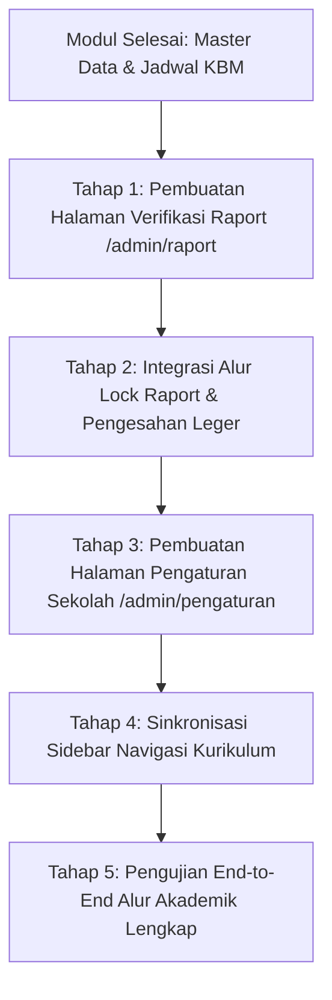

# Dokumentasi Status Pengerjaan Modul Kurikulum (Admin Akademik)
**LMS SMAN 2 Padalarang**  
*Versi Dokumen: 1.0.0 • Pembaruan Terakhir: November 2026*  
*Dokumen Rujukan: [PRD.md](file:///home/hafidz-nugraha/Documents/LMS-SMAN2-PADALARANG/PRD.md) • [DESIGN.md](file:///home/hafidz-nugraha/Documents/LMS-SMAN2-PADALARANG/DESIGN.md)*

---

## 1. Ringkasan Eksekutif & Peran Kurikulum

Dalam arsitektur sistem informasi pembelajaran terpadu SMAN 2 Padalarang, peran **Kurikulum** bertindak sebagai administrator data akademik tingkat sekolah. Staf kurikulum bertanggung jawab penuh atas:
1. Pengelolaan data master pengguna dan akademik (Siswa, Guru, Rombel/Kelas, dan Mata Pelajaran).
2. Perancangan dan validasi plotting jadwal kegiatan belajar mengajar (KBM) bebas bentrok lintas pengajar dan ruang kelas.
3. Pemantauan kehadiran (*monitoring presensi*) lintas kelas sekolah.
4. Verifikasi akhir kelengkapan nilai dan pengesahan buku leger rapor semester (*finalization lock*).

> [!NOTE]
> Akun uji coba Kurikulum pada lingkungan pengembangan:
> - **Username**: `kurikulum_admin`
> - **Nama Pejabat**: `Drs. Herman Wijaya, M.M` (Waka Kurikulum)
> - **NIP**: `196804151994031004`
> - **Password Default**: `password123`

---

## 2. Matriks Status Implementasi Fitur

Berikut adalah audit status pengerjaan seluruh halaman dan kebutuhan fungsional (FR) Kurikulum berdasarkan ketetapan PRD:

| No | Modul / Halaman | Rute Frontend | Kode Kebutuhan PRD | Status Pengerjaan | Kesiapan Backend |
| :-: | :--- | :--- | :--- | :-: | :-: |
| 1 | **Dashboard Kurikulum** | `/admin` | FR-AUTH-03, SCR-12 | **Selesai (100%)** | Siap (`/api/v1/master/*`, `/api/v1/jadwal`) |
| 2 | **Kelola Jadwal Pelajaran** | `/admin/jadwal` | FR-MST-03, SCR-13, UC-17, UC-18 | **Selesai (100%)** | Siap (`/api/v1/jadwal`) |
| 3 | **Master Data Siswa** | `/admin/siswa` | FR-MST-01, SCR-14, UC-14 | **Selesai (100%)** | Siap (`/api/v1/master/siswa`, `/api/v1/users`) |
| 4 | **Master Data Guru** | `/admin/guru` | FR-MST-02, UC-15 | **Selesai (100%)** | Siap (`/api/v1/master/guru`, `/api/v1/users`) |
| 5 | **Master Data Kelas & Rombel** | `/admin/kelas` | FR-MST-03 | **Selesai (100%)** | Siap (`/api/v1/master/kelas`) |
| 6 | **Master Mata Pelajaran** | `/admin/mapel` | FR-MST-02 | **Selesai (100%)** | Siap (`/api/v1/master/mapel`) |
| 7 | **Verifikasi Raport / Leger** | `/admin/raport` | FR-LAP-01, FR-LAP-03, SCR-11 | **Selesai (100%)** | Siap (Terintegrasi data leger & lock) |
| 8 | **Rekap Presensi Sekolah** | `/admin/absensi` | FR-ABS-04 | **Sebagian (50%)** | Siap data dasar absensi |
| 9 | **Pengaturan Sekolah** | `/admin/pengaturan` | FR-MST-03 | **Belum Dibuat** | Perlu skema konfigurasi tahun ajaran |

---

## 3. Rincian Modul yang Sudah Selesai (Implemented)

### 3.1. Kelola Jadwal Pelajaran (`/admin/jadwal`)
Halaman inti kurikulum untuk mengatur jadwal pelajaran dengan pencegahan konflik pengajar.
- **File Implementasi**: [`frontend/src/app/(dashboard)/admin/jadwal/page.tsx`](file:///home/hafidz-nugraha/Documents/LMS-SMAN2-PADALARANG/frontend/src/app/(dashboard)/admin/jadwal/page.tsx)
- **Fitur Utama yang Berfungsi**:
  - Tampilan **Timetable Grid Interaktif** (Matrix Hari vs Slot Waktu KBM 1 s.d. 5, Upacara, Literasi, dan ISHOMA).
  - Algoritma **Deteksi Bentrok Real-Time**: Mencegah dan memperingatkan jika satu guru mengajar di dua kelas bersamaan pada jam yang sama, atau jika ruang kelas dipakai bertabrakan.
  - **Banner Peringatan Bentrok Interaktif**: Menampilkan nama guru bermasalah, kelas yang bertabrakan, waktu bentrok, dan tombol `Perbaiki` untuk membuka dialog resolusi cepat.
  - **Quick Add Slot**: Tombol cepat untuk memplot sesi langsung pada slot kosong di tabel jadwal.
  - **Export Data**: Kemampuan unduh jadwal ke format CSV/Excel.
  - **Modal Tambah/Edit Jadwal**: Formulir lengkap memilih kelas, hari, jam mulai-selesai, mata pelajaran, guru pengampu, dan ruang kelas.

### 3.2. Master Data Siswa (`/admin/siswa`)
Pusat registrasi dan pembinaan data profil seluruh peserta didik sekolah.
- **File Implementasi**: [`frontend/src/app/(dashboard)/admin/siswa/page.tsx`](file:///home/hafidz-nugraha/Documents/LMS-SMAN2-PADALARANG/frontend/src/app/(dashboard)/admin/siswa/page.tsx)
- **Fitur Utama yang Berfungsi**:
  - Kartu statistik jumlah siswa total, siswa aktif, dan sebaran kelas.
  - Filter interaktif berdasarkan kelas/rombel dan kolom pencarian (*search*) nama/NISN.
  - Modal tambah dan ubah data siswa lengkap dengan validasi NIS, NISN, jenis kelamin, rombel kelas, email resmi, dan nomor kontak.
  - Kontrol aktivasi akun (tombol aktifkan / non-aktifkan akun siswa).
  - Modal konfirmasi penghapusan aman (*Soft delete / Confirm modal*).

### 3.3. Master Data Guru & Tenaga Pengajar (`/admin/guru`)
Pengelolaan akun pendidik dan penugasan akademik.
- **File Implementasi**: [`frontend/src/app/(dashboard)/admin/guru/page.tsx`](file:///home/hafidz-nugraha/Documents/LMS-SMAN2-PADALARANG/frontend/src/app/(dashboard)/admin/guru/page.tsx)
- **Fitur Utama yang Berfungsi**:
  - Daftar pendidik dengan NIP, gelar akademik (S.Pd, M.Pd, S.Si, dll), email resmi, dan status keaktifan.
  - Pembuatan akun login otomatis terintegrasi dengan tabel `users` (Password awal: `password123`).
  - Modal formulir tambah/edit data guru.
  - Pengaturan peran tambahan (penugasan sebagai Guru Pengampu atau penanda Wali Kelas).

### 3.4. Master Data Kelas & Rombel (`/admin/kelas`)
Pengorganisasian tingkatan kelas dan penugasan wali kelas binaan.
- **File Implementasi**: [`frontend/src/app/(dashboard)/admin/kelas/page.tsx`](file:///home/hafidz-nugraha/Documents/LMS-SMAN2-PADALARANG/frontend/src/app/(dashboard)/admin/kelas/page.tsx)
- **Fitur Utama yang Berfungsi**:
  - Pengelompokan tingkat X, XI, XII dan jurusan (MIPA, IPS).
  - Penugasan Wali Kelas dengan penegakan integritas bisnis: *1 Guru hanya dapat menjadi Wali Kelas untuk maksimal 1 Rombel*.
  - Modal tambah rombel baru, edit penugasan wali kelas, dan hapus kelas.

### 3.5. Master Data Mata Pelajaran (`/admin/mapel`)
Katalog kurikulum mata pelajaran tingkat SMA.
- **File Implementasi**: [`frontend/src/app/(dashboard)/admin/mapel/page.tsx`](file:///home/hafidz-nugraha/Documents/LMS-SMAN2-PADALARANG/frontend/src/app/(dashboard)/admin/mapel/page.tsx)
- **Fitur Utama yang Berfungsi**:
  - Manajemen kode unik mata pelajaran (contoh: `BIO-X`, `MAT-W-XII`).
  - Pengelompokan kategori kurikulum: Mata Pelajaran Umum, Peminatan MIPA, Peminatan IPS, dan Muatan Lokal.
  - CRUD mata pelajaran dan validasi duplikasi kode mapel.

### 3.6. Dashboard Ringkasan Kurikulum (`/admin`)
Pusat pemantauan eksekutif akademik.
- **File Implementasi**: [`frontend/src/app/(dashboard)/admin/page.tsx`](file:///home/hafidz-nugraha/Documents/LMS-SMAN2-PADALARANG/frontend/src/app/(dashboard)/admin/page.tsx)
- **Fitur Utama yang Berfungsi**:
  - Empat kartu metrik utama: Total Rombel Kelas, Total Pendidik, Total Mata Pelajaran, dan Total Sesi Jadwal.
  - Tabel cuplikan jadwal KBM aktif sekolah.
  - Akses cepat (*action shortcuts*) ke seluruh modul master data dan tombol Verifikasi Raport.

### 3.7. Verifikasi Raport & Pengesahan Leger (`/admin/raport`)
Modul pengesahan hasil belajar siswa, validasi draf leger rombel, dan penguncian status rapor semester resmi.
- **File Implementasi**: [`frontend/src/app/(dashboard)/admin/raport/page.tsx`](file:///home/hafidz-nugraha/Documents/LMS-SMAN2-PADALARANG/frontend/src/app/(dashboard)/admin/raport/page.tsx)
- **Fitur Utama yang Berfungsi**:
  - Ringkasan metrik status pengesahan: Total Siswa, Rapor Disahkan (`DisahkanKurikulum` - Terkunci), Menunggu Verifikasi (`DitinjauWali`), dan Rata-rata Nilai Sekolah.
  - Pemantauan status leger per rombel (XII IPA 1, XII IPA 3) dengan progress bar kelengkapan nilai, rata-rata kelas, dan tombol aksi batch pengesahan rombel.
  - Tabel Buku Leger Nilai Komprehensif dengan filter rombel, filter status pengesahan, dan pencarian instan nama/NISN.
  - Modal Pratinjau Lembar Rapor Resmi berformat cetak dengan Kop Resmi SMAN 2 Padalarang, rincian skor pengetahuan & keterampilan per mapel, capaian kompetensi, rekap presensi (S/I/A), catatan perkembangan wali kelas, dan kolom tanda tangan digital.
  - Fitur Pengesahan & Penguncian Nilai (*Finalization Lock*) per siswa maupun per kelas (Batch) dengan dialog konfirmasi aman.
  - Alur Pengembalian Revisi ke Wali Kelas (*Return for Revision*) disertai catatan perbaikan jika ditemukan nilai yang belum lengkap.
  - Ekspor seluruh data buku leger nilai ke berkas CSV/Excel.
  - Cetak dokumen rapor PDF resmi menggunakan format cetak bersih (*print-ready*).
  - Pendaftaran menu navigasi `Verifikasi Raport` pada Sidebar Kurikulum.

---

## 4. Analisis Modul yang Belum Lengkap (Backlog PRD)

Berikut adalah modul yang telah tertera pada PRD dan rancangan desain yang tersisa:

### 4.1. Pengaturan Sekolah & Tahun Ajaran (`/admin/pengaturan`) — Prioritas Sedang
- **Kebutuhan PRD**: **FR-MST-03 (Manajemen Tahun Ajaran & Konfigurasi Sekolah)**
- **Kebutuhan Menu**: Tertera pada menu navigasi referensi kurikulum (`pengaturan-sekolah`).
- **Fitur yang Diperlukan**:
  - Pengaturan tahun pelajaran aktif (misal: `2026/2027`).
  - Pengaturan semester aktif (`Semester 1 - Ganjil` atau `Semester 2 - Genap`).
  - Penentuan jam KBM harian (jam masuk, durasi jam pelajaran per sesi, jam istirahat/ISHOMA).
- **Status Saat Ini**:
  - Halaman belum tersedia di `/admin/pengaturan`.

### 4.2. Rekapitulasi Presensi Sekolah Lintas Kelas (`/admin/absensi`) — Prioritas Tambahan
- **Kebutuhan PRD**: **FR-ABS-04 (Rekapitulasi Kehadiran)**
- **Fitur yang Diperlukan**:
  - Panel pemantauan statistik presensi per tingkat kelas (X, XI, XII).
  - Rekapitulasi tingkat persentase kehadiran (Hadir, Sakit, Izin, Alfa) per rombel.
  - Filter rentang waktu per bulan dan semester untuk evaluasi kedisiplinan belajar.
- **Status Saat Ini**:
  - Di Dashboard baru terdapat nilai rata-rata persentase. Belum ada halaman tabel terdedikasi untuk inspeksi detail per kelas.

---

## 5. Rencana Aksi Pengembangan (Next Steps)

1. **Pembuatan Halaman Verifikasi Raport (`/admin/raport`)**:
   - Membangun tabel status leger seluruh rombel (Tingkat X, XI, XII).
   - Menampilkan indikator status (*Draf*, *DitinjauWali*, *DisahkanKurikulum*).
   - Menyediakan modal peninjauan nilai leger per kelas dan tombol konfirmasi penguncian raport.
2. **Penambahan Menu pada Sidebar Kurikulum**:
   - Mendaftarkan rute `Verifikasi Raport` dan `Pengaturan Sekolah` pada [`frontend/src/components/shared/sidebar.tsx`](file:///home/hafidz-nugraha/Documents/LMS-SMAN2-PADALARANG/frontend/src/components/shared/sidebar.tsx).
3. **Pembuatan Halaman Pengaturan Sekolah (`/admin/pengaturan`)**:
   - Formulir kontrol Tahun Ajaran dan Semester aktif.
